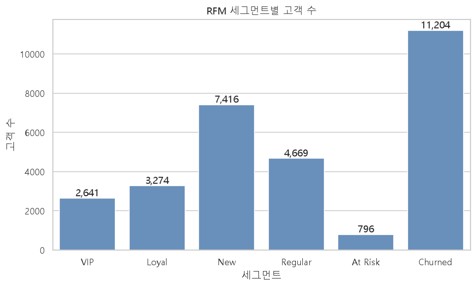

# A1-1 쇼핑몰 단골 찾기: H&M 구매 데이터 EDA와 RFM 고객 세분화

H&M의 3개월 치 구매 기록 14만 7,801건을 정리하고, 상품 사진 3,000장을 숫자 피처로 바꾼 뒤, 고객 3만 명을 RFM(최근성·빈도·금액) 점수로 6개 그룹으로 나눈 분석 프로젝트입니다. 분석 로직은 `DataAnalyzer` 클래스(`src/pipeline.py`)에 있고, 노트북은 결과·시각화·해석을 담습니다.

## 데이터 설명

Kaggle 「[H&M Personalized Fashion Recommendations](https://www.kaggle.com/competitions/h-and-m-personalized-fashion-recommendations)」 대회 데이터(H&M Group 제공, 2018-09 ~ 2020-09, 구매 3,179만 건)에서 아래 기준으로 잘라 낸 샘플을 씁니다. 대회 규칙상 **비상업·교육 목적으로만 쓸 수 있고 재배포가 금지**되어 데이터는 저장소에 넣지 않았습니다(`.gitignore`의 `data/`). 같은 이유로 노트북과 그림에는 상품 사진을 싣지 않고 사진에서 계산한 숫자만 보여 줍니다.

| 샘플 기준 | 값 |
| --- | --- |
| 기간 | 2020-06-23 ~ 2020-09-22 (원본 마지막 약 3개월) |
| 상품 | 기간 내 판매량 상위 중 사진이 있는 3,000개 |
| 고객 | 위 상품을 산 고객 중 무작위 30,000명 (시드 42) |
| 결과 | 구매 147,801행, 상품 3,000개, 고객 30,000명, 사진 3,000장 |

| 파일 | 주요 컬럼 | 의미 |
| --- | --- | --- |
| `transactions_sample.csv` | `t_dat`, `customer_id`, `article_id`, `price`, `sales_channel_id` | 한 행 = 고객이 상품 1개를 산 기록. 채널 1=매장, 2=온라인 |
| `articles_sample.csv` | `prod_name`, `product_group_name`, `colour_group_name`, `perceived_colour_value_name`, `detail_desc` 등 25개 | 상품명·상품군·색상·상세 설명 |
| `customers_sample.csv` | `age`, `club_member_status`, `FN`, `Active`, `fashion_news_frequency` 등 7개 | 고객 나이·회원 상태·뉴스 구독 |
| `images/{article_id}.jpg` | 1166×1750 컬러 사진 | 상품 사진 |

세 표를 합친 분석 표는 147,801행 × 35컬럼이고, 수치(`price`, `age`)·범주(상품군, 색상, 채널)·날짜(`t_dat`)·텍스트(상품명, 설명)·이미지(배열) 다섯 유형이 모두 들어 있습니다. **`price`는 원본이 실제 금액을 변환해 둔 값**(중앙값 0.0237)이라 통화 단위가 아닌 상대 크기로만 해석합니다.

분석 중에 `name_word_count`(상품명 단어 수), `desc_length`(설명 글자 수), `image_mean`·`image_std`(사진 밝기·명암 대비), 보너스로 `image_edge`(윤곽 세기)와 `image_hist_1~4`(밝기 4구간 비율)를 추가합니다.

## 빠른 시작

Windows PowerShell 기준이며 명령은 `A1-1` 폴더에서 실행합니다. Python 3.8 이상이 필요합니다(3.15.2에서 확인).

1. 가상환경을 만들고 라이브러리를 설치합니다.

```powershell
python -m venv .venv
.venv\Scripts\python -m pip install -r requirements.txt
```

2. 데이터를 준비합니다. Kaggle에서 대회 규칙에 동의한 뒤, 대회 Code 탭에서 비공개 노트북을 만들고 [scripts/make_hm_sample.py](scripts/make_hm_sample.py)의 내용을 붙여 넣어 실행합니다(약 6분). 만들어진 `/kaggle/working/hm_sample.zip`(약 720MB)을 내려받아 `data/raw/`에 압축을 풉니다.

```powershell
Expand-Archive $HOME\Downloads\hm_sample.zip -DestinationPath data\raw
```

3. 노트북을 위에서부터 끝까지 실행합니다.

```powershell
cd notebooks
..\.venv\Scripts\jupyter nbconvert --to notebook --execute --inplace analysis_report.ipynb
```

`..\.venv\Scripts\jupyter notebook`으로 열어 `Run All`을 해도 됩니다. 성공하면 `outputs/figures/`에 PNG 9개가 생기고, RFM 셀에 `고객 수: 30000`과 `F 점수별 고객 수: {1: 16452, 2: 6837, 3: 3215, 4: 2385, 5: 1111}`가 출력됩니다. 첫 실행은 사진 3,000장을 읽느라 약 40초 걸리고, 줄인 이미지 배열을 `data/processed/`에 저장해 두므로 다음 실행부터는 약 15초면 끝납니다.

## 사용법

노트북 없이 Python에서 파이프라인만 쓸 수도 있습니다. `A1-1` 폴더에서 실행합니다.

```python
import sys
sys.path.insert(0, "src")
from pipeline import DataAnalyzer, load_product_images

analyzer = DataAnalyzer("data/raw")
analyzer.load_data()
analyzer.handle_missing_values("group_median", "club_member_status", ["age"])
analyzer.add_text_features()
article_ids = sorted(analyzer.df["article_id"].unique())
images = load_product_images("data/raw/images", article_ids,
                             cache_path="data/processed/images_96x64.npz")
analyzer.add_image_features(images, article_ids)
analyzer.calculate_rfm()
analyzer.segment_customers()
print(analyzer.summarize_segments())
```

| 주요 인자 | 메서드 | 기본값 | 바꾸면 |
| --- | --- | --- | --- |
| `threshold` | `detect_outliers()`, `clip_outliers()` | 1.5 | 3.0으로 올리면 극단값만 이상치로 잡음 |
| `strategy`, `group_col` | `handle_missing_values()` | `group_median` | `group_mean`, `group_mode`, `constant`, `drop` 선택 |
| `reference_date` | `calculate_rfm()` | 최종 구매일 | 다른 분석 기준일로 Recency 계산 |
| `frequency_edges` | `calculate_rfm()` | `[0, 1, 2, 3, 5, inf]` | `None`이면 F도 R·M처럼 순위 5등분 |
| `IMAGE_HEIGHT`, `IMAGE_WIDTH` | `src/pipeline.py` 상수 | 96, 64 | 줄일 이미지 크기. 바꾸면 캐시 파일 이름도 바꿔야 함 |

## 파일 구성

| 경로 | 역할 |
| --- | --- |
| `src/pipeline.py` | `DataAnalyzer` 클래스와 IQR 경계 계산·이미지 읽기·이미지 피처 함수 |
| `notebooks/analysis_report.ipynb` | 단계별 분석·시각화·해석 리포트 (실행 결과 포함) |
| `scripts/make_hm_sample.py` | Kaggle 노트북에서 대회 데이터를 잘라 샘플 zip을 만드는 스크립트 |
| `outputs/figures/` | 노트북이 저장한 차트 PNG 9개 |
| `requirements.txt` | 필요한 라이브러리와 확인한 버전 |
| `data/` | 샘플 데이터와 이미지 캐시 (저장소에 올리지 않음) |

## 결과 요약

모든 수치는 노트북 실행 결과입니다. 기준일은 최종 구매일 2020-09-22이고, Frequency는 **서로 다른 구매일 수**입니다(주문번호가 없어 같은 날 산 여러 상품을 1회로 셈). Monetary는 변환된 가격의 합계입니다.

| 세그먼트 | 규칙 | 고객 수(비율) | 평균 Recency | 평균 Frequency | 평균 Monetary | 매출 비중 |
| --- | --- | --- | --- | --- | --- | --- |
| VIP | R≥4, F≥4, M≥4 | 2,641 (8.80%) | 10.78일 | 5.72회 | 0.380 | 26.89% |
| Churned | R≤2, F≤2 | 11,204 (37.35%) | 69.50일 | 1.20회 | 0.071 | 21.25% |
| New | R≥4, F≤2 | 7,416 (24.72%) | 13.68일 | 1.40회 | 0.099 | 19.62% |
| Loyal | R≥3, F≥3 | 3,274 (10.91%) | 21.97일 | 3.37회 | 0.202 | 17.73% |
| Regular | 나머지 | 4,669 (15.56%) | 36.76일 | 1.35회 | 0.083 | 10.45% |
| At Risk | R≤2, F≥3 | 796 (2.65%) | 58.62일 | 3.41회 | 0.190 | 4.06% |

규칙은 VIP → Loyal → New → At Risk → Churned → Regular 순서로 먼저 맞는 것을 적용합니다. R·M 점수는 고객 순위를 5개 구간으로 나눈 1~5점입니다. F는 고객의 54.8%가 1회 구매라서 순위로 나누면 같은 1회 고객이 다른 점수를 받으므로 방문 횟수로 구간을 정했습니다(1회 1점, 2회 2점, 3회 3점, 4~5회 4점, 6회 이상 5점).



**상품 사진 피처**: 원본 색 라벨이 Dark인 상품 1,295개의 사진 평균 밝기는 174.0, Light인 559개는 224.8입니다. 사진에서 계산한 숫자가 사람이 붙인 색 라벨과 일치합니다. 어두운 사진의 상품이 조금 더 비싸지만(Spearman -0.20, 밝기 하위 25% 평균 가격 0.0282 vs 상위 25% 0.0217), 판매 수량과는 관계가 거의 없습니다(-0.02).

## 비즈니스 인사이트

아래 '기대 효과'는 실행한 뒤 확인할 목표이며, 이 데이터로 효과를 측정한 결과가 아닙니다.

### 인사이트 1. 고객 8.8%가 매출의 27%를 만드는 VIP는 온라인에서 지켜야 한다

- **근거**: VIP 2,641명(8.80%)이 구매 금액의 26.89%를 차지하고, 한 명이 평균 5.72일 방문했습니다. 고객 전체로도 상위 10%가 37.9%를 냅니다. VIP의 온라인 구매 비율은 63.9%로 다른 그룹(54.7~58.6%)보다 높습니다. R×F 히트맵에서 F 5점 칸의 평균 금액은 0.373~0.533으로 F 1점 칸(0.058~0.073)의 5배가 넘습니다(`08_heatmap_rf_monetary.png`).
- **실행**: 대상은 VIP 2,641명입니다. 온라인몰·앱에서 신상품 선공개와 무료 배송 등급을 주고, 마지막 구매 후 21일(VIP 평균 Recency 10.8일의 약 2배)이 지나면 최근 구매 상품군 기반 개인화 추천을 보냅니다. 기대 효과는 VIP의 다음 분기 재방문율 유지이며, 30일 안 재방문 비율로 측정합니다.
- **검증**: 3개월 샘플이라 VIP가 1년 내내 VIP인지, 이탈하면 매출이 얼마나 줄어드는지(LTV)는 알 수 없습니다. 원본 대회 데이터의 2018~2020년 전체 이력으로 같은 고객을 추적해야 합니다.

### 인사이트 2. 최근 첫 구매 고객(New)을 두 번째 방문으로 이끌어야 한다

- **근거**: New 7,416명(24.72%)은 최근(Recency 중앙값 14일) 1~2회 산 고객이고, 이 중 39.5%만 2회째입니다. 방문 횟수가 1회에서 2회로 늘면 평균 금액이 0.063에서 0.127로 두 배가 되고, 고객 단위 Frequency와 Monetary의 Spearman 상관은 0.656입니다(`09_scatter_rfm_segments.png`).
- **실행**: 대상은 New 7,416명입니다. 첫 구매 후 7일 안에 같은 상품군의 다른 색상·코디 상품을 추천하고 2번째 주문에 쓸 기한 있는 쿠폰을 보냅니다. 기대 효과는 New → Loyal 전환이며, 첫 구매 후 30일 안 2회째 방문 비율로 측정합니다.
- **검증**: 상관은 인과가 아니므로 방문을 늘리면 금액이 늘어난다는 보장은 없습니다. 원래 많이 사는 고객이 자주 오는 것일 수 있습니다. 쿠폰 효과는 New 고객을 무작위로 나눈 A/B 테스트로 확인해야 합니다.

### 인사이트 3. 8월 중순부터 비싼 상품으로 시즌이 바뀌므로 가을 상품을 8월 초에 준비한다

- **근거**: 상품 1개당 평균 가격은 7월~8월 초 0.022~0.023이다가 8/17 주부터 오르기 시작해 9/14 주에 0.0321로 약 1.5배가 됐습니다. 같은 기간 주별 판매 수량은 12,686개(6/29 주)에서 8,000개(9/14 주)로 줄었지만, 주별 매출 합계는 8/24 주부터 다시 늘었습니다(`06_line_weekly_sales.png`). 판매 수량의 60.3%는 상의·하의입니다(`05_bar_product_group.png`).
- **실행**: 대상은 VIP·Loyal 5,915명(매출의 44.62%)입니다. 8월 첫째 주에 가을 신상품(상의·하의 중심)을 먼저 공개하고 사전 예약 혜택을 줍니다. 기대 효과는 시즌 전환기 매출 확보와 인기 가을 상품의 품절 감소입니다.
- **검증**: 3개월 데이터라 시즌 변화를 한 번만 봤고, 가격 상승이 가을 상품 때문인지는 상품 출시일 데이터로 확인해야 합니다. 원본의 2019년 같은 기간(6~9월) 구매 기록을 비교하면 매년 반복되는 패턴인지 알 수 있습니다.

## 분석 과정 요약

| 단계 | 처리 | 결과 |
| --- | --- | --- |
| 결측치 | FN·Active 빈칸 → 0, 회원 상태·뉴스 빈도는 그룹 최빈값, 나이는 회원 상태별 중앙값, 설명은 같은 상품코드 최빈값 | 나이 528행·설명 43행 등 대치, 남은 결측 0 |
| 이미지 | JPG를 `(96, 64, 3)`으로 줄여 `(3000, 96, 64, 3)`로 쌓고, 흑백 변환 후 `axis=(1, 2)`로 평균·표준편차 | 반복문 계산과의 최대 차이 0.0 |
| 이상치 | IQR 1.5배 경계로 자르기(clipping), 분포·상관 분석에만 사용 | price 3,476행(2.35%), 상품 판매량 205개(6.83%) |
| 상관 | 상품 단위 Pearson(원본)과 Spearman(처리 후) 비교 | 설명 길이-가격 0.49, 사진 밝기-가격 -0.20, 사진 밝기-판매량 -0.02 |

## 한계와 개선 방향

- 기간 3개월, 판매량 상위 3,000개 상품, 고객 3만 명만 잘라 낸 샘플입니다. 잘 팔린 상품끼리만 비교해 판매량과 다른 변수의 상관이 약하게 나올 수 있습니다(선택 편향).
- 가격이 변환된 값이라 실제 매출 규모는 알 수 없습니다.
- 주문번호가 없어 Frequency를 구매일 수로 셌습니다. 같은 날 매장과 온라인에서 따로 산 경우도 1회입니다.
- 세그먼트 규칙의 점수 경계는 분석자가 정한 기준입니다. 경계를 바꾸면 그룹 크기가 달라집니다.
- 이미지 피처는 밝기·대비·윤곽만 담고 옷의 종류나 모양은 모릅니다.

## 학습 자료

- [기초·핵심 지식](docs/basic_knowledge.md)
- [코드 해설](docs/code_translation.md)

## 검증

| 요구사항 (원문 4장) | 구분 | 구현 위치 | 상태·증거 |
| --- | --- | --- | --- |
| 1,000건·8컬럼 이상, 3유형 이상 | 필수 | `load_data()` | 충족: 147,801행 × 35컬럼, 5유형 |
| `info`·`describe`·`head` 해석 | 필수 | 노트북 1절 | 충족: 수치 근거·시사점 포함 |
| `DataAnalyzer`와 메서드 4개, 파라미터 인자화 | 필수 | `src/pipeline.py` | 충족: `load_data`, `handle_missing_values`, `detect_outliers`, `calculate_rfm` |
| 이미지 평균·표준편차, 반복문 없이 | 필수 | `calculate_image_features()` | 충족: `axis=(1, 2)`, 반복문 결과와 차이 0.0 |
| 텍스트 단어 수·길이 | 필수 | `add_text_features()` | 충족 |
| 그룹별 결측 대치 1가지 이상 | 필수 | `handle_missing_values()` | 충족: group_median·group_mode |
| IQR 함수 구현, 처리 전후 시각화 | 필수 | `calculate_iqr_bounds()`, 그림 01 | 충족 |
| 평균·중앙값·표준편차·사분위수, 상관 2쌍 이상 | 필수 | `summarize_numeric()`, 노트북 6절 | 충족: 6쌍 |
| 6종 차트, 제목·축 레이블 | 필수 | 그림 01~09 | 충족: 히스토그램·박스플롯·막대·히트맵·산점도·라인 |
| RFM 4그룹 이상 | 필수 | `segment_customers()` | 충족: 6그룹 |
| README 인사이트 3개(근거·실행·검증) | 필수 | 이 문서 | 충족: 3개 |
| 이미지 히스토그램·엣지 피처 | 보너스 1 | `calculate_image_features()` | 구현: `image_edge`, `image_hist_1~4` |
| 코호트 분석, Plotly | 보너스 2·3 | - | 미구현 |

- 노트북은 이미지 캐시를 지운 상태에서 새 커널로 처음부터 끝까지 실행해 오류·경고 없이 출력을 저장했습니다(약 40초).
- 사용 라이브러리는 NumPy·Pandas·Matplotlib·Seaborn과 표준 라이브러리(pathlib, shutil)뿐입니다. JPG는 미션이 허용한 `imread()`(`matplotlib.pyplot.imread`)로 읽습니다. Matplotlib이 JPG를 해독할 때 내부적으로 Pillow를 쓰지만, 코드에서 Pillow를 직접 부르지 않고 크기 조절·흑백 변환·통계는 NumPy 배열 연산으로 직접 합니다. OpenCV·scikit-learn·자동 EDA 라이브러리는 쓰지 않았습니다.
- `scripts/make_hm_sample.py`는 Kaggle 노트북에서 실제로 실행한 추출 코드를 함수 단위로 정리한 것입니다. 정리 후 버전을 Kaggle에서 다시 실행해 보지는 않았습니다.
- 차트에는 한글 제목을 썼습니다. Windows(맑은 고딕)·macOS(AppleGothic)에서는 한글 글꼴을 자동으로 고르지만, 한글 글꼴이 없는 환경에서는 글자가 네모로 보일 수 있습니다.
