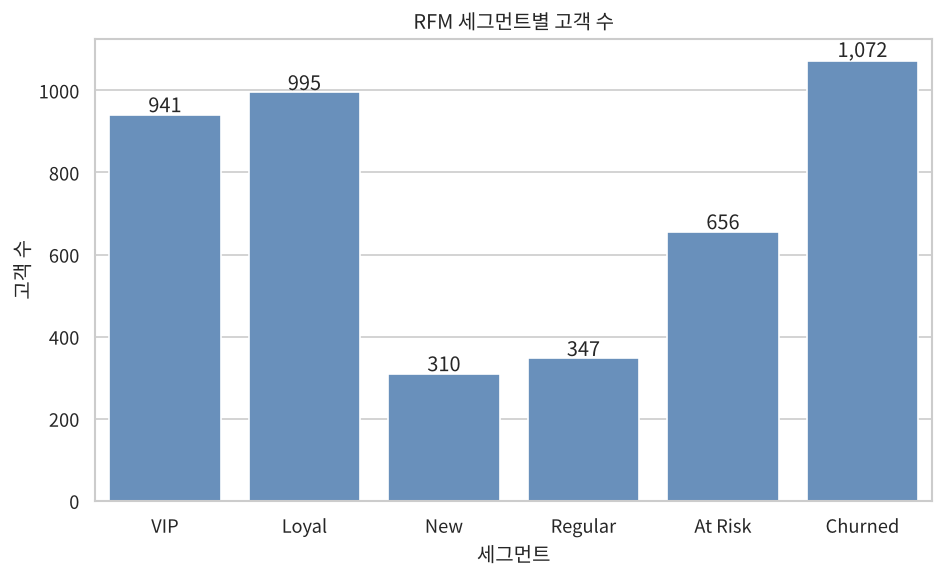

# A1-1 쇼핑몰 단골 찾기: 이커머스 EDA와 RFM 고객 세분화

영국 온라인 선물용품 쇼핑몰의 1년 치 주문 54만 건을 정리하고, 고객을 RFM(최근성·빈도·금액) 점수로 6개 그룹으로 나눈 분석 프로젝트입니다. 분석 로직은 `DataAnalyzer` 클래스(`src/pipeline.py`)에 있고, 노트북은 결과·시각화·해석을 담습니다.

## 데이터 설명

| 데이터 | 내용 | 출처·라이선스 |
| --- | --- | --- |
| `data/raw/data.csv` | 2010-12-01 ~ 2011-12-09 주문 541,909행, 8컬럼 | UCI Machine Learning Repository, [Online Retail](https://archive.ics.uci.edu/dataset/352/online+retail) (Daqing Chen, 2015), CC BY 4.0. Kaggle의 [E-Commerce Data](https://www.kaggle.com/datasets/carrie1/ecommerce-data)로 내려받은 같은 데이터 |
| `data/raw/t10k-images-idx3-ubyte.gz` | 28×28 흑백 의류 이미지 10,000장 | [Fashion-MNIST](https://github.com/zalandoresearch/fashion-mnist) (Zalando Research), MIT |

| 컬럼 | 유형 | 의미 |
| --- | --- | --- |
| InvoiceNo | 범주(문자열) | 주문번호. `C`로 시작하면 취소 주문 |
| StockCode | 범주(문자열) | 상품코드 (4,070개) |
| Description | 텍스트 | 상품명 |
| Quantity | 수치 | 수량 (취소는 음수) |
| InvoiceDate | 날짜 | 주문 일시 |
| UnitPrice | 수치 | 단가 (파운드, GBP) |
| CustomerID | 범주(문자열) | 고객 ID (24.93% 결측) |
| Country | 범주 | 국가 (38개국) |

분석 중에 `Amount`(수량×단가), `desc_word_count`·`desc_length`(상품명 단어 수·글자 수), `image_mean`·`image_std`(이미지 픽셀 평균·표준편차)를 추가합니다.

원본 주문 데이터에는 상품 이미지가 없습니다. 이미지 → 수치 피처 과정을 실습하기 위해 상품코드마다 Fashion-MNIST 이미지 1장을 시드 42로 무작위 연결했습니다. 실제 상품 사진이 아니므로 이미지 피처와 매출의 관계는 해석하지 않습니다.

## 빠른 시작

Python 3.8 이상(3.13.18에서 확인)이 필요하고, 명령은 `A1-1` 폴더에서 실행합니다.

1. 라이브러리를 설치하고 이미지 파일을 받습니다. 스크립트가 `data/raw/` 폴더도 만듭니다.

```bash
pip install -r requirements.txt
python scripts/download_images.py
```

2. [Kaggle E-Commerce Data](https://www.kaggle.com/datasets/carrie1/ecommerce-data)에서 `archive.zip`을 받아 압축을 풀고 `data.csv`를 `data/raw/`에 넣습니다. 원본 데이터는 용량(45MB) 때문에 저장소에 포함하지 않았습니다.
3. 노트북을 위에서부터 끝까지 실행합니다.

```bash
cd notebooks
jupyter nbconvert --to notebook --execute --inplace analysis_report.ipynb
```

`jupyter notebook`으로 열어 `Run All`을 해도 됩니다. 성공하면 `outputs/figures/`에 PNG 10개가 생기고, 노트북 마지막 RFM 셀에 `고객 수: 4,321, 총 매출: 8,304,335`가 출력됩니다. 전체 실행에 약 15초 걸립니다.

## 사용법

노트북 없이 Python에서 파이프라인만 쓸 수도 있습니다. `A1-1` 폴더에서 실행합니다.

```python
import sys
sys.path.insert(0, "src")
from pipeline import DataAnalyzer, load_idx_images

analyzer = DataAnalyzer("data/raw/data.csv")
analyzer.load_data()
analyzer.convert_invalid_to_missing("UnitPrice", 0.001)
analyzer.handle_missing_values("group_mode", "StockCode", ["Description"],
                               fallback_value="UNKNOWN")
analyzer.handle_missing_values("group_median", "StockCode", ["UnitPrice"])
analyzer.add_text_features()
analyzer.add_amount()
analyzer.add_image_features(
    load_idx_images("data/raw/t10k-images-idx3-ubyte.gz"))
analyzer.filter_valid_transactions()
analyzer.calculate_rfm(cancellations=analyzer.cancellations)
analyzer.segment_customers()
print(analyzer.summarize_segments())
```

| 주요 인자 | 메서드 | 기본값 | 바꾸면 |
| --- | --- | --- | --- |
| `threshold` | `detect_outliers()`, `clip_outliers()` | 1.5 | 3.0으로 올리면 극단값만 이상치로 잡음 |
| `strategy`, `group_col` | `handle_missing_values()` | `group_median`, `StockCode` | `group_mean`, `group_mode`, `drop` 선택 |
| `reference_date` | `calculate_rfm()` | 최종 거래일 | 다른 분석 기준일로 Recency 계산 |
| `n_bins` | `calculate_rfm()` | 5 | 점수 구간 수(1~n점) |
| `seed` | `add_image_features()` | 42 | 상품-이미지 연결이 바뀜 |

## 파일 구성

| 경로 | 역할 |
| --- | --- |
| `src/pipeline.py` | `DataAnalyzer` 클래스와 IQR 경계 계산·IDX 이미지 읽기 함수 |
| `notebooks/analysis_report.ipynb` | 단계별 분석·시각화·해석 리포트 (실행 결과 포함) |
| `scripts/download_images.py` | Fashion-MNIST 이미지 파일 다운로드 |
| `outputs/figures/` | 노트북이 저장한 차트 PNG 10개 |
| `requirements.txt` | 필요한 라이브러리와 확인한 버전 |

## 결과 요약

모든 수치는 노트북 실행 결과입니다. 분석 대상은 고객 ID가 있는 정상 구매 396,370행, 고객 4,321명입니다. 취소 금액을 뺀 순구매액 기준입니다.

| 세그먼트 | 규칙 | 고객 수(비율) | 평균 Recency | 평균 Frequency | 평균 Monetary(GBP) | 매출 비중 |
| --- | --- | --- | --- | --- | --- | --- |
| VIP | R≥4, F≥4, M≥4 | 941 (21.78%) | 11.48일 | 11.12회 | 5,877.61 | 66.60% |
| Loyal | R≥3, F≥3 | 995 (23.03%) | 32.32일 | 3.74회 | 1,270.39 | 15.22% |
| At Risk | R≤2, F≥3 | 656 (15.18%) | 149.07일 | 3.40회 | 1,183.06 | 9.35% |
| Churned | R≤2, F≤2 | 1,072 (24.81%) | 216.08일 | 1.10회 | 401.92 | 5.19% |
| Regular | 나머지 | 347 (8.03%) | 51.39일 | 1.15회 | 441.03 | 1.84% |
| New | R≥4, F≤2 | 310 (7.17%) | 17.04일 | 1.25회 | 482.19 | 1.80% |

규칙은 위에서부터 먼저 맞는 것을 적용합니다(VIP → Loyal → New → At Risk → Churned → Regular). R·F·M 점수는 고객 순위를 5개 구간으로 나눈 1~5점입니다.



## 비즈니스 인사이트

아래 '기대 효과'는 실행 후 확인할 목표이며, 이 데이터로 효과를 측정한 결과가 아닙니다.

### 인사이트 1. 매출의 3분의 2를 만드는 VIP는 이탈을 막는 것이 최우선

- **근거**: VIP는 고객의 21.78%(941명)지만 순매출의 66.60%를 차지하고, 한 명이 평균 11.12회 주문했습니다. 고객 전체로도 상위 10%가 매출의 60.1%를 냅니다. R×F 히트맵에서 R=5·F=5 칸의 평균 구매금액은 8,961파운드로 다른 칸보다 압도적으로 큽니다(`08_heatmap_rf_monetary.png`).
- **실행**: 대상은 VIP 941명입니다. 성수기 전인 8월에 선주문 우선 배정과 대량 구매 할인 등급을 제공하고, 마지막 구매 후 30일이 넘으면 담당자가 연락합니다. 기대 효과는 VIP의 다음 분기 재구매율 유지와 성수기 매출 확보입니다.
- **검증**: VIP가 이탈했을 때의 매출 손실(LTV)을 추정하려면 1년보다 긴 구매 이력이 필요합니다. 또한 VIP 중 상당수가 도매 업체라면 개인 고객용 혜택은 효과가 없을 수 있으므로 고객 유형(도매/소매) 데이터가 추가로 필요합니다.

### 인사이트 2. 경험 많은 이탈 위험 고객(At Risk)이 복귀 캠페인의 가장 좋은 대상

- **근거**: At Risk 656명은 평균 3.40회 주문한 경험이 있지만 평균 149.07일 동안 사지 않았습니다. 이 그룹의 순구매액 합계는 776,089파운드로 Churned(430,863파운드)의 약 1.8배이며, 평균 금액도 1,183.06파운드로 Churned(401.92파운드)의 약 3배입니다.
- **실행**: 대상은 At Risk 656명입니다. 과거에 산 상품 카테고리의 신상품과 재입고 소식을 담은 개인화 메일에 기한 있는 할인 쿠폰을 붙여 보냅니다. Churned(1,072명)에는 비용이 적은 일괄 뉴스레터만 보냅니다. 기대 효과는 같은 예산으로 더 많은 매출 회복이며, 쿠폰 발송군과 미발송군의 재구매율 차이로 측정합니다.
- **검증**: 이 고객들이 왜 멈췄는지(가격, 배송, 경쟁사, 사업 종료)는 주문 데이터만으로 알 수 없어 이탈 사유 설문이나 고객 문의 기록이 필요합니다. 또 연 1회 성수기에만 사는 고객이라면 '이탈'이 아니라 정상 주기일 수 있다는 반증 가능성이 있습니다.

### 인사이트 3. 매출이 9~11월에 몰리므로 재고와 마케팅을 3분기 말에 집중

- **근거**: 월별 매출은 2011-09부터 급증해 11월 1,153,596파운드로 가장 높고, 이는 2월(443,356파운드)의 약 2.6배입니다. 11월 주문 수도 2,643건으로 가장 많습니다(`06_line_monthly_revenue.png`). 2011-12는 9일까지만 기록돼 제외했습니다.
- **실행**: 대상은 VIP·Loyal 고객(1,936명, 매출의 81.82%)입니다. 8월 말에 크리스마스 상품 카탈로그와 조기 주문 혜택을 보내고, 인기 상품 재고를 9월 전에 확보합니다. 기대 효과는 성수기 품절로 인한 매출 손실 감소와 주문 시점 분산입니다.
- **검증**: 관측 기간이 약 1년이라 계절 패턴을 한 번만 봤습니다. 매년 반복되는지 확인하려면 2009~2010년 데이터(UCI Online Retail II)가 추가로 필요합니다.

### 인사이트 4. 첫 구매 고객의 두 번째 구매 전환이 성장의 열쇠

- **근거**: RFM 대상 고객의 34.6%가 한 번만 샀습니다. New 그룹 310명은 최근(Recency 중앙값 18일) 1~2회 산 고객인데, 평균 구매금액은 482.19파운드로 아직 작습니다. 고객 단위 Spearman 상관에서 Frequency와 Monetary는 0.81로, 구매 횟수가 늘수록 금액도 커지는 경향이 강합니다.
- **실행**: 대상은 New 310명입니다. 첫 구매 후 2주 안에 함께 많이 산 상품을 추천하고 두 번째 주문 무료 배송을 제공합니다. 기대 효과는 New → Loyal 전환이며, 60일 안 두 번째 주문 비율로 측정합니다.
- **검증**: 상관은 인과가 아니므로, 구매 횟수를 늘리면 금액이 커진다는 보장은 없습니다. 두 번째 주문 혜택의 효과는 무작위로 나눈 A/B 테스트로 확인해야 합니다.

## 분석 과정 요약

| 단계 | 처리 | 결과 |
| --- | --- | --- |
| 결측치 | 단가 0 이하를 결측으로 표시 후 상품코드별 중앙값으로, 상품명은 상품코드별 최빈값으로 대치 | 단가 2,517건·상품명 1,454건 대치 (112건은 `UNKNOWN`) |
| 대상 선정 | 고객 ID 없음·취소·상품 아닌 코드 제외, 취소는 Monetary 차감용으로 보관 | 396,370행 사용, 취소 8,539행 보관 |
| 이상치 | IQR 1.5배 경계로 자르기(clipping), 분포·상관 분석에만 사용 | Quantity 표준편차 180.73 → 8.10 |
| 상관 | Pearson(원본)과 Spearman(처리 후) 비교 | Quantity-UnitPrice가 -0.02 → -0.41로, 극단값이 관계를 가렸음 |

## 한계와 개선 방향

- 고객 ID가 없는 24.93%의 거래는 RFM에서 빠졌습니다.
- 세그먼트 규칙의 점수 경계는 분석자가 정한 기준입니다. 경계를 바꾸면 그룹 크기가 달라집니다.
- 이상치 처리 후 데이터는 분포 분석에만 썼고, 대량 주문은 실제 도매 거래로 보고 RFM에 원본 금액을 썼습니다.
- 이미지 피처는 무작위로 연결한 공개 이미지로 계산해 매출 분석에 의미가 없습니다. 실제 상품 사진이 있으면 같은 메서드로 다시 계산할 수 있습니다.

## 학습 자료

- [기초·핵심 지식](docs/basic_knowledge.md)
- [코드 해설](docs/code_translation.md)

## 검증

- 노트북을 커널 재시작 후 처음부터 끝까지 실행해 오류 없이 출력이 저장된 상태입니다.
- 이미지 평균은 axis 연산과 반복문 계산이 소수점 넷째 자리까지 같음을 노트북에서 확인했습니다.
- 사용 라이브러리는 NumPy·Pandas·Matplotlib·Seaborn과 표준 라이브러리(gzip, pathlib, urllib)뿐입니다. OpenCV·Pillow·scikit-learn·자동 EDA 라이브러리는 쓰지 않았습니다.
- 차트에는 한글 제목을 썼습니다. Windows(맑은 고딕)·macOS(AppleGothic)에서는 자동으로 한글 글꼴을 고르지만, 한글 글꼴이 없는 환경에서는 글자가 네모로 보일 수 있습니다.
