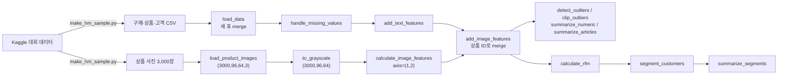

# A1-1 코드 해설

직접 작성한 `src/pipeline.py`, `scripts/make_hm_sample.py`, `notebooks/analysis_report.ipynb`의 코드 셀을 해설한다. 개념 설명은 [basic_knowledge.md](basic_knowledge.md)에 있고, 여기서는 '어느 줄이 무엇을 하고 데이터가 어떻게 바뀌는가'에 집중한다.

## 1. 전체 구조

| 파일 | 역할 | 실행 방식 |
| --- | --- | --- |
| `scripts/make_hm_sample.py` | Kaggle 대회 데이터(34.56GB)에서 샘플 zip을 만든다 | Kaggle 노트북 셀에 붙여 넣어 한 번 실행 |
| `src/pipeline.py` | `DataAnalyzer` 클래스와 이미지·IQR 도우미 함수. 계산만 하고 그림은 그리지 않음 | 직접 실행하지 않고 노트북이 import |
| `notebooks/analysis_report.ipynb` | 클래스를 순서대로 호출하고 표·그림·해석을 보여 줌 | `notebooks/`에서 위에서부터 끝까지 실행 |

### 사용한 모듈/라이브러리

| 모듈 | 사용 위치 | 용도 |
| --- | --- | --- |
| `pathlib.Path` (표준) | 세 파일 모두 | 운영체제와 무관한 경로 다루기, 폴더 만들기 |
| `shutil` (표준) | `make_hm_sample.py` | 사진 복사, zip 만들기, 폴더 지우기 |
| `sys` (표준) | 노트북 | 모듈 검색 경로에 `src` 추가 |
| `numpy` | 세 파일 모두 | 이미지 배열 쌓기·흑백 변환·axis 통계, 난수, 조건 선택 |
| `pandas` | 세 파일 모두 | CSV 로드, merge, 결측·그룹·집계·상관, 분위수 점수 |
| `matplotlib.pyplot` | `pipeline.py`, 노트북 | `imread`로 JPG 읽기, 그림 칸 만들기·저장 |
| `matplotlib.font_manager` | 노트북 | 설치된 한글 글꼴 찾기 |
| `seaborn` | 노트북 | 히스토그램·박스플롯·막대·히트맵·산점도 |

## 2. 주요 함수·메서드의 입력과 결과

'self.df 변경' 열이 '예'인 메서드는 같은 셀을 두 번 실행하면 이미 바뀐 데이터에 다시 적용된다.

| 이름 | 입력 | 반환 | self.df 변경 |
| --- | --- | --- | --- |
| `calculate_iqr_bounds(values, multiplier)` | 수치 Series, 배수 | `(lower, upper)` | 해당 없음 |
| `read_image_resized(path, height, width)` | JPG 경로 | `(96, 64, 3)` uint8 배열 | 해당 없음 |
| `load_product_images(image_dir, article_ids, cache_path)` | 폴더, 상품 ID 목록, 캐시 경로 | `(N, 96, 64, 3)` 배열 | 해당 없음 (캐시 파일을 저장할 수 있음) |
| `to_grayscale(images)` | `(N, H, W, 3)` | `(N, H, W)` 실수 배열 | 해당 없음 |
| `calculate_image_features(gray_images)` | `(N, H, W)` | 피처 이름 → 길이 N 배열 사전 | 해당 없음 |
| `load_data()` | (생성 때 받은 폴더) | 147,801×35 표 | 예: 새로 만듦 |
| `summarize_missing()` | 없음 | 결측 있는 컬럼 표 | 아니오 |
| `handle_missing_values(strategy, group_col, columns, fallback_value)` | 전략 등 | `{컬럼: 처리 건수}` | 예: 결측 채움(또는 행 삭제) |
| `add_text_features(name_col, desc_col)` | 텍스트 컬럼 | 없음 | 예: 컬럼 2개 추가 |
| `add_image_features(images, article_ids, article_col)` | 이미지 배열, ID 목록 | 상품별 피처 표 (3,000행) | 예: 컬럼 7개 추가 |
| `detect_outliers(column, threshold, data)` | 컬럼, 배수, 표(선택) | `(이상치 행, lower, upper)` | 아니오 |
| `clip_outliers(columns, threshold, data)` | 컬럼 목록 등 | 자른 사본 | 아니오 |
| `summarize_numeric(columns, data)` | 컬럼 목록, 표(선택) | 통계 표 | 아니오 |
| `calculate_correlations(columns, data, method)` | 컬럼 목록 등 | 상관행렬 | 아니오 |
| `summarize_articles()` | 없음 | 상품 단위 표 (3,000행) | 아니오 |
| `calculate_weekly_sales()` | 없음 | 주별 표 | 아니오 |
| `calculate_rfm(..., reference_date, n_bins, frequency_edges)` | 기준일 등 | 고객 RFM 표 | 아니오 (`self.rfm` 저장) |
| `segment_customers()` | 없음 | `Segment` 붙은 RFM | 아니오 (`self.rfm` 수정) |
| `summarize_segments()` | 없음 | 세그먼트 요약 표 | 아니오 |

출력(`print`)은 노트북에서만 하고, `pipeline.py`의 함수·메서드는 모두 값을 반환한다. 그래서 같은 메서드를 화면 없이 다른 스크립트에서도 쓸 수 있다.

## 3. 작은 입력으로 따라가 보기

설명용 예시 데이터다(실제 실행 결과 아님).

### 3-1. 이미지 2장이 피처가 되기까지

2×2 크기 컬러 이미지 2장이 있다고 하자. 배열 shape은 `(2, 2, 2, 3)`이다.

| 이미지 | 픽셀 (R, G, B) | 흑백 밝기 (0.299R + 0.587G + 0.114B) |
| --- | --- | --- |
| 0번 | 4개 모두 (255, 255, 255) | `[[255, 255], [255, 255]]` |
| 1번 | 위 2개 (255, 255, 255), 아래 2개 (0, 0, 0) | `[[255, 255], [0, 0]]` |

1. `to_grayscale` → `(2, 2, 2, 3) @ (3,)` = `(2, 2, 2)`. 마지막 축(RGB)이 사라진다.
2. `mean(axis=(1, 2))` → `[255.0, 127.5]`. 0번은 완전히 흰색, 1번은 절반이 검정이다.
3. `std(axis=(1, 2))` → `[0.0, 127.5]`. 0번은 모든 픽셀이 같아 대비 0, 1번은 흰색·검정이 반반이라 대비가 크다.
4. `np.diff(axis=1)`(세로 방향 차이) → 0번은 `[[0, 0]]`, 1번은 `[[-255, -255]]`. 절댓값 평균은 0과 255다. 가로 방향 차이는 둘 다 0이다. 따라서 `image_edge` = `[0.0, 127.5]`.
5. `image_hist_1`(밝기 0~63 비율) → `[0.0, 0.5]`, `image_hist_4`(192~255) → `[1.0, 0.5]`.

### 3-2. 구매 4행이 RFM이 되기까지

| t_dat | customer_id | article_id | price |
| --- | --- | --- | --- |
| 2020-09-20 | A | 0001 | 0.03 |
| 2020-09-20 | A | 0002 | 0.02 |
| 2020-09-01 | A | 0001 | 0.03 |
| 2020-08-23 | B | 0003 | 0.05 |

기준일은 남은 행의 최대 날짜인 2020-09-20이다.

| 고객 | last_purchase | Frequency | Monetary | Recency |
| --- | --- | --- | --- | --- |
| A | 2020-09-20 | 2 (9/20, 9/1 두 날) | 0.08 | 0 |
| B | 2020-08-23 | 1 | 0.05 | 28 |

A는 구매 행이 3개지만 구매일이 2개라 Frequency 2다. 고정 경계 `[0, 1, 2, 3, 5, inf]`로 F 점수를 매기면 A는 (1, 2] 구간이라 2점, B는 (0, 1] 구간이라 1점이다.

## 4. 줄별 해설: `src/pipeline.py`

import 줄, 빈 줄, 주석만 있는 줄, 독스트링, 괄호만 있는 줄은 제외했다. 번호는 실제 파일의 줄 번호다.

### 상수와 도우미 함수 (19~123줄)

이름 붙은 상수로 '왜 그 값인지'를 드러냈다. `calculate_iqr_bounds`는 IQR 수식을 그대로 옮긴 함수이고, 이미지 함수 네 개는 '파일 읽기 → 쌓기 → 흑백 → 통계' 순서로 이어진다. 반복문은 파일을 읽을 때(81줄)와 히스토그램 구간 4개를 돌 때(120줄)만 쓰고, 픽셀 계산은 모두 배열 연산이다.

| 원본 줄 | 해당 코드 | 쉬운 설명 |
| --- | --- | --- |
| 19 | `TRANSACTIONS_FILE = "transactions_sample.csv"` | 구매 기록 파일 이름. 파일 이름을 상수로 두면 바꿀 때 한곳만 고치면 된다. |
| 20 | `ARTICLES_FILE = "articles_sample.csv"` | 상품 정보 파일 이름. |
| 21 | `CUSTOMERS_FILE = "customers_sample.csv"` | 고객 정보 파일 이름. |
| 22 | `ARTICLE_ID_DIGITS = 10               # 상품 ID는 앞자리 0을 포함한 10자리` | 상품 ID 자릿수 10. `0108775015`처럼 앞자리 0이 있는 ID를 맞출 때 쓴다. |
| 25 | `IMAGE_HEIGHT = 96                    # 원본 1750x1166(세로x가로)을` | 줄인 이미지의 세로 크기 96픽셀. |
| 26 | `IMAGE_WIDTH = 64                     # 비율(약 3:2)을 유지해 줄인 크기` | 줄인 이미지의 가로 크기 64픽셀. 원본 1750×1166의 세로:가로 비율(약 3:2)을 유지한다. |
| 27 | `GRAY_WEIGHTS = np.array([0.299, 0.587, 0.114])  # RGB → 밝기(ITU-R BT.601)` | RGB를 밝기로 바꿀 가중치. 사람 눈이 초록에 가장 민감하다는 표준(ITU-R BT.601) 값이다. 셋을 더하면 1이라 결과도 0~255 범위다. |
| 28 | `HISTOGRAM_EDGES = [0, 64, 128, 192, 256]  # 밝기 4구간: 어두움 ~ 밝음` | 밝기 히스토그램 구간 경계. [0,64), [64,128), [128,192), [192,256) 네 구간이다. |
| 31 | `DEFAULT_IQR_MULTIPLIER = 1.5` | IQR 배수 기본값 1.5. |
| 32 | `DEFAULT_SCORE_BINS = 5               # RFM 점수를 1~5점으로 매긴다` | R·M 점수 구간 수. 5면 1~5점. |
| 36 | `DEFAULT_FREQUENCY_EDGES = [0, 1, 2, 3, 5, np.inf]` | Frequency 점수 경계. `pd.cut`은 (왼쪽, 오른쪽] 구간이라 (0,1]=1회, (1,2]=2회, (2,3]=3회, (3,5]=4~5회, (5,∞)=6회 이상이 된다. `np.inf`는 무한대다. |
| 39 | `def calculate_iqr_bounds(values, multiplier=DEFAULT_IQR_MULTIPLIER):` | IQR 경계를 계산하는 함수 정의. DataFrame 상태 없이 Series 하나만 있으면 되는 계산이라 클래스 밖에 둔다. |
| 47 | `q1 = values.quantile(0.25)` | 25% 위치의 값 Q1. |
| 48 | `q3 = values.quantile(0.75)` | 75% 위치의 값 Q3. |
| 49 | `iqr = q3 - q1` | IQR = Q3 − Q1. 가운데 50% 값이 퍼진 폭이다. |
| 50 | `lower = q1 - multiplier * iqr` | 하한 = Q1 − 배수×IQR. |
| 51 | `upper = q3 + multiplier * iqr` | 상한 = Q3 + 배수×IQR. IQR이 0이면(값 대부분이 같으면) 하한=상한=Q1이 되어 그 값과 다른 모든 값이 이상치가 된다. |
| 52 | `return lower, upper` | 하한과 상한을 튜플로 반환한다. 호출하는 쪽에서 `lower, upper = ...`로 나눠 받는다. |
| 55 | `def read_image_resized(path, height=IMAGE_HEIGHT, width=IMAGE_WIDTH):` | 이미지 파일 하나를 읽어 줄이는 함수 정의. 크기 기본값은 위의 상수다. |
| 61 | `image = plt.imread(path)                 # JPG → (세로, 가로, 3) 배열` | `plt.imread`로 JPG를 읽는다. 결과는 shape `(1750, 1166, 3)`, 자료형 uint8(0~255)인 배열이다. 축 순서는 (세로, 가로, 채널)이다. |
| 62 | `rows = np.linspace(0, image.shape[0] - 1, height).round().astype(int)` | `np.linspace(0, 1749, 96)`은 0부터 1749까지를 같은 간격으로 나눈 96개 값이다. `round().astype(int)`로 정수 행 번호로 바꾼다. 남길 행 96개를 고르는 줄이다. |
| 63 | `cols = np.linspace(0, image.shape[1] - 1, width).round().astype(int)` | 같은 방식으로 남길 열 번호 64개를 고른다. |
| 64 | `return image[rows][:, cols, :3]          # 알파 채널이 있으면 버린다` | `image[rows]`로 행 96개를 고르면 `(96, 1166, 3)`, 다시 `[:, cols, :3]`로 열 64개와 채널 3개를 고르면 `(96, 64, 3)`이 된다. 가까운 픽셀 하나를 대표로 남기는 최근접 다운샘플링이다. `:3`은 PNG처럼 투명도(알파) 채널이 4번째에 있는 경우를 대비한다. |
| 67 | `def load_product_images(image_dir, article_ids, cache_path=None):` | 여러 상품의 이미지를 한 배열로 모으는 함수 정의. 캐시 경로는 선택 인자다. |
| 74 | `article_ids = list(article_ids)` | `numpy` 배열 등이 들어와도 비교할 수 있도록 상품 ID를 리스트로 바꾼다. |
| 75 | `if cache_path is not None and Path(cache_path).exists():` | 캐시 경로를 받았고 그 파일이 실제로 있는지 확인한다. `and`는 앞이 False면 뒤를 보지 않으므로 경로가 None일 때 `Path(None)` 오류가 나지 않는다. |
| 76 | `cached = np.load(cache_path)` | `.npz` 캐시를 연다. 저장할 때 붙인 이름(`images`, `article_ids`)으로 배열을 꺼낼 수 있다. |
| 77 | `if list(cached["article_ids"]) == article_ids:` | 캐시에 저장된 상품 ID 순서가 이번 요청과 똑같은지 확인한다. 다르면 이미지와 ID가 어긋나므로 캐시를 쓰지 않는다. |
| 78 | `return cached["images"]` | 같으면 저장해 둔 이미지 배열을 바로 반환한다(조기 반환). 3,000장을 다시 읽지 않는다. |
| 81 | `resized = [read_image_resized(Path(image_dir) / f"{aid}.jpg")` | 리스트 컴프리헨션으로 상품마다 `read_image_resized`를 호출해 `(96, 64, 3)` 배열 3,000개를 만든다. 파일 읽기는 한 장씩일 수밖에 없다. |
| 82 | `for aid in article_ids]` | (위 줄에 이어지는 반복 부분) `article_ids`의 순서대로 읽으므로 결과 순서도 ID 순서와 같다. |
| 83 | `images = np.stack(resized)               # (N, H, W, 3)` | `np.stack`이 같은 모양의 배열 3,000개를 새 축(0번)으로 쌓아 `(3000, 96, 64, 3)` 배열 하나를 만든다. |
| 85 | `if cache_path is not None:` | 캐시 경로를 받았는지 확인한다. |
| 86 | `Path(cache_path).parent.mkdir(parents=True, exist_ok=True)` | 캐시를 저장할 폴더(`data/processed`)가 없으면 만든다. `parents=True`는 상위 폴더까지, `exist_ok=True`는 이미 있어도 오류 없이 넘어가게 한다. |
| 87 | `np.savez(cache_path, images=images, article_ids=article_ids)` | 이미지 배열과 상품 ID 목록을 한 `.npz` 파일에 이름을 붙여 저장한다. |
| 88 | `return images` | 쌓은 이미지 배열을 반환한다. |
| 91 | `def to_grayscale(images):` | 컬러 배열을 흑백 밝기 배열로 바꾸는 함수 정의. |
| 97 | `return images.astype(np.float64) @ GRAY_WEIGHTS` | `astype(np.float64)`로 uint8을 실수로 바꾼 뒤 `@`(행렬곱)를 한다. `(3000, 96, 64, 3) @ (3,)`은 마지막 축 3개 값에 가중치를 곱해 더하므로 결과는 `(3000, 96, 64)`다. 예: (R,G,B)=(200,100,50)이면 0.299×200+0.587×100+0.114×50=124.2. 가중치가 실수라 `astype` 없이도 결과는 실수가 되지만, 이후 평균·표준편차를 실수로 계산한다는 의도를 코드에 드러내려고 명시한다. |
| 100 | `def calculate_image_features(gray_images):` | 흑백 배열에서 이미지별 피처를 계산하는 함수 정의. |
| 106 | `image_axes = (1, 2)` | 줄일 축을 이름 있는 변수로 둔다. 축 0은 이미지 번호, 1은 세로, 2는 가로다. |
| 107 | `features = {` | 피처 이름과 값을 담을 사전을 만든다. |
| 108 | `"image_mean": gray_images.mean(axis=image_axes),   # 전체 밝기` | `mean(axis=(1, 2))`는 세로·가로 축을 함께 없애고 이미지 축만 남긴다. 결과 shape `(3000,)`, 이미지마다 평균 밝기 하나다. |
| 109 | `"image_std": gray_images.std(axis=image_axes),     # 명암 대비` | 같은 방식의 표준편차. 밝기가 평균에서 얼마나 퍼져 있는지, 즉 명암 대비다. NumPy `std`는 기본적으로 n으로 나누는 모집단 표준편차다. |
| 113 | `horizontal_diff = np.abs(np.diff(gray_images, axis=2))` | `np.diff(axis=2)`는 가로 방향으로 옆 픽셀과의 차이를 구한다. 가로가 64 → 63칸으로 하나 줄어 `(3000, 96, 63)`이 된다. `np.abs`로 크기만 남긴다. |
| 114 | `vertical_diff = np.abs(np.diff(gray_images, axis=1))` | 세로 방향(axis=1)으로 아래 픽셀과의 차이. `(3000, 95, 64)`. |
| 115 | `features["image_edge"] = (horizontal_diff.mean(axis=image_axes)` | 두 차이 배열의 이미지별 평균을 구해 더한다. 모양은 달라도 `axis=(1, 2)` 평균 결과는 둘 다 `(3000,)`이라 더할 수 있다. |
| 116 | `+ vertical_diff.mean(axis=image_axes)) / 2` | (위 줄에 이어짐) 2로 나눠 가로·세로 평균을 낸다. 윤곽이 많은(무늬·주름이 많은) 사진일수록 값이 크다. |
| 119 | `bin_pairs = zip(HISTOGRAM_EDGES[:-1], HISTOGRAM_EDGES[1:])` | `zip`으로 경계 목록을 한 칸 어긋나게 짝지어 (0,64), (64,128), (128,192), (192,256) 구간 쌍을 만든다. |
| 120 | `for bin_index, (low, high) in enumerate(bin_pairs, start=1):` | 구간마다 반복한다. `enumerate(..., start=1)`로 구간 번호를 1부터 붙인다. 반복은 4번뿐이고, 각 반복 안의 계산은 3,000장 전체에 대한 배열 연산이다. |
| 121 | `in_bin = (gray_images >= low) & (gray_images < high)` | 픽셀마다 이 구간에 속하면 True인 불리언 배열 `(3000, 96, 64)`. `&`는 두 조건이 모두 True인 원소만 True로 만든다. |
| 122 | `features[f"image_hist_{bin_index}"] = in_bin.mean(axis=image_axes)` | True=1, False=0으로 평균을 내면 '구간에 속한 픽셀 비율'이 된다. `image_hist_1`(어두움) ~ `image_hist_4`(밝음) 4개 컬럼이 생긴다. |
| 123 | `return features` | 피처 사전을 반환한다. 값은 모두 길이 3,000인 1차원 배열이다. |

**확인 질문 (C1)** — 97줄에서 `astype(np.float64)` 없이 uint8 배열에 바로 `@ GRAY_WEIGHTS`를 하면 결과 자료형은 무엇이 되고, 왜 실수로 먼저 바꾸는 편이 안전한가?

### 클래스 생성과 데이터 로드 (126~164줄)

세 CSV를 읽어 ID 모양을 맞춘 뒤 LEFT JOIN 두 번으로 구매 단위 표 하나를 만든다.

| 원본 줄 | 해당 코드 | 쉬운 설명 |
| --- | --- | --- |
| 126 | `class DataAnalyzer:` | 분석 파이프라인 클래스 정의. |
| 134 | `def __init__(self, data_dir):` | 객체를 만들 때 실행되는 초기화 메서드. 데이터 폴더 경로만 받는다. |
| 135 | `self.data_dir = Path(data_dir)` | 경로 문자열을 `Path` 객체로 바꿔 저장한다. `/` 연산자로 하위 경로를 이어 붙일 수 있다. |
| 136 | `self.df = None` | 구매 단위 데이터를 담을 자리. 아직 읽지 않았으므로 `None`. |
| 137 | `self.rfm = None` | 고객 단위 RFM 결과를 담을 자리. `calculate_rfm()`이 채운다. |
| 142 | `def load_data(self):` | 세 CSV를 읽어 합치는 메서드 정의. |
| 148 | `id_types = {"article_id": str, "customer_id": str}` | 상품 ID·고객 ID를 문자열로 읽도록 지정할 사전. 숫자로 읽으면 `0108775015`의 앞자리 0이 사라진다. |
| 149 | `transactions = pd.read_csv(self.data_dir / TRANSACTIONS_FILE,` | 구매 CSV를 읽는다. 경로는 `Path / 파일이름`으로 만든다. |
| 150 | `dtype=id_types, parse_dates=["t_dat"])` | (인자 이어짐) `parse_dates`로 `t_dat` 문자열을 날짜형으로 바꿔 읽는다. 그래야 날짜끼리 빼기(Recency)와 주 단위 묶기가 된다. |
| 151 | `articles = pd.read_csv(self.data_dir / ARTICLES_FILE,` | 상품 CSV를 읽는다. |
| 152 | `dtype=id_types)` | (인자 이어짐) 같은 ID 자료형 지정. |
| 153 | `customers = pd.read_csv(self.data_dir / CUSTOMERS_FILE,` | 고객 CSV를 읽는다. |
| 154 | `dtype=id_types)` | (인자 이어짐) 같은 ID 자료형 지정. |
| 157 | `for table in (transactions, articles):` | 상품 ID가 있는 두 표에 같은 처리를 하기 위해 반복한다. |
| 158 | `table["article_id"] = (table["article_id"]` | `str.zfill(10)`으로 10자리가 안 되는 ID 앞을 0으로 채운다. 이미 10자리면 그대로다. 두 표의 키 모양을 똑같이 맞춰야 merge가 된다. |
| 159 | `.str.zfill(ARTICLE_ID_DIGITS))` | (위 줄에 이어지는 메서드 호출) |
| 161 | `df = transactions.merge(articles, on="article_id", how="left")` | 구매 표에 상품 정보를 `article_id` 기준으로 붙인다. `how="left"`는 구매 행을 모두 남긴다(SQL의 LEFT JOIN). 상품 쪽 컬럼 24개가 추가된다. |
| 162 | `df = df.merge(customers, on="customer_id", how="left")` | 같은 방식으로 고객 정보를 `customer_id` 기준으로 붙인다. 결과는 147,801행 × 35컬럼이다. |
| 163 | `self.df = df` | 완성한 표를 객체 상태 `self.df`에 저장한다. |
| 164 | `return self.df` | 같은 표를 반환해 노트북에서 바로 `head()` 등을 볼 수 있게 한다. |

### 결측치 처리 (169~246줄)

`handle_missing_values`는 전략 이름에 따라 `_group_statistic`이 그룹 통계 Series를 만들고 `fillna`가 결측 칸에만 넣는다. 그룹 전체가 비어 남은 칸은 `_fill_remaining`이 처리한다.

| 원본 줄 | 해당 코드 | 쉬운 설명 |
| --- | --- | --- |
| 169 | `def summarize_missing(self):` | 결측 현황 표를 만드는 메서드 정의. `self.df`를 바꾸지 않는다. |
| 171 | `missing_count = self.df.isna().sum()` | `isna()`는 칸마다 결측이면 True인 표를 만들고, `sum()`은 True를 1로 세어 컬럼별 결측 개수를 낸다. |
| 172 | `missing_ratio = missing_count / len(self.df) * 100` | 결측 개수 ÷ 전체 행 수 × 100 = 결측 비율(%). |
| 173 | `summary = pd.DataFrame({"missing_count": missing_count,` | 두 Series를 컬럼으로 하는 새 표를 만든다. |
| 174 | `"missing_ratio_pct": missing_ratio.round(2)})` | (이어짐) 비율은 소수 둘째 자리로 반올림한다. |
| 175 | `return summary[summary["missing_count"] > 0]` | 결측이 1개 이상인 컬럼만 골라 반환한다. 35개 컬럼 중 문제 있는 것만 보기 위해서다. |
| 177 | `def handle_missing_values(self, strategy="group_median", group_col=None,` | 결측 대치 메서드 정의 시작. 기본 전략은 그룹 중앙값이다. |
| 178 | `columns=None, fallback_value=None):` | (인자 이어짐) 처리할 컬럼 목록과, 그룹 통계로도 못 채운 칸에 쓸 대체값. |
| 192 | `if columns is None:` | 처리할 컬럼을 주지 않았는지 확인한다. |
| 193 | `raise ValueError("처리할 columns 를 지정하세요.")` | 주지 않았으면 무엇이 필요한지 알려 주는 오류를 내고 멈춘다. |
| 195 | `if strategy == "drop":` | 삭제 전략인지 확인한다. |
| 196 | `before = len(self.df)` | 삭제 전 행 수를 기억한다. |
| 197 | `self.df = self.df.dropna(subset=columns).reset_index(drop=True)` | `dropna(subset=...)`로 지정 컬럼에 결측이 있는 행을 지우고 `reset_index(drop=True)`로 행 번호를 0부터 다시 매긴다. 새 표를 `self.df`에 다시 넣는다. |
| 198 | `return {"dropped_rows": before - len(self.df)}` | 지운 행 수를 사전으로 반환한다(조기 반환). |
| 200 | `report = {}` | 컬럼별 처리 건수를 담을 빈 사전. |
| 201 | `for column in columns:` | 처리할 컬럼마다 반복한다. |
| 202 | `missing_before = int(self.df[column].isna().sum())` | 채우기 전 결측 개수를 기억한다. NumPy 정수를 `int()`로 일반 정수로 바꾼다. |
| 203 | `if strategy == "constant":` | 상수 전략인지 확인한다. |
| 204 | `self.df[column] = self.df[column].fillna(fallback_value)` | 결측 칸을 `fallback_value` 하나로 채운다. 이 노트북에서는 FN·Active를 0으로 채울 때 쓴다. |
| 205 | `else:` | 그룹 전략이면 아래를 실행한다. |
| 206 | `group_values = self._group_statistic(strategy, group_col,` | 행마다 '자기 그룹의 통계값'이 든 Series를 받는다. |
| 207 | `column)` | (인자 이어짐) |
| 208 | `self.df[column] = self.df[column].fillna(group_values)` | `fillna(Series)`는 행 번호가 같은 위치끼리 맞춰 결측 칸만 채운다. 값이 있는 칸은 그대로다. |
| 209 | `self._fill_remaining(column, fallback_value)` | 그룹 전체가 결측이라 남은 칸을 처리한다. |
| 210 | `missing_after = int(self.df[column].isna().sum())` | 채운 뒤 결측 개수를 센다. |
| 211 | `report[column] = missing_before - missing_after` | 채운 건수 = 전 − 후. |
| 212 | `return report` | 컬럼별 처리 건수 사전을 반환한다. |
| 214 | `def _group_statistic(self, strategy, group_col, column):` | 전략 이름에 맞는 그룹 통계를 만드는 내부 메서드. 이름 앞 `_`는 '클래스 안에서만 쓰는 도우미'라는 관례 표시다. |
| 220 | `if group_col is None:` | 그룹 기준 컬럼을 주지 않았는지 확인한다. |
| 221 | `raise ValueError("그룹 전략에는 group_col 이 필요합니다.")` | 없으면 오류를 낸다. 그룹 없이 그룹 통계를 낼 수 없기 때문이다. |
| 222 | `grouped = self.df.groupby(group_col)[column]` | 그룹 기준으로 묶은 뒤 대상 컬럼만 고른 GroupBy 객체를 만든다. 결측인 그룹 키는 그룹에서 빠진다. |
| 223 | `if strategy == "group_mean":` | 평균 전략인지 확인한다. |
| 224 | `return grouped.transform("mean")` | `transform("mean")`은 그룹 평균을 원래 행 개수만큼 펼쳐 반환한다. `agg`는 그룹 수만큼으로 줄어들어 `fillna`에 바로 쓸 수 없다. |
| 225 | `if strategy == "group_median":` | 중앙값 전략인지 확인한다. |
| 226 | `return grouped.transform("median")` | 그룹 중앙값을 행마다 펼쳐 반환한다. |
| 227 | `if strategy == "group_mode":` | 최빈값 전략인지 확인한다. |
| 228 | `return grouped.transform(self._first_mode)` | Pandas `transform`에는 '최빈값' 이름의 집계가 없어서 직접 만든 함수 `_first_mode`를 그룹마다 적용한다. |
| 229 | `raise ValueError(f"지원하지 않는 strategy: {strategy}")` | 세 전략이 아니면 오류를 낸다. |
| 231 | `@staticmethod` | 정적 메서드 데코레이터. 아래 메서드는 `self`가 필요 없다. |
| 232 | `def _first_mode(values):` | 그룹 하나의 최빈값을 구하는 함수 정의. |
| 234 | `modes = values.mode()` | `mode()`는 가장 많이 나온 값들을 Series로 반환한다. 동률이면 여러 개이고, 결측은 세지 않는다. |
| 235 | `if modes.empty:` | 모든 값이 결측이라 최빈값이 없는지 확인한다. |
| 236 | `return np.nan` | 없으면 NaN을 반환해 결측으로 남긴다. 나중에 `_fill_remaining`이 처리한다. |
| 237 | `return modes.iloc[0]` | 동률이면 정렬상 첫 번째 값을 고른다. |
| 239 | `def _fill_remaining(self, column, fallback_value):` | 그룹 통계로 못 채운 칸을 처리하는 내부 메서드 정의. |
| 241 | `if fallback_value is not None:` | 대체값을 줬는지 확인한다. |
| 242 | `self.df[column] = self.df[column].fillna(fallback_value)` | 줬으면 남은 결측을 그 값으로 채운다(예: `UNKNOWN`). |
| 243 | `return` | 대체값을 썼으면 끝낸다. |
| 244 | `if pd.api.types.is_numeric_dtype(self.df[column]):` | 대체값이 없을 때, 컬럼이 숫자형인지 확인한다. |
| 245 | `overall_median = self.df[column].median()` | 숫자형이면 컬럼 전체 중앙값을 구한다. |
| 246 | `self.df[column] = self.df[column].fillna(overall_median)` | 그 값으로 남은 결측을 채운다. 문자형은 알맞은 값을 추측할 수 없어 그대로 둔다. |

**확인 질문 (C2)** — 224줄의 `transform("mean")`을 `grouped.mean()`으로 바꾸면 208줄 `fillna`가 의도대로 동작하지 않는 이유는?

### 텍스트·이미지 피처 (251~277줄)

이미지 피처는 '상품 단위로 한 번 계산 → 구매 행에 merge' 순서다. 구매 14만 행마다 사진을 계산하지 않고 상품 3,000개만 계산한다.

| 원본 줄 | 해당 코드 | 쉬운 설명 |
| --- | --- | --- |
| 251 | `def add_text_features(self, name_col="prod_name",` | 텍스트 피처 메서드 정의 시작. 상품명 컬럼 기본값은 `prod_name`. |
| 252 | `desc_col="detail_desc"):` | (인자 이어짐) 상세 설명 컬럼 기본값은 `detail_desc`. |
| 254 | `names = self.df[name_col].fillna("").str.strip()` | 결측을 빈 문자열로 바꾸고 앞뒤 공백을 지운 상품명 사본. |
| 255 | `descriptions = self.df[desc_col].fillna("").str.strip()` | 같은 처리를 한 상세 설명 사본. |
| 256 | `self.df["name_word_count"] = names.str.split().str.len()` | `str.split()`은 공백 기준 단어 리스트를 만들고, 그다음 `str.len()`은 리스트 길이, 즉 단어 수를 센다. 'Pascal Top' → 2. |
| 257 | `self.df["desc_length"] = descriptions.str.len()` | 문자열에 바로 `str.len()`을 쓰면 글자 수다. |
| 259 | `def add_image_features(self, images, article_ids,` | 이미지 피처를 붙이는 메서드 정의 시작. |
| 260 | `article_col="article_id"):` | (인자 이어짐) 상품 ID 컬럼 이름. |
| 270 | `if len(images) != len(article_ids):` | 이미지 수와 ID 수가 다른지 확인한다. 다르면 어떤 사진이 어떤 상품인지 어긋난다. |
| 271 | `raise ValueError("이미지 수와 상품 ID 수가 다릅니다.")` | 어긋나면 오류를 내고 멈춘다. |
| 272 | `gray_images = to_grayscale(images)` | `(N, 96, 64, 3)` → `(N, 96, 64)` 흑백 변환. |
| 273 | `features = calculate_image_features(gray_images)` | 이미지별 피처 사전을 계산한다. |
| 274 | `image_features = pd.DataFrame({article_col: list(article_ids),` | 첫 컬럼에 상품 ID, 이어서 피처들을 넣은 표를 만든다. |
| 275 | `**features})` | (이어짐) `**features`는 사전의 키·값을 그대로 풀어 넣는 문법이다. 피처 7개 컬럼이 생긴다. |
| 276 | `self.df = self.df.merge(image_features, on=article_col, how="left")` | 상품 ID를 키로 구매 표에 피처를 붙인다. 같은 상품이 여러 번 팔렸으면 같은 피처가 그 행마다 복사된다. `merge`는 새 표를 만들므로 `self.df`에 다시 넣는다. |
| 277 | `return image_features` | 상품별 피처 표(3,000행)를 반환한다. |

**확인 질문 (C3)** — 276줄 merge 뒤 `self.df`의 행 수는 늘어나는가, 그대로인가? 상품 ID가 이미지 표에 한 번씩만 있다는 점에서 설명해 보자.

### 이상치·통계·상품/주별 요약 (282~370줄)

`detect_outliers`와 `clip_outliers`는 `self.df`를 바꾸지 않는다. `data` 인자로 상품 단위 표 같은 다른 표에도 같은 로직을 쓴다.

| 원본 줄 | 해당 코드 | 쉬운 설명 |
| --- | --- | --- |
| 282 | `def detect_outliers(self, column, threshold=DEFAULT_IQR_MULTIPLIER,` | IQR 이상치를 찾는 메서드 정의 시작. |
| 283 | `data=None):` | (인자 이어짐) `data`를 주면 다른 표(예: 상품 단위 표)에서 찾는다. |
| 289 | `if data is None:` | 표를 따로 주지 않았는지 확인한다. |
| 290 | `data = self.df` | 주지 않았으면 `self.df`를 쓴다. |
| 291 | `lower, upper = calculate_iqr_bounds(data[column], threshold)` | 모듈 함수로 경계를 계산한다. |
| 292 | `is_outlier = (data[column] < lower) \| (data[column] > upper)` | 경계 밖이면 True. `|`는 둘 중 하나라도 True면 True다. |
| 293 | `return data[is_outlier], lower, upper` | 이상치 행만 고른 표와 두 경계를 함께 반환한다. 원본은 바뀌지 않는다. |
| 295 | `def clip_outliers(self, columns, threshold=DEFAULT_IQR_MULTIPLIER,` | 경계로 자른 사본을 만드는 메서드 정의 시작. |
| 296 | `data=None):` | (인자 이어짐) |
| 302 | `if data is None:` | 표를 따로 주지 않았는지 확인한다. |
| 303 | `data = self.df` | 주지 않았으면 `self.df`를 쓴다. |
| 304 | `clipped = data.copy()` | `copy()`로 사본을 만든다. 이후 수정이 원본에 영향을 주지 않는다. |
| 305 | `for column in columns:` | 자를 컬럼마다 반복한다. |
| 306 | `lower, upper = calculate_iqr_bounds(clipped[column], threshold)` | 컬럼마다 경계를 계산한다. |
| 307 | `clipped[column] = clipped[column].clip(lower=lower, upper=upper)` | `clip`으로 하한보다 작으면 하한, 상한보다 크면 상한으로 바꾼다. 행 수는 그대로다. |
| 308 | `return clipped` | 자른 사본을 반환한다. |
| 313 | `def summarize_numeric(self, columns, data=None):` | 기술 통계 표를 만드는 메서드 정의. |
| 315 | `if data is None:` | 표를 따로 주지 않았는지 확인한다. |
| 316 | `data = self.df` | 주지 않았으면 `self.df`를 쓴다. 이 구조 덕분에 원본·사본·상품 단위 표를 같은 메서드로 요약한다. |
| 317 | `target = data[columns]` | 필요한 컬럼만 고른다. |
| 318 | `return pd.DataFrame({` | 통계별 Series를 컬럼으로 하는 표를 만든다. |
| 319 | `"mean": target.mean(),` | 컬럼별 평균. |
| 320 | `"median": target.median(),` | 컬럼별 중앙값. |
| 321 | `"std": target.std(),` | 컬럼별 표준편차. Pandas `std`는 n−1로 나누는 표본 표준편차다(NumPy 기본값과 다르다). |
| 322 | `"q1": target.quantile(0.25),` | 컬럼별 Q1. |
| 323 | `"q3": target.quantile(0.75),` | 컬럼별 Q3. |
| 326 | `def calculate_correlations(self, columns, data=None, method="pearson"):` | 상관행렬 메서드 정의. 방식 기본값은 Pearson. |
| 328 | `if data is None:` | 표를 따로 주지 않았는지 확인한다. |
| 329 | `data = self.df` | 주지 않았으면 `self.df`를 쓴다. |
| 330 | `return data[columns].corr(method=method)` | 고른 컬럼끼리 모든 쌍의 상관계수를 계산한 정사각 행렬을 반환한다. `method="spearman"`이면 순위 상관이다. |
| 332 | `def summarize_articles(self, article_col="article_id",` | 상품 단위 요약 메서드 정의 시작. |
| 333 | `customer_col="customer_id", price_col="price"):` | (인자 이어짐) 고객·가격 컬럼 이름. |
| 340 | `sales = self.df.groupby(article_col).agg(` | 상품별로 묶어 여러 집계를 한 번에 한다. |
| 341 | `units_sold=(article_col, "size"),` | `units_sold` = 그룹 크기(구매 행 수) = 판매 수량. |
| 342 | `buyers=(customer_col, "nunique"),` | `buyers` = 서로 다른 고객 수. |
| 343 | `avg_price=(price_col, "mean"),` | `avg_price` = 평균 가격. |
| 345 | `feature_cols = [col for col in self.df.columns` | `self.df` 컬럼 중 이름이 `image_`, `name_`, `desc_`로 시작하는 것(만든 피처)만 고른다. |
| 346 | `if col.startswith(("image_", "name_", "desc_"))]` | (이어짐) `startswith`에 튜플을 주면 셋 중 하나로 시작하면 True다. |
| 347 | `descriptive_cols = ["prod_name", "product_group_name",` | 결과 표에 함께 보여 줄 상품 설명 컬럼 목록. |
| 348 | `"perceived_colour_value_name",` | (목록 이어짐) |
| 349 | `"index_group_name"]` | (목록 끝) |
| 350 | `article_info = (self.df[[article_col] + descriptive_cols` | 상품 ID·설명·피처 컬럼만 고르는 식 시작. |
| 351 | `+ feature_cols]` | (컬럼 목록 이어짐) |
| 352 | `.drop_duplicates(subset=article_col)` | 같은 상품이 여러 행에 반복되므로 상품마다 첫 행만 남긴다. 피처는 상품마다 같아서 어느 행이든 결과가 같다. |
| 353 | `.set_index(article_col))` | 상품 ID를 행 이름(인덱스)으로 바꾼다. 아래 `join`이 인덱스로 맞추기 때문이다. |
| 354 | `return sales.join(article_info).reset_index()` | 판매 집계와 상품 정보를 상품 ID로 붙이고, 인덱스를 다시 컬럼으로 돌려 3,000행 표를 반환한다. |
| 356 | `def calculate_weekly_sales(self, date_col="t_dat", price_col="price"):` | 주별 판매 집계 메서드 정의. |
| 362 | `week_start = self.df[date_col].dt.to_period("W-SUN").dt.start_time` | `to_period("W-SUN")`은 날짜를 '일요일에 끝나는 주'로 바꾸고, `start_time`은 그 주의 시작일(월요일)을 준다. 2020-06-23(화) → 2020-06-22(월). |
| 363 | `weekly = self.df.groupby(week_start).agg(` | 그 주 시작일로 묶어 여러 집계를 한다. |
| 364 | `units_sold=(price_col, "size"),` | 주별 판매 수량(행 수). |
| 365 | `revenue=(price_col, "sum"),` | 주별 가격 합계(매출). |
| 366 | `customers=("customer_id", "nunique"),` | 주별 구매 고객 수. |
| 367 | `day_count=(date_col, "nunique"),` | 그 주에 실제로 포함된 날짜 수. 첫 주는 6일, 마지막 주는 2일이다. |
| 369 | `weekly.index.name = "week_start"` | 인덱스 이름을 `week_start`로 정한다. |
| 370 | `return weekly` | 주별 표를 반환한다. |

### RFM과 세그먼트 (375~477줄)

`calculate_rfm`은 고객 단위로 접은 뒤 점수를 매기고, `segment_customers`는 조건 리스트의 순서가 곧 우선순위다.

| 원본 줄 | 해당 코드 | 쉬운 설명 |
| --- | --- | --- |
| 375 | `def calculate_rfm(self, customer_col="customer_id", date_col="t_dat",` | RFM 메서드 정의 시작. |
| 376 | `amount_col="price", reference_date=None,` | (인자 이어짐) 금액 컬럼과 기준일. |
| 377 | `n_bins=DEFAULT_SCORE_BINS,` | (인자 이어짐) 점수 구간 수. |
| 378 | `frequency_edges=DEFAULT_FREQUENCY_EDGES):` | (인자 이어짐) Frequency 점수 경계. |
| 390 | `if reference_date is None:` | 기준일을 주지 않았는지 확인한다. |
| 391 | `reference_date = self.df[date_col].max()` | 주지 않았으면 데이터의 최종 구매일(2020-09-22)을 쓴다. |
| 393 | `rfm = self.df.groupby(customer_col).agg(` | 고객별로 묶어 집계 시작. 결과는 고객 ID가 인덱스인 30,000행 표다. |
| 394 | `last_purchase=(date_col, "max"),` | 마지막 구매일 = 날짜 최댓값. |
| 395 | `Frequency=(date_col, "nunique"),` | Frequency = 서로 다른 구매일 수(`nunique`). 같은 날 여러 상품을 사도 1회다. |
| 396 | `Monetary=(amount_col, "sum"),` | Monetary = 가격 합계. |
| 398 | `rfm["Recency"] = (reference_date - rfm["last_purchase"]).dt.days` | 기준일 − 마지막 구매일은 기간(Timedelta)이고, `.dt.days`로 일수 정수를 꺼낸다. |
| 400 | `rfm["R_score"] = self._quantile_score(rfm["Recency"], n_bins,` | Recency 점수. 작을수록 좋으므로 `higher_is_better=False`. |
| 401 | `higher_is_better=False)` | (인자 이어짐) |
| 402 | `if frequency_edges is None:` | F 경계를 주지 않았는지 확인한다. |
| 403 | `rfm["F_score"] = self._quantile_score(rfm["Frequency"], n_bins)` | 주지 않았으면 R·M처럼 순위 5등분으로 점수를 매긴다. |
| 404 | `else:` | 경계를 줬으면 아래를 실행한다. |
| 405 | `rfm["F_score"] = self._fixed_bin_score(rfm["Frequency"],` | 방문 횟수 자체로 구간을 나눠 점수를 매긴다. |
| 406 | `frequency_edges)` | (인자 이어짐) |
| 407 | `rfm["M_score"] = self._quantile_score(rfm["Monetary"], n_bins)` | Monetary 점수. 클수록 높은 점수. |
| 408 | `rfm["RFM_score"] = rfm["R_score"] + rfm["F_score"] + rfm["M_score"]` | 세 점수의 합(3~15). 참고용 종합 점수. |
| 410 | `self.rfm = rfm.drop(columns="last_purchase")` | 중간 계산용 `last_purchase` 컬럼을 빼고 `self.rfm`에 저장한다. |
| 411 | `return self.rfm` | RFM 표를 반환한다. |
| 413 | `@staticmethod` | 정적 메서드 데코레이터. |
| 414 | `def _quantile_score(values, n_bins, higher_is_better=True):` | 분위수 점수 함수 정의. |
| 420 | `ranks = values.rank(method="first")` | 값이 같아도 먼저 나온 순서대로 서로 다른 순위(1, 2, 3, …)를 준다. 경계 중복 오류를 막는다. |
| 421 | `labels = list(range(1, n_bins + 1))` | 점수 레이블 `[1, 2, 3, 4, 5]`. |
| 422 | `if not higher_is_better:` | 작을수록 좋은 지표인지 확인한다. |
| 423 | `labels = labels[::-1]` | 그렇다면 레이블을 `[5, 4, 3, 2, 1]`로 뒤집는다. `[::-1]`은 역순 슬라이싱이다. |
| 424 | `return pd.qcut(ranks, q=n_bins, labels=labels).astype(int)` | `pd.qcut`이 순위를 같은 인원 5구간으로 나눠 레이블을 붙이고, 범주형 결과를 `astype(int)`로 정수로 바꿔 반환한다. |
| 426 | `@staticmethod` | 정적 메서드 데코레이터. |
| 427 | `def _fixed_bin_score(values, edges):` | 고정 경계 점수 함수 정의. |
| 433 | `labels = list(range(1, len(edges)))` | 점수 레이블. 경계가 6개면 구간은 5개라 `[1, 2, 3, 4, 5]`다. |
| 434 | `return pd.cut(values, bins=edges, labels=labels).astype(int)` | `pd.cut`이 값을 경계 구간에 넣고 레이블을 붙인다. 3회 → (2,3] → 3점, 4회 → (3,5] → 4점. |
| 436 | `def segment_customers(self):` | 세그먼트 규칙 메서드 정의. |
| 446 | `r_score = self.rfm["R_score"]` | R 점수 Series를 짧은 이름으로 꺼낸다. |
| 447 | `f_score = self.rfm["F_score"]` | F 점수. |
| 448 | `m_score = self.rfm["M_score"]` | M 점수. |
| 450 | `is_vip = (r_score >= 4) & (f_score >= 4) & (m_score >= 4)` | VIP 조건: 세 점수 모두 4 이상. 비교 결과는 고객마다 True/False인 Series다. |
| 451 | `is_loyal = (r_score >= 3) & (f_score >= 3)` | Loyal 조건: R과 F가 3 이상. |
| 452 | `is_new = (r_score >= 4) & (f_score <= 2)` | New 조건: 최근(R 4 이상)인데 방문이 적음(F 2 이하 = 1~2회). |
| 453 | `is_at_risk = (r_score <= 2) & (f_score >= 3)` | At Risk 조건: 오래됐는데(R 2 이하) 방문이 많았음(F 3 이상 = 3회 이상). |
| 454 | `is_churned = (r_score <= 2) & (f_score <= 2)` | Churned 조건: 오래됐고 방문도 적음. |
| 456 | `conditions = [is_vip, is_loyal, is_new, is_at_risk, is_churned]` | 조건을 우선순위 순서대로 리스트에 담는다. 좁은 조건(VIP)이 앞에 있어야 한다. |
| 457 | `segment_names = ["VIP", "Loyal", "New", "At Risk", "Churned"]` | 조건과 같은 순서의 이름 리스트. |
| 458 | `self.rfm["Segment"] = np.select(conditions, segment_names,` | `np.select`는 고객마다 조건 리스트를 앞에서부터 확인해 처음 True인 조건의 이름을 고른다. |
| 459 | `default="Regular")` | (이어짐) 어느 조건에도 맞지 않으면 `Regular`. |
| 460 | `return self.rfm` | 세그먼트가 붙은 RFM 표를 반환한다. |
| 462 | `def summarize_segments(self):` | 세그먼트 요약 메서드 정의. |
| 464 | `summary = self.rfm.groupby("Segment").agg(` | 세그먼트별로 묶어 집계 시작. |
| 465 | `customers=("Recency", "size"),` | 고객 수 = 그룹 크기(`size`). |
| 466 | `avg_recency_days=("Recency", "mean"),` | 평균 Recency. |
| 467 | `avg_frequency=("Frequency", "mean"),` | 평균 Frequency. |
| 468 | `avg_monetary=("Monetary", "mean"),` | 평균 Monetary. |
| 469 | `total_monetary=("Monetary", "sum"),` | Monetary 합계. |
| 471 | `summary["customer_share_pct"] = (` | 고객 비율(%) 컬럼 계산 시작. |
| 472 | `summary["customers"] / summary["customers"].sum() * 100` | 그룹 고객 수 ÷ 전체 고객 수 × 100. |
| 474 | `summary["revenue_share_pct"] = (` | 매출 비중(%) 컬럼 계산 시작. |
| 475 | `summary["total_monetary"] / summary["total_monetary"].sum() * 100` | 그룹 매출 ÷ 전체 매출 × 100. |
| 477 | `return summary.sort_values("total_monetary", ascending=False)` | 매출이 큰 세그먼트부터 정렬해 반환한다. |

**확인 질문 (C4)** — 456줄에서 `is_loyal`을 `is_vip`보다 앞에 두면 VIP 고객 수는 몇 명이 될까?

## 5. 줄별 해설: `scripts/make_hm_sample.py`

Kaggle 노트북에서 실행하는 스크립트다. 함수 네 개가 '기간 거르기 → 상품 고르기 → 고객 고르기 → 저장'을 나눠 맡고 `main()`이 순서대로 부른다.

| 원본 줄 | 해당 코드 | 쉬운 설명 |
| --- | --- | --- |
| 32 | `INPUT_DIR = Path(` | Kaggle 노트북에서 대회 데이터가 연결되는 폴더 경로 시작. |
| 33 | `"/kaggle/input/competitions/h-and-m-personalized-fashion-recommendations"` | (경로 문자열) Kaggle에 연결된 대회 데이터의 실제 위치다. 직접 `os.listdir('/kaggle/input')`으로 확인한 값이다. |
| 35 | `OUTPUT_DIR = Path("/kaggle/working/hm_sample")` | 잘라 낸 파일을 모을 임시 폴더. `/kaggle/working`은 Kaggle 노트북의 출력 폴더다. |
| 36 | `ZIP_BASE_NAME = "/kaggle/working/hm_sample"   # .zip은 자동으로 붙는다` | 만들 zip 파일 경로(확장자 제외). `make_archive`가 `.zip`을 붙인다. |
| 38 | `START_DATE = "2020-06-23"` | 샘플 기간 시작일. 데이터 마지막 날에서 약 3개월 전이다. |
| 39 | `END_DATE = "2020-09-22"` | 샘플 기간 종료일(원본 마지막 날). |
| 40 | `N_ARTICLES = 3000` | 남길 상품 수. |
| 41 | `N_CUSTOMERS = 30000` | 남길 고객 수. |
| 42 | `RANDOM_SEED = 42` | 고객 무작위 선택 시드. 같은 시드면 같은 고객이 뽑힌다. |
| 43 | `ARTICLE_ID_DIGITS = 10` | 상품 ID 자릿수. |
| 46 | `def image_path(article_id):` | 상품 ID로 사진 경로를 만드는 함수 정의. |
| 48 | `return INPUT_DIR / "images" / article_id[:3] / f"{article_id}.jpg"` | `article_id[:3]`(앞 3자리)가 하위 폴더 이름이다. 예: `0108775015` → `images/010/0108775015.jpg`. |
| 51 | `def load_transactions_in_period():` | 전체 구매 기록을 읽고 기간을 거르는 함수 정의. |
| 53 | `transactions = pd.read_csv(` | 구매 CSV(약 3,179만 행)를 읽는 호출 시작. |
| 54 | `INPUT_DIR / "transactions_train.csv",` | (인자) 읽을 파일 경로. |
| 55 | `dtype={"customer_id": str, "article_id": str,` | (인자) ID는 문자열로 읽는다. |
| 56 | `"price": "float32", "sales_channel_id": "int8"},` | (인자 이어짐) 가격은 `float32`, 채널은 `int8`로 읽어 메모리를 줄인다. |
| 57 | `parse_dates=["t_dat"],` | (인자) 날짜 컬럼을 날짜형으로 읽는다. |
| 59 | `transactions["article_id"] = (transactions["article_id"]` | 상품 ID를 10자리로 맞추는 식 시작. |
| 60 | `.str.zfill(ARTICLE_ID_DIGITS))` | (이어짐) `str.zfill`로 앞자리를 0으로 채운다. |
| 61 | `in_period = transactions["t_dat"].between(START_DATE, END_DATE)` | `between`은 시작일 이상·종료일 이하면 True다(양끝 포함). |
| 62 | `return transactions[in_period]` | 기간 안의 행만 반환한다. 이 단계에서 3,981,458행이 남았다. |
| 65 | `def choose_top_articles(transactions):` | 인기 상품을 고르는 함수 정의. |
| 67 | `sales_count = transactions["article_id"].value_counts()` | `value_counts()`는 상품별 판매 행 수를 많은 순서로 센다. |
| 68 | `with_image = [aid for aid in sales_count.index` | 판매량 순서를 유지하며 사진 파일이 있는 상품만 남긴다. |
| 69 | `if image_path(aid).exists()]` | (이어짐) `exists()`로 파일이 실제로 있는지 확인한다. 원본 설명대로 사진이 없는 상품도 있다. |
| 70 | `return with_image[:N_ARTICLES]` | 앞에서부터 3,000개를 반환한다. |
| 73 | `def choose_customers(transactions):` | 고객을 무작위로 고르는 함수 정의. |
| 75 | `rng = np.random.default_rng(RANDOM_SEED)` | 시드 42로 고정한 난수 생성기. |
| 76 | `all_customers = transactions["customer_id"].unique()` | 구매 고객 ID 목록(중복 없이). |
| 77 | `sample_size = min(N_CUSTOMERS, len(all_customers))` | 고객이 30,000명보다 적으면 있는 만큼만 뽑도록 작은 값을 고른다. |
| 78 | `return rng.choice(all_customers, size=sample_size, replace=False)` | `replace=False`로 같은 고객을 두 번 뽑지 않는다. |
| 81 | `def save_sample(transactions, customer_ids):` | 샘플 파일을 저장하는 함수 정의. |
| 83 | `image_out_dir = OUTPUT_DIR / "images"` | 사진을 모을 폴더 경로. |
| 84 | `image_out_dir.mkdir(parents=True, exist_ok=True)` | 폴더를 만든다(상위 폴더 포함, 이미 있어도 오류 없음). |
| 85 | `used_articles = transactions["article_id"].unique()` | 최종 구매 기록에 남은 상품 ID 목록. |
| 87 | `articles = pd.read_csv(INPUT_DIR / "articles.csv",` | 상품 CSV를 읽는다. |
| 88 | `dtype={"article_id": str})` | (인자) 상품 ID를 문자열로 읽는다. |
| 89 | `articles["article_id"] = articles["article_id"].str.zfill(` | 상품 ID를 10자리로 맞추는 식 시작. |
| 90 | `ARTICLE_ID_DIGITS)` | (인자) 자릿수 10. |
| 91 | `articles = articles[articles["article_id"].isin(used_articles)]` | 남은 상품의 정보만 고른다. |
| 93 | `customers = pd.read_csv(INPUT_DIR / "customers.csv",` | 고객 CSV를 읽는다. |
| 94 | `dtype={"customer_id": str})` | (인자) 고객 ID를 문자열로 읽는다. |
| 95 | `customers = customers[customers["customer_id"].isin(customer_ids)]` | 고른 고객의 정보만 고른다. |
| 97 | `transactions.to_csv(OUTPUT_DIR / "transactions_sample.csv", index=False)` | 구매 기록을 CSV로 저장한다. `index=False`는 행 번호를 저장하지 않는다. |
| 98 | `articles.to_csv(OUTPUT_DIR / "articles_sample.csv", index=False)` | 상품 정보를 저장한다. |
| 99 | `customers.to_csv(OUTPUT_DIR / "customers_sample.csv", index=False)` | 고객 정보를 저장한다. |
| 101 | `for aid in used_articles:` | 남은 상품마다 반복한다. |
| 102 | `shutil.copy(image_path(aid), image_out_dir / f"{aid}.jpg")` | 원본 사진을 그대로 복사한다. 하위 폴더 없이 `images/{상품ID}.jpg`로 평평하게 저장한다. |
| 103 | `return len(articles), len(customers)` | 저장한 상품 수와 고객 수를 반환한다. |
| 106 | `def main():` | 전체 순서를 연결하는 함수 정의. |
| 107 | `transactions = load_transactions_in_period()` | 기간 내 구매 기록을 읽는다. |
| 108 | `print("기간 내 구매 행:", len(transactions))` | 남은 행 수를 출력한다. |
| 110 | `top_articles = choose_top_articles(transactions)` | 인기 상품 3,000개를 고른다. |
| 111 | `transactions = transactions[transactions["article_id"]` | 그 상품의 구매만 남기는 식 시작. |
| 112 | `.isin(top_articles)]` | (이어짐) `isin`은 목록에 포함되면 True다. |
| 113 | `customer_ids = choose_customers(transactions)` | 그 구매를 한 고객 중 30,000명을 고른다. |
| 114 | `transactions = transactions[transactions["customer_id"]` | 고른 고객의 구매만 남기는 식 시작. |
| 115 | `.isin(customer_ids)]` | (이어짐) 147,801행이 남는다. |
| 117 | `article_count, customer_count = save_sample(transactions, customer_ids)` | 파일을 저장하고 상품 수·고객 수를 받는다. |
| 118 | `print("구매 행:", len(transactions), "\| 고객:", customer_count,` | 결과 규모를 출력한다. |
| 119 | `"\| 상품·사진:", article_count)` | (출력 이어짐) |
| 123 | `zip_path = shutil.make_archive(ZIP_BASE_NAME, "zip", OUTPUT_DIR)` | `OUTPUT_DIR` 안의 파일을 `hm_sample.zip` 하나로 묶고 그 경로를 받는다. |
| 124 | `shutil.rmtree(OUTPUT_DIR)` | 원래 폴더를 지운다. zip과 폴더가 둘 다 있으면 출력 용량이 두 배가 된다. |
| 125 | `size_mb = Path(zip_path).stat().st_size / 1_000_000` | zip 크기를 MB로 바꾼다. `1_000_000`의 `_`는 읽기 쉽게 쓴 숫자 구분자다. |
| 126 | `print(f"zip: {zip_path} ({size_mb:.1f} MB)")` | zip 경로와 크기를 소수 첫째 자리까지 출력한다. |
| 129 | `if __name__ == "__main__":` | 이 파일을 직접 실행했을 때만 아래를 실행한다. Kaggle 셀에 붙여 넣어 실행해도 `__name__`이 `"__main__"`이라 실행된다. |
| 130 | `main()` | 전체 과정을 실행한다. |

**확인 질문 (C5)** — 68~70줄에서 사진이 있는지 확인하기 전에 먼저 3,000개를 자르면(`sales_count.index[:3000]`) 어떤 문제가 생길까?

## 6. 줄별 해설: `notebooks/analysis_report.ipynb`

위치는 `셀 N`(마크다운 셀을 포함한 전체 셀 기준 1부터)과 셀 ID, 셀 내부 원본 줄 번호(1부터)다. 실행 번호 `In [n]`과는 다르다. import 줄과 주석 줄은 제외했다.

#### 셀 2 · `87ac0627` · A1-1 H&M 고객 분석 리포트: 단골 찾기

| 셀 내부 줄 | 해당 코드 | 쉬운 설명 |
| --- | --- | --- |
| 11 | `PROJECT_ROOT = Path.cwd().parent` | 현재 폴더(`notebooks/`)의 부모, 즉 `A1-1` 폴더를 프로젝트 루트로 잡는다. 노트북을 `notebooks/`에서 실행한다는 전제다. |
| 12 | `sys.path.insert(0, str(PROJECT_ROOT / "src"))` | `src` 폴더를 모듈 검색 경로 맨 앞에 넣어 `pipeline.py`를 import할 수 있게 한다. |
| 15 | `DATA_DIR = PROJECT_ROOT / "data" / "raw"` | 샘플 데이터 폴더 경로. |
| 16 | `IMAGE_DIR = DATA_DIR / "images"` | 상품 사진 폴더 경로. |
| 17 | `IMAGE_CACHE = PROJECT_ROOT / "data" / "processed" / "images_96x64.npz"` | 줄인 이미지 배열을 저장할 캐시 파일 경로. 파일 이름에 크기(96x64)를 넣어 크기를 바꾸면 다른 캐시를 쓰게 한다. |
| 18 | `FIGURE_DIR = PROJECT_ROOT / "outputs" / "figures"` | 그림 저장 폴더 경로. |
| 19 | `FIGURE_DIR.mkdir(parents=True, exist_ok=True)` | 그림 폴더가 없으면 만든다. |
| 21 | `IQR_MULTIPLIER = 1.5` | IQR 배수. 노트북 전체에서 이 이름으로 쓴다. |
| 22 | `PRICE_LABEL = "price (변환된 가격)"` | 가격 축 레이블. 변환된 값이라는 것을 그림마다 밝히려고 상수로 둔다. |
| 25 | `KOREAN_FONTS = ["Malgun Gothic", "AppleGothic", "NanumGothic",` | 한글을 지원하는 글꼴 후보 목록 시작(Windows·macOS·Linux 순). |
| 26 | `"Noto Sans CJK KR"]` | (목록 이어짐) |
| 27 | `installed_fonts = {font.name for font in font_manager.fontManager.ttflist}` | Matplotlib이 아는 글꼴 이름을 집합(set)으로 모은다. 집합은 `in` 검사가 빠르다. |
| 28 | `for font_name in KOREAN_FONTS:` | 후보를 순서대로 확인한다. |
| 29 | `if font_name in installed_fonts:` | 설치돼 있으면 |
| 30 | `plt.rcParams["font.family"] = font_name` | 그 글꼴을 기본 글꼴로 지정하고 |
| 31 | `break` | 더 찾지 않고 반복을 끝낸다. |
| 32 | `plt.rcParams["axes.unicode_minus"] = False  # 마이너스 기호 깨짐 방지` | 한글 글꼴에서 음수 기호가 네모로 깨지는 것을 막는다. |
| 33 | `sns.set_theme(style="whitegrid", font=plt.rcParams["font.family"])` | Seaborn 기본 스타일(흰 바탕 격자)을 적용하면서 고른 글꼴을 유지한다. |
| 34 | `pd.set_option("display.float_format", "{:,.4f}".format)` | 표의 실수를 천 단위 쉼표와 소수 넷째 자리로 보여 준다(표시만 바뀌고 값은 그대로다). 가격이 0.02 수준이라 넷째 자리까지 필요하다. |
| 35 | `pd.set_option("display.width", 120)` | 표 출력 폭을 넓힌다. |
| 36 | `pd.set_option("display.max_columns", 40)` | 35개 컬럼 중 최대 40개까지 생략 없이 보여 준다. |
| 39 | `def save_figure(fig, file_name):` | 그림 저장 도우미 함수 정의. |
| 41 | `fig.savefig(FIGURE_DIR / file_name, dpi=120, bbox_inches="tight")` | 그림을 PNG로 저장한다. `bbox_inches="tight"`는 여백을 잘라 제목이 잘리지 않게 한다. |

#### 셀 4 · `6dbb541a` · 1. 데이터 로드와 기본 탐색

| 셀 내부 줄 | 해당 코드 | 쉬운 설명 |
| --- | --- | --- |
| 1 | `analyzer = DataAnalyzer(DATA_DIR)` | 데이터 폴더 경로를 넘겨 분석 객체를 만든다. 아직 파일을 읽지 않는다. |
| 2 | `raw_df = analyzer.load_data()` | 세 CSV를 읽어 합치고 `self.df`에 저장한다. 반환값을 `raw_df`로도 받는다. |
| 3 | `raw_df.head()` | 앞 5행을 표시한다. |

#### 셀 5 · `04717c6d` · 1. 데이터 로드와 기본 탐색

| 셀 내부 줄 | 해당 코드 | 쉬운 설명 |
| --- | --- | --- |
| 1 | `raw_df.info()` | 컬럼별 자료형·결측 아닌 개수·메모리를 출력한다. |

#### 셀 6 · `0358b25c` · 1. 데이터 로드와 기본 탐색

| 셀 내부 줄 | 해당 코드 | 쉬운 설명 |
| --- | --- | --- |
| 1 | `raw_df.describe()` | 수치·날짜 컬럼의 개수·평균·최솟값·사분위수·최댓값·표준편차를 표시한다. |

#### 셀 7 · `366de09e` · 1. 데이터 로드와 기본 탐색

| 셀 내부 줄 | 해당 코드 | 쉬운 설명 |
| --- | --- | --- |
| 1 | `print("구매 행 수:", len(raw_df))` | 구매 행 수. |
| 2 | `print("고객 수:", raw_df["customer_id"].nunique())` | 고유 고객 수. |
| 3 | `print("상품 수:", raw_df["article_id"].nunique())` | 고유 상품 수. |
| 4 | `print("기간:", raw_df["t_dat"].min().date(), "~", raw_df["t_dat"].max().date())` | 가장 이른·늦은 구매일. `.date()`로 시각 없이 날짜만 보여 준다. |
| 5 | `print("판매 채널 비율(1=매장, 2=온라인):",` | 채널 비율 출력 시작. |
| 6 | `raw_df["sales_channel_id"].value_counts(normalize=True)` | `value_counts(normalize=True)`는 개수 대신 비율을 준다. |
| 7 | `.round(3).to_dict())` | 소수 셋째 자리로 반올림해 사전으로 바꾼다. |
| 8 | `print("완전히 같은 행:", int(raw_df.duplicated().sum()))` | `duplicated()`는 앞에 똑같은 행이 있으면 True다. 합계가 완전히 같은 행 수다. |

#### 셀 10 · `12f1189b` · 2. 결측치 처리

| 셀 내부 줄 | 해당 코드 | 쉬운 설명 |
| --- | --- | --- |
| 1 | `analyzer.summarize_missing()` | 결측이 있는 컬럼과 개수·비율 표. |

#### 셀 11 · `b8f47f39` · 2. 결측치 처리

| 셀 내부 줄 | 해당 코드 | 쉬운 설명 |
| --- | --- | --- |
| 1 | `reports = {` | 처리 결과를 모을 사전 시작. |
| 2 | `"flags": analyzer.handle_missing_values(` | FN·Active 처리 호출 시작. |
| 3 | `strategy="constant", columns=["FN", "Active"], fallback_value=0),` | 빈칸을 0(구독·활성 아님)으로 채운다. |
| 4 | `"club_member_status": analyzer.handle_missing_values(` | 회원 상태 처리 호출 시작. |
| 5 | `strategy="group_mode", group_col="Active",` | 같은 Active 값끼리의 최빈값으로 채운다. |
| 6 | `columns=["club_member_status"], fallback_value="UNKNOWN"),` | 그룹에 값이 하나도 없으면 `UNKNOWN`. |
| 7 | `"fashion_news_frequency": analyzer.handle_missing_values(` | 뉴스 수신 빈도 처리 호출 시작. |
| 8 | `strategy="group_mode", group_col="FN",` | 같은 FN 값끼리의 최빈값으로 채운다. |
| 9 | `columns=["fashion_news_frequency"], fallback_value="NONE"),` | 그룹에 값이 없으면 `NONE`. |
| 10 | `"age": analyzer.handle_missing_values(` | 나이 처리 호출 시작. |
| 11 | `strategy="group_median", group_col="club_member_status",` | 같은 회원 상태끼리의 중앙값으로 채운다. 회원 상태를 먼저 채웠으므로 그룹 키에 결측이 없다. |
| 12 | `columns=["age"]),` | 대체값을 안 줬으므로 남은 결측은 전체 중앙값으로 채워진다. |
| 13 | `"detail_desc": analyzer.handle_missing_values(` | 상세 설명 처리 호출 시작. |
| 14 | `strategy="group_mode", group_col="product_code",` | 같은 상품코드(색만 다른 같은 상품)끼리의 최빈값으로 채운다. |
| 15 | `columns=["detail_desc"], fallback_value=""),` | 그룹에 설명이 없으면 빈 문자열. |
| 17 | `for name, report in reports.items():` | 사전의 (이름, 결과) 쌍마다 반복한다. |
| 18 | `print(name, report)` | 처리 건수를 출력한다. |
| 20 | `print("처리 후 남은 결측 컬럼 수:", len(analyzer.summarize_missing()))` | 처리 후 결측이 남은 컬럼 수(0이어야 한다). |
| 21 | `print("회원 상태별 나이 중앙값:",` | 회원 상태별 나이 중앙값 출력 시작. |
| 22 | `analyzer.df.groupby("club_member_status")["age"].median().to_dict())` | 그룹 중앙값이 서로 다른지 확인해 그룹 대치의 근거로 삼는다. |

#### 셀 14 · `9cfb7a5d` · 3. 피처 엔지니어링: 텍스트·이미지

| 셀 내부 줄 | 해당 코드 | 쉬운 설명 |
| --- | --- | --- |
| 1 | `analyzer.add_text_features(name_col="prod_name", desc_col="detail_desc")` | 상품명 단어 수·설명 글자 수 컬럼을 추가한다. |
| 3 | `article_ids = sorted(analyzer.df["article_id"].unique())` | 상품 ID를 정렬해 고정된 순서의 목록을 만든다. 캐시의 순서 비교도 이 순서를 기준으로 한다. |
| 4 | `images = load_product_images(IMAGE_DIR, article_ids, cache_path=IMAGE_CACHE)` | 사진 3,000장을 `(3000, 96, 64, 3)` 배열로 읽는다. 캐시가 있으면 캐시를 읽는다. |
| 5 | `print("이미지 배열:", images.shape, images.dtype)` | 배열 모양과 자료형(uint8)을 출력한다. |
| 6 | `print("흑백 변환 후:", to_grayscale(images).shape)` | 흑백 변환 후 모양 `(3000, 96, 64)`을 확인한다. |
| 8 | `image_features = analyzer.add_image_features(images, article_ids)` | 이미지 피처를 계산해 `self.df`에 붙이고 상품별 피처 표를 받는다. |
| 9 | `print("이미지가 연결된 상품 수:", len(image_features))` | 이미지가 연결된 상품 수(3,000). |
| 10 | `image_features.head()` | 상품별 피처 표 앞 5행. |

#### 셀 15 · `a7896d58` · 3. 피처 엔지니어링: 텍스트·이미지

| 셀 내부 줄 | 해당 코드 | 쉬운 설명 |
| --- | --- | --- |
| 2 | `sample_index = [0, 1, 2]` | 비교할 이미지 번호 3개. |
| 3 | `gray_samples = to_grayscale(images[sample_index])` | 3장만 흑백으로 바꾼다. 리스트로 인덱싱하면 `(3, 96, 64)`. |
| 4 | `loop_means = [gray_samples[i].mean() for i in range(len(sample_index))]` | 반복문(리스트 컴프리헨션)으로 한 장씩 평균을 계산한다. |
| 5 | `print("axis 연산:", image_features["image_mean"].iloc[sample_index]` | axis 연산 결과 출력 시작. |
| 6 | `.round(4).tolist())` | (이어짐) 소수 넷째 자리로 반올림해 리스트로 바꾼다. |
| 7 | `print("반복문   :", np.round(loop_means, 4).tolist())` | 반복문 결과를 같은 자리로 출력한다. |
| 8 | `print("최대 차이:", float(np.max(np.abs(` | 두 결과의 최대 차이 출력 시작. |
| 9 | `image_features["image_mean"].iloc[sample_index].to_numpy()` | axis 연산 결과를 NumPy 배열로 꺼낸다. |
| 10 | `- np.array(loop_means)))))` | 반복문 결과를 빼서 절댓값의 최댓값을 구한다. 0.0이면 완전히 같다. |

#### 셀 16 · `f99b28e3` · 3. 피처 엔지니어링: 텍스트·이미지

| 셀 내부 줄 | 해당 코드 | 쉬운 설명 |
| --- | --- | --- |
| 2 | `articles = analyzer.summarize_articles()` | 상품 단위 요약 표(3,000행)를 만든다. |
| 3 | `colour_check = (articles.groupby("perceived_colour_value_name")` | 원본의 체감 색 밝기 라벨별로 묶는 식 시작. |
| 4 | `.agg(products=("article_id", "size"),` | 라벨별 상품 수. |
| 5 | `image_mean=("image_mean", "mean"),` | 라벨별 사진 평균 밝기의 평균. |
| 6 | `image_std=("image_std", "mean"),` | 라벨별 명암 대비의 평균. |
| 7 | `dark_pixel_ratio=("image_hist_1", "mean"))` | 라벨별 어두운 픽셀(0~63) 비율의 평균. |
| 8 | `.sort_values("image_mean"))` | 평균 밝기 순으로 정렬한다. |
| 9 | `colour_check` | 표를 표시한다. |

#### 셀 19 · `53ec6180` · 4. IQR 이상치 탐지와 처리

| 셀 내부 줄 | 해당 코드 | 쉬운 설명 |
| --- | --- | --- |
| 1 | `outlier_rows = []` | 컬럼별 결과를 모을 빈 리스트. |
| 2 | `targets = [("price", None), ("age", None), ("units_sold", articles)]` | (컬럼, 표) 쌍 목록. `None`이면 `self.df`, 표를 주면 그 표에서 찾는다. |
| 3 | `for column, table in targets:` | 쌍마다 반복한다. |
| 4 | `data = analyzer.df if table is None else table` | 비율 계산에 쓸 실제 표를 고른다. 조건 표현식(`A if 조건 else B`)이다. |
| 5 | `outliers, lower, upper = analyzer.detect_outliers(` | 이상치 행과 경계를 받는다. |
| 6 | `column, threshold=IQR_MULTIPLIER, data=table)` | (인자) 컬럼, 배수, 표. |
| 7 | `outlier_rows.append({` | 한 컬럼의 결과를 사전으로 만들어 추가하기 시작. |
| 8 | `"column": column, "rows": len(data),` | 컬럼 이름과 전체 행 수. |
| 9 | `"lower": lower, "upper": upper,` | 하한과 상한. |
| 10 | `"outlier_count": len(outliers),` | 이상치 개수. |
| 11 | `"outlier_pct": len(outliers) / len(data) * 100,` | 이상치 비율(%). |
| 12 | `"max_value": data[column].max(),` | 최댓값(얼마나 극단적인지 확인). |
| 14 | `outlier_table = pd.DataFrame(outlier_rows).set_index("column")` | 사전 리스트를 표로 만들고 컬럼 이름을 행 이름으로 쓴다. |
| 15 | `outlier_table` | 표를 표시한다. |

#### 셀 20 · `b2fec9bd` · 4. IQR 이상치 탐지와 처리

| 셀 내부 줄 | 해당 코드 | 쉬운 설명 |
| --- | --- | --- |
| 1 | `clipped_df = analyzer.clip_outliers(["price", "age"],` | 구매 단위 price·age를 경계로 자른 사본. |
| 2 | `threshold=IQR_MULTIPLIER)` | (인자) 배수. |
| 3 | `clipped_articles = analyzer.clip_outliers(["units_sold"],` | 상품 단위 판매 수량을 자른 사본. |
| 4 | `threshold=IQR_MULTIPLIER,` | (인자) 배수. |
| 5 | `data=articles)` | (인자) 상품 단위 표를 지정한다. |
| 7 | `panels = [("price", analyzer.df, clipped_df, PRICE_LABEL),` | (컬럼, 처리 전 표, 처리 후 표, 축 이름) 목록 시작. |
| 8 | `("age", analyzer.df, clipped_df, "나이 (세)"),` | (목록 이어짐) |
| 9 | `("units_sold", articles, clipped_articles, "상품별 판매 수량 (개)")]` | (목록 끝) |
| 10 | `fig, axes = plt.subplots(2, 3, figsize=(14, 8))` | 2행 3열 그림 칸. 위 행은 처리 전, 아래 행은 처리 후. |
| 11 | `for col_index, (column, before, after, label) in enumerate(panels):` | 칸 번호와 목록 항목을 함께 꺼낸다. |
| 12 | `sns.boxplot(y=before[column], ax=axes[0, col_index], color="#9db4d6")` | 위 칸에 처리 전 박스플롯을 그린다. |
| 13 | `sns.boxplot(y=after[column], ax=axes[1, col_index], color="#e3a67a")` | 아래 칸에 처리 후 박스플롯을 그린다. |
| 14 | `axes[0, col_index].set(title=f"{column} 처리 전", ylabel=label)` | 위 칸 제목과 y축 레이블. |
| 15 | `axes[1, col_index].set(title=f"{column} 처리 후 (IQR 경계로 자름)",` | 아래 칸 제목과 y축 레이블 지정 시작. |
| 16 | `ylabel=label)` | (인자 이어짐) |
| 17 | `fig.suptitle("IQR 이상치 처리 전후 박스플롯")` | 전체 제목. |
| 18 | `fig.tight_layout()` | 칸끼리 글자가 겹치지 않게 간격을 자동 조정한다. |
| 19 | `save_figure(fig, "01_boxplot_outlier_before_after.png")` | PNG로 저장한다. |
| 20 | `plt.show()` | 화면에 표시한다. |

#### 셀 21 · `003e3129` · 4. IQR 이상치 탐지와 처리

| 셀 내부 줄 | 해당 코드 | 쉬운 설명 |
| --- | --- | --- |
| 1 | `pd.concat({` | 두 요약 표를 옆으로 붙이는 식 시작. 사전 키가 위쪽 컬럼 이름이 된다. |
| 2 | `"before": analyzer.summarize_numeric(["price", "age"]),` | 처리 전 요약. |
| 3 | `"after": analyzer.summarize_numeric(["price", "age"], data=clipped_df),` | 처리 후 요약(`data`로 사본 지정). |
| 4 | `}, axis=1)` | `axis=1`은 옆으로(컬럼 방향) 붙인다는 뜻이다. |

#### 셀 24 · `62a7c10a` · 5. 기술 통계와 분포

| 셀 내부 줄 | 해당 코드 | 쉬운 설명 |
| --- | --- | --- |
| 1 | `print("[구매 단위]")` | 구분 제목 출력. |
| 2 | `display(analyzer.summarize_numeric(["price", "age"]))` | 구매 단위 통계 표. 셀 중간 표는 `display()`로 보여 준다. |
| 3 | `print("[상품 단위]")` | 구분 제목 출력. |
| 4 | `ARTICLE_NUMERIC = ["units_sold", "avg_price", "name_word_count",` | 상품 단위로 볼 컬럼 목록 시작. |
| 5 | `"desc_length", "image_mean", "image_std", "image_edge"]` | (목록 이어짐) |
| 6 | `analyzer.summarize_numeric(ARTICLE_NUMERIC, data=articles)` | 상품 단위 통계 표. |

#### 셀 25 · `f24638a3` · 5. 기술 통계와 분포

| 셀 내부 줄 | 해당 코드 | 쉬운 설명 |
| --- | --- | --- |
| 1 | `fig, axes = plt.subplots(2, 2, figsize=(12, 8))` | 2×2 그림 칸. |
| 2 | `sns.histplot(clipped_df["price"], bins=40, ax=axes[0, 0])` | 왼쪽 위: 자른 가격의 히스토그램(40구간). |
| 3 | `axes[0, 0].set(title="구매 가격 분포 (이상치 처리 후)",` | 제목·축 레이블 지정 시작. |
| 4 | `xlabel=PRICE_LABEL, ylabel="구매 행 수")` | (인자 이어짐) |
| 5 | `sns.histplot(analyzer.df.drop_duplicates("customer_id")["age"],` | 오른쪽 위: 고객마다 한 행만 남겨 나이 히스토그램을 그린다. 구매 행으로 그리면 많이 산 고객이 여러 번 세어진다. |
| 6 | `bins=40, ax=axes[0, 1])` | (인자 이어짐) |
| 7 | `axes[0, 1].set(title="고객 나이 분포 (고객 1명당 1번)",` | 제목 지정 시작. |
| 8 | `xlabel="나이 (세)", ylabel="고객 수")` | (축 레이블) |
| 9 | `sns.histplot(articles["image_mean"], bins=30, ax=axes[1, 0])` | 왼쪽 아래: 상품별 사진 밝기 히스토그램. |
| 10 | `axes[1, 0].set(title="상품 사진 밝기 분포",` | 제목 지정 시작. |
| 11 | `xlabel="image_mean (0=검정, 255=흰색)", ylabel="상품 수")` | (축 레이블) |
| 12 | `sns.histplot(articles["desc_length"], bins=30, ax=axes[1, 1])` | 오른쪽 아래: 상품별 설명 글자 수 히스토그램. |
| 13 | `axes[1, 1].set(title="상세 설명 글자 수 분포",` | 제목 지정 시작. |
| 14 | `xlabel="desc_length (글자)", ylabel="상품 수")` | (축 레이블) |
| 15 | `fig.tight_layout()` | 간격 자동 조정. |
| 16 | `save_figure(fig, "02_histograms.png")` | PNG로 저장. |
| 17 | `plt.show()` | 화면에 표시. |

#### 셀 28 · `83d03d1a` · 6. 상관 분석

| 셀 내부 줄 | 해당 코드 | 쉬운 설명 |
| --- | --- | --- |
| 1 | `CORR_COLUMNS = ["units_sold", "avg_price", "image_mean", "image_std",` | 상관을 볼 상품 단위 컬럼 목록 시작. |
| 2 | `"image_edge", "name_word_count", "desc_length"]` | (목록 이어짐) |
| 3 | `pearson_raw = analyzer.calculate_correlations(CORR_COLUMNS, data=articles)` | 원본 상품 표의 Pearson 상관행렬. |
| 4 | `spearman_clipped = analyzer.calculate_correlations(` | 판매량을 자른 상품 표의 Spearman 상관행렬 계산 시작. |
| 5 | `CORR_COLUMNS, data=clipped_articles, method="spearman")` | (인자) 컬럼, 사본, 방식. |
| 7 | `pairs = [("image_mean", "image_std"), ("image_mean", "avg_price"),` | 해석할 변수 쌍 목록 시작. |
| 8 | `("image_edge", "avg_price"), ("desc_length", "avg_price"),` | (이어짐) |
| 9 | `("image_mean", "units_sold"), ("avg_price", "units_sold")]` | (끝) |
| 10 | `pd.DataFrame({` | 쌍별 비교 표를 만드는 식 시작. |
| 11 | `"pair": [f"{a} - {b}" for a, b in pairs],` | 쌍 이름 문자열 리스트. |
| 12 | `"pearson_raw": [pearson_raw.loc[a, b] for a, b in pairs],` | 행렬에서 `loc[a, b]`로 해당 쌍의 Pearson 값을 꺼낸다. |
| 13 | `"spearman_clipped": [spearman_clipped.loc[a, b] for a, b in pairs],` | 같은 쌍의 Spearman 값. |
| 14 | `}).set_index("pair").round(3)` | 쌍 이름을 행 이름으로 쓰고 소수 셋째 자리로 반올림한다. |

#### 셀 29 · `a0e9d0eb` · 6. 상관 분석

| 셀 내부 줄 | 해당 코드 | 쉬운 설명 |
| --- | --- | --- |
| 1 | `fig, ax = plt.subplots(figsize=(8, 6.5))` | 그림 한 칸 생성. |
| 2 | `sns.heatmap(spearman_clipped, annot=True, fmt=".2f", cmap="RdBu_r",` | 상관행렬 히트맵. `annot=True`는 칸에 숫자 표시, `RdBu_r`은 음수 파랑·양수 빨강. |
| 3 | `vmin=-1, vmax=1, ax=ax)` | 색 범위를 −1~1로 고정해 0이 흰색이 되게 한다. |
| 4 | `ax.set(title="상품 단위 변수 상관행렬 (Spearman, 판매량 이상치 처리 후)",` | 제목 지정 시작. |
| 5 | `xlabel="변수", ylabel="변수")` | (축 레이블) |
| 6 | `save_figure(fig, "03_heatmap_correlation.png")` | PNG로 저장. |
| 7 | `plt.show()` | 화면에 표시. |

#### 셀 30 · `7249a1c2` · 6. 상관 분석

| 셀 내부 줄 | 해당 코드 | 쉬운 설명 |
| --- | --- | --- |
| 1 | `COLOUR_ORDER = ["Dark", "Medium Dusty", "Medium", "Bright",` | 색 밝기 라벨을 어두운 순서로 정한 목록 시작. |
| 2 | `"Dusty Light", "Light"]` | (목록 끝) |
| 3 | `scatter_data = articles[articles["perceived_colour_value_name"]` | 목록에 있는 라벨의 상품만 고르는 식 시작. Undefined 1개가 빠진다. |
| 4 | `.isin(COLOUR_ORDER)]` | (이어짐) |
| 5 | `fig, ax = plt.subplots(figsize=(9, 6))` | 그림 한 칸 생성. |
| 6 | `sns.scatterplot(data=scatter_data, x="image_mean", y="avg_price",` | x=사진 밝기, y=평균 가격 산점도 시작. |
| 7 | `hue="perceived_colour_value_name", hue_order=COLOUR_ORDER,` | 점 색을 원본 색 라벨로 나눈다. |
| 8 | `palette="viridis", alpha=0.6, s=18, ax=ax)` | 어두움→밝음이 보라→노랑으로 보이게 `viridis` 색표를 쓰고, 반투명(`alpha`)·작은 점(`s`)으로 겹친 정도가 보이게 한다. |
| 9 | `ax.set(title="상품 사진 밝기와 평균 가격 (상품 3,000개)",` | 제목 지정 시작. |
| 10 | `xlabel="image_mean (사진 평균 밝기, 0~255)", ylabel=PRICE_LABEL)` | (축 레이블) |
| 11 | `ax.legend(title="원본 색 밝기 라벨")` | 범례 제목. |
| 12 | `save_figure(fig, "04_scatter_image_price.png")` | PNG로 저장. |
| 13 | `plt.show()` | 화면에 표시. |
| 15 | `print("밝기 4분위별 평균 가격·판매 수량:")` | 다음 표의 제목을 출력한다. |
| 16 | `brightness_quartile = pd.qcut(articles["image_mean"], 4,` | `pd.qcut`으로 사진 밝기를 같은 상품 수(750개씩)의 4구간으로 나눈다. |
| 17 | `labels=["Q1 어두움", "Q2", "Q3", "Q4 밝음"])` | (구간 이름) |
| 18 | `articles.groupby(brightness_quartile, observed=True).agg(` | 밝기 구간별로 묶어 집계 시작. `observed=True`는 실제로 있는 구간만 남긴다. |
| 19 | `products=("article_id", "size"), avg_price=("avg_price", "mean"),` | 구간별 상품 수와 평균 가격. |
| 20 | `mean_units=("units_sold", "mean"),` | 평균 판매 수량. |
| 21 | `median_units=("units_sold", "median"))` | 판매 수량 중앙값. |

#### 셀 33 · `d5a2c85d` · 7. 범주형·시계열 분석

| 셀 내부 줄 | 해당 코드 | 쉬운 설명 |
| --- | --- | --- |
| 1 | `group_units = (analyzer.df["product_group_name"].value_counts().head(8))` | 상품군별 판매 행 수를 많은 순으로 세어 상위 8개를 고른다. |
| 2 | `fig, ax = plt.subplots(figsize=(10, 5))` | 그림 한 칸 생성. |
| 3 | `sns.barplot(x=group_units.values, y=group_units.index, ax=ax,` | 가로 막대그래프. 상품군 이름이 길어 y축에 둔다. |
| 4 | `color="#5b8fc9")` | (막대 색) |
| 5 | `ax.set(title="상품군별 판매 수량 상위 8개", xlabel="판매 수량 (구매 행 수)",` | 제목·축 레이블 지정 시작. |
| 6 | `ylabel="상품군")` | (y축 레이블) |
| 7 | `save_figure(fig, "05_bar_product_group.png")` | PNG로 저장. |
| 8 | `plt.show()` | 화면에 표시. |
| 9 | `print("상위 3개 상품군 비중(%):",` | 상위 3개 상품군 비중 출력 시작. |
| 10 | `(group_units.head(3) / len(analyzer.df) * 100).round(1).to_dict())` | 상품군 행 수 ÷ 전체 행 수 × 100. |

#### 셀 34 · `f9e24f1c` · 7. 범주형·시계열 분석

| 셀 내부 줄 | 해당 코드 | 쉬운 설명 |
| --- | --- | --- |
| 1 | `weekly = analyzer.calculate_weekly_sales()` | 주별 판매 수량·매출·고객 수·포함 날짜 수 표. |
| 2 | `weekly["avg_price_per_unit"] = weekly["revenue"] / weekly["units_sold"]` | 상품 1개당 평균 가격 = 매출 ÷ 판매 수량. |
| 3 | `display(weekly)` | 표를 표시한다(Jupyter의 `display`). |
| 5 | `full_weeks = weekly[weekly["day_count"] == 7]` | 7일이 모두 포함된 주만 남긴다. 일부 날짜만 있는 첫 주·마지막 주를 같은 선에 그리면 판매 수량이 왜곡된다. |
| 6 | `fig, axes = plt.subplots(2, 1, figsize=(11, 8), sharex=True)` | 위아래 2칸 그림. `sharex=True`로 x축(날짜)을 공유한다. |
| 7 | `axes[0].plot(full_weeks.index, full_weeks["units_sold"], marker="o",` | 위 칸: 주별 판매 수량 선 그래프. |
| 8 | `label="판매 수량")` | (선 이름) |
| 9 | `axes[0].set(title="주별 판매 수량 추이 (7일이 모두 포함된 주)",` | 제목 지정 시작. |
| 10 | `ylabel="판매 수량 (개)")` | (y축 레이블) |
| 11 | `axes[1].plot(full_weeks.index, full_weeks["avg_price_per_unit"],` | 아래 칸: 주별 1개당 평균 가격 선 그래프. |
| 12 | `marker="o", color="#d1603d")` | (점 표시와 선 색) |
| 13 | `axes[1].set(title="주별 상품 1개당 평균 가격 추이", xlabel="주 시작일 (월요일)",` | 제목·x축 레이블 지정 시작. |
| 14 | `ylabel=PRICE_LABEL)` | (y축 레이블) |
| 15 | `fig.tight_layout()` | 간격 자동 조정. |
| 16 | `save_figure(fig, "06_line_weekly_sales.png")` | PNG로 저장. |
| 17 | `plt.show()` | 화면에 표시. |

#### 셀 37 · `dbbcd97c` · 8. RFM 고객 세분화

| 셀 내부 줄 | 해당 코드 | 쉬운 설명 |
| --- | --- | --- |
| 1 | `reference_date = analyzer.df["t_dat"].max()` | 가장 늦은 구매일을 기준일로 정한다. |
| 2 | `print("Recency 기준일(최종 구매일):", reference_date.date())` | 기준일 출력. |
| 4 | `rfm = analyzer.calculate_rfm(reference_date=reference_date)` | 기준일을 넘겨 RFM을 계산한다. F는 기본 경계(1·2·3·4~5·6+회)로 점수화된다. |
| 5 | `rfm = analyzer.segment_customers()` | 세그먼트를 붙인다. 같은 `self.rfm`을 수정해 반환한다. |
| 6 | `print("고객 수:", len(rfm))` | 고객 수 출력. |
| 7 | `print("총 구매 가격 합계:", round(rfm["Monetary"].sum(), 2),` | 고객별 금액 합계 출력 시작. |
| 8 | `"/ 구매 행 가격 합계:", round(analyzer.df["price"].sum(), 2))` | 구매 행 가격 합계와 비교한다. 같으면 집계에서 빠진 금액이 없다. |
| 9 | `print("F 점수별 고객 수:", rfm["F_score"].value_counts().sort_index()` | F 점수별 고객 수 출력 시작. |
| 10 | `.to_dict())` | (사전으로 바꿈) |
| 11 | `rfm.head()` | 앞 5명 표시. |

#### 셀 38 · `c2bbd7ee` · 8. RFM 고객 세분화

| 셀 내부 줄 | 해당 코드 | 쉬운 설명 |
| --- | --- | --- |
| 1 | `rfm[["Recency", "Frequency", "Monetary"]].describe()` | R·F·M 값 분포 요약. |

#### 셀 39 · `8eb9bab3` · 8. RFM 고객 세분화

| 셀 내부 줄 | 해당 코드 | 쉬운 설명 |
| --- | --- | --- |
| 1 | `segment_summary = analyzer.summarize_segments()` | 세그먼트 요약 표를 받는다. |
| 2 | `segment_summary` | 표 표시. |

#### 셀 40 · `a00617f0` · 8. RFM 고객 세분화

| 셀 내부 줄 | 해당 코드 | 쉬운 설명 |
| --- | --- | --- |
| 1 | `SEGMENT_ORDER = ["VIP", "Loyal", "New", "Regular", "At Risk", "Churned"]` | 그림에 쓸 세그먼트 순서(좋은 고객 → 이탈 고객). |
| 2 | `counts = rfm["Segment"].value_counts().reindex(SEGMENT_ORDER)` | 세그먼트별 고객 수를 세고 정한 순서로 재배열한다. |
| 3 | `fig, ax = plt.subplots(figsize=(9, 5))` | 그림 한 칸 생성. |
| 4 | `sns.barplot(x=counts.index, y=counts.values, ax=ax, color="#5b8fc9")` | 세로 막대그래프. |
| 5 | `for index, value in enumerate(counts.values):` | 막대 순서 번호와 값을 함께 꺼낸다. |
| 6 | `ax.text(index, value, f"{value:,}", ha="center", va="bottom")` | 막대 위 가운데에 고객 수를 쉼표 넣어 적는다. |
| 7 | `ax.set(title="RFM 세그먼트별 고객 수", xlabel="세그먼트", ylabel="고객 수")` | 제목과 축 레이블. |
| 8 | `save_figure(fig, "07_bar_segment_customers.png")` | PNG로 저장. |
| 9 | `plt.show()` | 화면에 표시. |

#### 셀 41 · `3a1d414a` · 8. RFM 고객 세분화

| 셀 내부 줄 | 해당 코드 | 쉬운 설명 |
| --- | --- | --- |
| 1 | `rf_table = rfm.pivot_table(index="R_score", columns="F_score",` | R 점수(행) × F 점수(열) 칸마다 평균 Monetary를 계산하는 피벗 표 시작. |
| 2 | `values="Monetary", aggfunc="mean")` | (값 컬럼과 집계 방식) |
| 3 | `rf_table = rf_table.sort_index(ascending=False)` | R 점수 5가 위로 오게 행을 내림차순 정렬한다. |
| 5 | `fig, ax = plt.subplots(figsize=(8, 6))` | 그림 한 칸 생성. |
| 6 | `sns.heatmap(rf_table, annot=True, fmt=".3f", cmap="YlOrRd", ax=ax)` | 피벗 표 히트맵. 가격 수준이 작아 소수 셋째 자리로 표시한다. |
| 7 | `ax.set(title="R 점수 x F 점수별 평균 구매 금액 (Monetary)",` | 제목 지정 시작. |
| 8 | `xlabel="F 점수 (방문 횟수)", ylabel="R 점수 (최근성)")` | (축 레이블) |
| 9 | `save_figure(fig, "08_heatmap_rf_monetary.png")` | PNG로 저장. |
| 10 | `plt.show()` | 화면에 표시. |

#### 셀 42 · `194f76a0` · 8. RFM 고객 세분화

| 셀 내부 줄 | 해당 코드 | 쉬운 설명 |
| --- | --- | --- |
| 1 | `fig, ax = plt.subplots(figsize=(9, 6))` | 그림 한 칸 생성. |
| 2 | `sns.scatterplot(data=rfm, x="Frequency", y="Monetary", hue="Segment",` | 고객별 Frequency(x)·Monetary(y) 산점도, 세그먼트별 색. |
| 3 | `hue_order=SEGMENT_ORDER, alpha=0.5, s=15, ax=ax)` | 범례 순서·투명도·점 크기. |
| 4 | `ax.set(xscale="log", yscale="log",` | 두 축 모두 로그로 바꾼다. 값 범위가 넓어 일반 축에서는 점이 한쪽에 몰린다. |
| 5 | `title="고객별 방문 횟수와 구매 금액 (로그 축)",` | (제목) |
| 6 | `xlabel="Frequency (구매일 수)", ylabel="Monetary (가격 합계)")` | (축 레이블) |
| 9 | `plain_number = plt.FuncFormatter(lambda value, _: f"{value:g}")` | 로그 축 눈금을 0.1, 1처럼 일반 숫자로 쓰는 표시 함수. 기본 표시(10^-1)는 수식 글꼴이라 한글 글꼴 환경에서 마이너스가 깨진다. `lambda`는 이름 없는 짧은 함수다. |
| 10 | `ax.xaxis.set_major_formatter(plain_number)` | x축에 적용. |
| 11 | `ax.yaxis.set_major_formatter(plain_number)` | y축에 적용. |
| 12 | `save_figure(fig, "09_scatter_rfm_segments.png")` | PNG로 저장. |
| 13 | `plt.show()` | 화면에 표시. |
| 15 | `rfm[["Recency", "Frequency", "Monetary"]].corr(method="spearman").round(3)` | 고객 단위 R·F·M의 Spearman 상관행렬. |

#### 셀 43 · `f471b0ac` · 8. RFM 고객 세분화

| 셀 내부 줄 | 해당 코드 | 쉬운 설명 |
| --- | --- | --- |
| 2 | `total_monetary = rfm["Monetary"].sum()` | 전체 구매 금액. |
| 3 | `top_customers = rfm["Monetary"].sort_values(ascending=False)` | Monetary를 큰 순서로 정렬한다. |
| 4 | `top10_share = (top_customers.head(int(len(rfm) * 0.1)).sum()` | 상위 10% 인원(`int`로 소수점 버림)의 금액 합계 계산 시작. |
| 5 | `/ total_monetary * 100)` | ÷ 전체 × 100 = 금액 비중. |
| 6 | `one_visit = (rfm["Frequency"] == 1).mean() * 100` | Frequency가 1인지 True/False → 평균은 True 비율 → ×100은 %. |
| 7 | `print(f"1회 구매 고객 비율: {one_visit:.1f}%")` | 1회 구매 비율 출력. |
| 8 | `print(f"상위 10% 고객의 구매 금액 비중: {top10_share:.1f}%")` | 상위 10% 금액 비중 출력. |
| 10 | `f_means = rfm.groupby("Frequency")["Monetary"].mean()` | 방문 횟수별 평균 금액. |
| 11 | `print("방문 1회 → 2회 평균 금액:", round(f_means.loc[1], 3), "→",` | 1회와 2회의 평균 금액 출력 시작. |
| 12 | `round(f_means.loc[2], 3))` | (이어짐) |
| 14 | `new_customers = rfm[rfm["Segment"] == "New"]` | New 고객만 고른다. |
| 15 | `print("New Recency 중앙값:", new_customers["Recency"].median(),` | New의 Recency 중앙값 출력 시작. |
| 16 | `"/ 2회 방문 비율(%):",` | (이어짐) |
| 17 | `round((new_customers["Frequency"] == 2).mean() * 100, 1))` | New 중 이미 2회 방문한 비율. |
| 19 | `at_risk = rfm[rfm["Segment"] == "At Risk"]` | At Risk 고객만 고른다. |
| 20 | `print("At Risk 평균 방문:", round(at_risk["Frequency"].mean(), 2),` | At Risk 평균 방문 출력 시작. |
| 21 | `"/ Recency 중앙값:", at_risk["Recency"].median(),` | Recency 중앙값. |
| 22 | `"/ 평균 금액:", round(at_risk["Monetary"].mean(), 3))` | 평균 금액. |
| 24 | `online_share = (analyzer.df.assign(online=analyzer.df["sales_channel_id"]` | 구매 행마다 온라인(채널 2)이면 True인 `online` 컬럼을 임시로 붙인 사본을 만든다. `assign`은 원본을 바꾸지 않는다. |
| 25 | `== 2)` | (비교식 이어짐) |
| 26 | `.groupby("customer_id")["online"].mean())` | 고객별 온라인 행 비율(True 평균). |
| 27 | `print("세그먼트별 온라인 구매 비율:",` | 세그먼트별 온라인 비율 출력 시작. |
| 28 | `rfm.join(online_share)["online"].groupby(rfm["Segment"]).mean()` | RFM 표에 고객별 온라인 비율을 붙이고 세그먼트별 평균을 낸다. |
| 29 | `.round(3).to_dict())` | (반올림해 사전으로) |

## 확인 질문 정답

**C1.** 결과는 float64다. NumPy는 uint8 배열과 float64 가중치를 계산할 때 더 넓은 자료형인 float64로 맞춘다(자료형 승격). 그래서 `astype` 없이도 값은 같다. 그래도 명시해 두면 '이후 평균·표준편차를 실수로 계산한다'는 의도가 코드에 드러나고, 나중에 가중치를 정수로 바꾸는 등 다른 연산을 붙여도 자료형을 따로 추적하지 않아도 된다.

**C2.** `grouped.mean()`은 그룹 수만큼 행이 있는 Series(인덱스 = 그룹 값, 예: ACTIVE·PRE-CREATE)를 반환한다. `fillna`는 인덱스를 맞춰 채우는데, `self.df`의 인덱스는 행 번호(0, 1, 2…)라서 그룹 값과 맞지 않아 거의 채워지지 않는다. `transform`은 원래 행 번호를 그대로 가진 Series를 돌려줘서 위치가 맞는다.

**C3.** 그대로다(147,801행). 이미지 피처 표에는 상품 ID가 한 번씩만 있으므로 구매 행 하나에 붙는 피처 행도 하나뿐이다. 만약 피처 표에 같은 상품 ID가 두 번 있었다면 그 상품의 구매 행이 두 배로 늘어났을 것이다. merge 전후 행 수를 확인하는 습관이 필요한 이유다.

**C4.** 0명이다. VIP 조건(R≥4, F≥4, M≥4)을 만족하면 Loyal 조건(R≥3, F≥3)도 항상 만족한다. Loyal이 앞에 오면 VIP 후보가 모두 Loyal로 먼저 분류된다. 더 좁은 조건을 앞에 둬야 한다.

**C5.** 판매 상위 3,000개 중 사진이 없는 상품이 섞여 있으면, 사진을 복사하는 102줄에서 `FileNotFoundError`가 나거나, 그 상품을 거른 뒤에는 3,000개보다 적게 남는다. 사진 확인을 먼저 하고 자르면 '사진 있는 상품 3,000개'를 정확히 얻는다.
