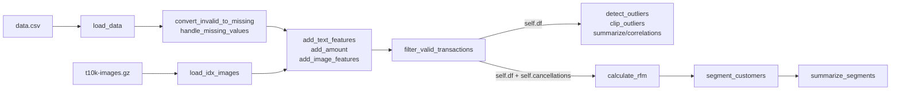

# A1-1 코드 해설

직접 작성한 `src/pipeline.py`, `scripts/download_images.py`, `notebooks/analysis_report.ipynb`의 코드 셀을 해설한다. 개념 설명은 [basic_knowledge.md](basic_knowledge.md)에 있고, 여기서는 '어느 줄이 무엇을 하고 데이터가 어떻게 바뀌는가'에 집중한다.

## 1. 전체 구조

| 파일 | 역할 | 실행 방식 |
| --- | --- | --- |
| `scripts/download_images.py` | Fashion-MNIST 이미지 파일 다운로드 | 처음 한 번 `python scripts/download_images.py` |
| `src/pipeline.py` | `DataAnalyzer` 클래스와 도우미 함수 2개. 계산만 하고 그림은 그리지 않음 | 직접 실행하지 않고 노트북이 import |
| `notebooks/analysis_report.ipynb` | 클래스를 순서대로 호출하고 표·그림·해석을 보여 줌 | 위에서부터 끝까지 실행 |

### 사용한 모듈/라이브러리

| 모듈 | 사용 위치 | 용도 |
| --- | --- | --- |
| `gzip` (표준) | `pipeline.py` | `.gz` 압축 이미지 파일 열기 |
| `pathlib.Path` (표준) | 세 파일 모두 | 운영체제와 무관한 경로 다루기 |
| `urllib.request` (표준) | `download_images.py` | 파일 다운로드 |
| `sys` (표준) | 스크립트·노트북 | 종료 코드, 모듈 검색 경로 추가 |
| `numpy` | `pipeline.py`, 노트북 | 바이트 → 배열, axis 통계, 난수, 조건 선택 |
| `pandas` | `pipeline.py`, 노트북 | CSV 로드, 결측·그룹·집계·상관 |
| `matplotlib.pyplot`, `font_manager` | 노트북 | 그림 칸 만들기, 한글 글꼴 선택, PNG 저장 |
| `seaborn` | 노트북 | 히스토그램·박스플롯·막대·히트맵·산점도 |

## 2. 주요 함수·메서드의 입력과 결과

'self.df 변경' 열이 '예'인 메서드는 같은 셀을 두 번 실행하면 이미 바뀐 데이터에 다시 적용된다.

| 이름 | 입력 | 반환 | self.df 변경 |
| --- | --- | --- | --- |
| `calculate_iqr_bounds(values, multiplier)` | 수치 Series, 배수 | `(lower, upper)` | 해당 없음 |
| `load_idx_images(path)` | `.gz` 경로 | `(N, 28, 28)` uint8 배열 | 해당 없음 |
| `load_data()` | (생성 때 받은 경로) | 541,909×8 표 | 예: 새로 만듦 |
| `summarize_missing()` | 없음 | 컬럼별 결측 표 | 아니오 |
| `convert_invalid_to_missing(column, min_valid)` | 컬럼, 기준값 | 바꾼 행 수 | 예: 값 → NaN |
| `handle_missing_values(strategy, group_col, columns, fallback_value)` | 전략 등 | `{컬럼: 처리 건수}` | 예: 결측 채움(또는 행 삭제) |
| `add_text_features(text_col)` | 텍스트 컬럼 | 없음 | 예: 컬럼 2개 추가 |
| `add_amount()` | 없음 | 없음 | 예: `Amount` 추가 |
| `add_image_features(images, product_col, seed)` | 이미지 배열 | 상품별 피처 표 (4,070행) | 예: 컬럼 3개 추가 |
| `filter_valid_transactions()` | 없음 | 제외 사유 사전 | 예: 396,370행으로 줄임, `self.cancellations` 저장 |
| `detect_outliers(column, threshold)` | 컬럼, 배수 | `(이상치 행, lower, upper)` | 아니오 |
| `clip_outliers(columns, threshold)` | 컬럼 목록, 배수 | 자른 사본 | 아니오 |
| `summarize_numeric(columns, data)` | 컬럼 목록, 표(선택) | 통계 표 | 아니오 |
| `calculate_correlations(columns, data, method)` | 컬럼 목록 등 | 상관행렬 | 아니오 |
| `calculate_monthly_revenue()` | 없음 | 월별 매출·주문 수 | 아니오 |
| `calculate_rfm(..., reference_date, cancellations, n_bins)` | 기준일, 취소 기록 등 | 고객 RFM 표 | 아니오 (`self.rfm` 저장) |
| `segment_customers()` | 없음 | `Segment` 붙은 RFM | 아니오 (`self.rfm` 수정) |
| `summarize_segments()` | 없음 | 세그먼트 요약 표 | 아니오 |

출력(`print`)은 노트북에서만 하고, `pipeline.py`의 메서드는 모두 값을 반환한다. 그래서 같은 메서드를 화면 없이 다른 스크립트에서도 쓸 수 있다.

## 3. 작은 입력으로 따라가 보기

설명용 예시 데이터다(실제 실행 결과 아님). 고객 2명, 주문 줄 5개.

| InvoiceNo | StockCode | Quantity | InvoiceDate | UnitPrice | CustomerID |
| --- | --- | --- | --- | --- | --- |
| 1001 | 22139 | 10 | 2011-12-01 | 2.0 | A |
| 1001 | 22140 | 2 | 2011-12-01 | 0.0 | A |
| C1002 | 22139 | -10 | 2011-12-02 | 2.0 | A |
| 1003 | 22139 | 5 | 2011-11-01 | 3.0 | B |
| 1004 | POST | 1 | 2011-11-01 | 18.0 | B |

1. `convert_invalid_to_missing("UnitPrice", 0.001)` → 2행의 단가 0.0이 NaN이 된다.
2. `handle_missing_values("group_median", "StockCode", ["UnitPrice"])` → 22140 그룹에는 다른 단가가 없어 그룹 중앙값도 NaN이다. `_fill_remaining`이 전체 중앙값(2.0, 3.0, 18.0, 2.0의 중앙값 = 2.5)으로 채운다.
3. `add_amount()` → Amount = [20.0, 5.0, -20.0, 15.0, 18.0].
4. `filter_valid_transactions()` → C1002는 취소라 `self.cancellations`로, POST는 상품코드가 아니라 제외. `self.df`에는 1·2·4행이 남는다.
5. `calculate_rfm(cancellations=...)` (기준일 = 남은 행의 최대 2011-12-01)

| 고객 | last_purchase | Frequency | 구매 합계 | 취소 합계 | Monetary | Recency |
| --- | --- | --- | --- | --- | --- | --- |
| A | 2011-12-01 | 1 (주문 1001 하나) | 25.0 | -20.0 | 5.0 | 0 |
| B | 2011-11-01 | 1 | 15.0 | 0 | 15.0 | 30 |

A는 주문 줄이 2개지만 주문번호가 하나라 Frequency 1이다. 취소를 빼지 않았다면 A의 Monetary는 25.0으로 B보다 컸을 것이다.

**확인 질문 (C1)** — 위 예시에서 `filter_valid_transactions()`를 `add_amount()`보다 먼저 실행하면 RFM 계산 때 무슨 문제가 생기는가?

## 4. 줄별 해설: `src/pipeline.py`

import 줄, 빈 줄, 주석만 있는 줄, 독스트링, 괄호만 있는 줄은 제외했다. 번호는 실제 파일의 줄 번호다.

### 상수와 도우미 함수 (18~79줄)

이름 붙은 상수로 '왜 그 값인지'를 드러냈다. `calculate_iqr_bounds`는 IQR 수식을 그대로 옮긴 순수 함수이고, `load_idx_images`는 바이트를 배열로 해석한다.

**확인 질문 (C2)** — 73줄에서 `dtype=">i4"` 대신 `dtype=np.int32`(시스템 기본, 보통 리틀엔디언)를 쓰면 `image_count`는 어떻게 될까?

### 결측 처리 (126~213줄)

`handle_missing_values`는 전략 이름에 따라 `_group_statistic`이 그룹 통계 Series를 만들고, `fillna`가 결측 칸에만 넣는다. 그룹 전체가 비어 남은 칸은 `_fill_remaining`이 처리한다.

**확인 질문 (C3)** — 192줄에서 `transform` 대신 `grouped.mean()`(=`agg`)을 쓰면 179줄 `fillna`가 의도대로 동작하지 않는 이유는?

### 피처와 거래 필터 (218~313줄)

이미지 피처는 '상품 단위로 한 번 계산 → 거래 행에 merge' 순서다. 거래 행 39만 개마다 이미지를 계산하지 않고 상품 4,070개만 계산하므로 빠르다. 필터는 네 조건에 이름을 붙여 `&`로 조합한다.

**확인 질문 (C4)** — 268줄의 `how="left"`를 `how="inner"`로 바꾸면 행 수가 달라지는가?

### 이상치·통계·RFM (318~493줄)

`detect_outliers`와 `clip_outliers`는 `self.df`를 바꾸지 않는다. `calculate_rfm`은 고객 단위로 접은 뒤 취소를 빼고, 분위수 점수를 매긴다. `segment_customers`는 조건 리스트의 순서가 곧 우선순위다.

**확인 질문 (C5)** — 472·473줄에서 `is_loyal`을 `is_vip`보다 앞에 두면 VIP 고객 수는 몇 명이 될까?

| 원본 줄 | 해당 코드 | 쉬운 설명 |
| --- | --- | --- |
| 18 | `CSV_ENCODING = "ISO-8859-1"          # 원본 CSV는 UTF-8이 아니라 Latin-1` | 원본 CSV의 문자 인코딩. UTF-8로 읽으면 '£' 같은 문자에서 오류가 나서 Latin-1(ISO-8859-1)로 지정한다. |
| 19 | `DATE_FORMAT = "%m/%d/%Y %H:%M"       # 예: 12/1/2010 8:26` | 주문일 문자열의 형식. `%m`=월, `%d`=일, `%Y`=4자리 연도, `%H:%M`=시:분. 형식을 알려 주면 날짜 해석이 빠르고 월·일을 헷갈리지 않는다. |
| 20 | `CANCEL_PREFIX = "C"                  # 취소 주문은 InvoiceNo가 C로 시작` | 취소 주문을 구분하는 주문번호 접두어 `C`. |
| 21 | `PRODUCT_CODE_PATTERN = r"^\d{5}"     # 실제 상품은 숫자 5자리로 시작` | 정규표현식. `^`는 문자열 시작, `\d{5}`는 숫자 5개. '숫자 5자리로 시작하는 코드'만 실제 상품으로 본다. |
| 25 | `IDX_HEADER_BYTES = 16                # 매직넘버·개수·행·열 = 4바이트 x 4` | IDX 파일 헤더 길이. 4바이트 정수 4개(매직넘버·개수·행·열) = 16바이트. |
| 26 | `IDX_IMAGE_MAGIC = 2051               # 이미지 파일임을 뜻하는 매직넘버` | IDX 이미지 파일임을 나타내는 약속된 번호 2051. 다른 파일을 잘못 넣었는지 확인하는 데 쓴다. |
| 29 | `DEFAULT_IQR_MULTIPLIER = 1.5` | IQR 배수의 기본값 1.5. |
| 30 | `DEFAULT_RANDOM_SEED = 42` | 무작위 배정을 매번 같게 만드는 시드 42. |
| 31 | `DEFAULT_SCORE_BINS = 5               # RFM 점수를 1~5점으로 매긴다` | RFM 점수 구간 수. 5면 1~5점. |
| 32 | `MIN_NET_MONETARY = 0.01              # 1펜스 미만 순구매액은 0으로 본다` | 순구매액이 이 값(1펜스) 미만이면 '산 것이 없는 고객'으로 본다. 구매−취소 계산에서 생기는 아주 작은 소수 오차를 걸러낸다. |
| 36 | `def calculate_iqr_bounds(values, multiplier=DEFAULT_IQR_MULTIPLIER):` | IQR 경계를 계산하는 함수 정의. 클래스 밖에 둔 이유는 DataFrame 상태 없이 Series 하나만 있으면 되는 순수 계산이기 때문이다. |
| 51 | `q1 = values.quantile(0.25)` | 25% 위치의 값 Q1. |
| 52 | `q3 = values.quantile(0.75)` | 75% 위치의 값 Q3. |
| 53 | `iqr = q3 - q1` | IQR = Q3 − Q1. 가운데 50% 값이 퍼진 폭. |
| 54 | `lower = q1 - multiplier * iqr` | 하한 = Q1 − 배수×IQR. |
| 55 | `upper = q3 + multiplier * iqr` | 상한 = Q3 + 배수×IQR. |
| 56 | `return lower, upper` | 하한과 상한을 튜플로 반환한다. 호출하는 쪽에서 `lower, upper = ...`로 나눠 받는다. |
| 59 | `def load_idx_images(path):` | gzip으로 압축된 IDX 이미지 파일을 배열로 읽는 함수 정의. |
| 69 | `with gzip.open(path, "rb") as file:` | `gzip.open`으로 압축을 풀면서 파일을 연다. `"rb"`는 바이너리 읽기 모드. `with` 블록이 끝나면 파일이 자동으로 닫힌다. |
| 70 | `raw_bytes = file.read()` | 파일 전체를 바이트 묶음(bytes)으로 읽는다. 약 7.8MB. |
| 73 | `header = np.frombuffer(raw_bytes[:IDX_HEADER_BYTES], dtype=">i4")` | 앞 16바이트를 빅엔디언(`>`) 4바이트 정수(`i4`) 배열로 해석한다. IDX는 큰 자리 바이트가 먼저 오는 형식이라 `>`가 필요하다. |
| 74 | `magic, image_count, rows, cols = header` | 정수 4개를 네 변수에 나눠 담는다(언패킹). Fashion-MNIST 테스트 파일이면 2051, 10000, 28, 28. |
| 75 | `if magic != IDX_IMAGE_MAGIC:` | 매직넘버가 이미지 파일의 값과 다른지 확인한다. |
| 76 | `raise ValueError(f"IDX 이미지 파일이 아닙니다: magic={magic}")` | 다르면 원인을 담은 오류를 내고 멈춘다. 라벨 파일 등을 잘못 넣은 경우를 잡는다. |
| 78 | `pixels = np.frombuffer(raw_bytes[IDX_HEADER_BYTES:], dtype=np.uint8)` | 나머지 바이트를 0~255 부호 없는 1바이트 정수(`uint8`) 배열로 바꾼다. 결과는 길이 7,840,000의 1차원 배열. |
| 79 | `return pixels.reshape(image_count, rows, cols)` | 1차원 배열을 shape `(10000, 28, 28)`로 접어서 반환한다. 데이터 복사 없이 보는 모양만 바꾼다. |
| 82 | `class DataAnalyzer:` | 분석 파이프라인 클래스 정의. |
| 92 | `def __init__(self, data_path):` | 객체를 만들 때 실행되는 초기화 메서드. 데이터 경로만 받는다. |
| 93 | `self.data_path = Path(data_path)` | 경로 문자열을 `Path` 객체로 바꿔 저장한다. 운영체제마다 다른 경로 구분자(`/`, `\`)를 알아서 처리한다. |
| 94 | `self.df = None      # 거래 단위 데이터 (한 행 = 주문 상품 한 줄)` | 거래 데이터를 담을 자리. 아직 읽지 않았으므로 `None`. |
| 95 | `self.cancellations = None   # 고객 취소 주문 행 (Amount가 음수)` | 고객 취소 기록을 담을 자리. `filter_valid_transactions()`가 채운다. |
| 96 | `self.rfm = None     # 고객 단위 RFM 결과 (한 행 = 고객 한 명)` | 고객 단위 RFM 결과를 담을 자리. `calculate_rfm()`이 채운다. |
| 97 | `self.rfm_excluded = None    # 순구매액 0 이하로 RFM에서 뺀 고객` | 순구매액이 없어 RFM에서 뺀 고객을 담을 자리. |
| 102 | `def load_data(self):` | CSV를 읽는 메서드 정의. |
| 108 | `df = pd.read_csv(` | `pd.read_csv` 호출 시작. 결과를 지역 변수 `df`에 받는다. |
| 109 | `self.data_path,` | 읽을 파일 경로. |
| 110 | `encoding=CSV_ENCODING,` | 문자 인코딩 지정(Latin-1). |
| 112 | `dtype={"InvoiceNo": str, "StockCode": str},` | `dtype`으로 주문번호와 상품코드를 문자열로 읽게 한다. 지정하지 않으면 '536365'는 숫자, 'C536379'는 문자열이 섞여 한 컬럼에 두 타입이 생긴다. |
| 114 | `df["InvoiceDate"] = pd.to_datetime(` | 주문일 컬럼을 날짜형으로 바꾼 결과를 같은 컬럼에 다시 넣는다. |
| 115 | `df["InvoiceDate"], format=DATE_FORMAT` | 변환할 컬럼과 날짜 형식을 넘긴다. |
| 119 | `df["CustomerID"] = df["CustomerID"].astype("Int64").astype("string")` | CustomerID는 결측 때문에 `17850.0` 같은 실수로 읽힌다. 결측을 허용하는 정수형 `Int64`(대문자 I)로 소수점을 없앤 뒤 문자열 `string`으로 바꾼다. 결측은 `<NA>`로 유지된다. |
| 120 | `self.df = df` | 완성한 표를 객체 상태 `self.df`에 저장한다. |
| 121 | `return self.df` | 같은 표를 반환해 노트북에서 바로 `head()` 등을 볼 수 있게 한다. |
| 126 | `def summarize_missing(self):` | 결측 현황 표를 만드는 메서드 정의. `self.df`를 바꾸지 않는다. |
| 128 | `missing_count = self.df.isna().sum()` | `isna()`는 칸마다 결측이면 True인 표를 만들고, `sum()`은 True를 1로 세어 컬럼별 결측 개수를 낸다. |
| 129 | `missing_ratio = missing_count / len(self.df) * 100` | 결측 개수 ÷ 전체 행 수 × 100 = 결측 비율(%). |
| 130 | `return pd.DataFrame(` | 두 Series를 컬럼으로 하는 새 표를 반환한다. |
| 131 | `{"missing_count": missing_count,` | 컬럼 `missing_count`에 결측 개수를 넣는다. |
| 132 | `"missing_ratio_pct": missing_ratio.round(2)}` | 컬럼 `missing_ratio_pct`에 소수 둘째 자리로 반올림한 비율을 넣는다. |
| 135 | `def convert_invalid_to_missing(self, column, min_valid):` | 틀린 값을 결측으로 바꾸는 메서드 정의. `self.df`를 직접 수정한다. |
| 144 | `is_invalid = self.df[column] < min_valid` | 값이 기준보다 작은 행이면 True인 조건(불리언 Series). 결측(NaN)은 비교 결과가 False라 그대로 남는다. |
| 145 | `self.df.loc[is_invalid, column] = np.nan` | `loc[행 조건, 컬럼]`으로 조건이 True인 칸에만 `np.nan`을 넣는다. |
| 146 | `return int(is_invalid.sum())` | 바꾼 행 수를 정수로 반환한다. `sum()` 결과는 NumPy 정수라 `int()`로 보기 좋게 바꾼다. |
| 148 | `def handle_missing_values(self, strategy="group_median",` | 결측 대치 메서드 정의 시작. 기본 전략은 상품코드별 중앙값. |
| 149 | `group_col="StockCode", columns=None,` | 그룹 기준 컬럼과 처리할 컬럼 목록 인자. |
| 150 | `fallback_value=None):` | 그룹 통계로도 못 채운 칸에 쓸 대체값 인자. |
| 166 | `if columns is None:` | 처리할 컬럼을 주지 않았는지 확인한다. |
| 167 | `raise ValueError("처리할 columns 를 지정하세요.")` | 주지 않았으면 무엇을 해야 하는지 알려 주는 오류를 낸다. |
| 169 | `report = {}` | 컬럼별 처리 건수를 담을 빈 사전. |
| 170 | `if strategy == "drop":` | 삭제 전략인지 확인한다. |
| 171 | `before = len(self.df)` | 삭제 전 행 수를 기억한다. |
| 172 | `self.df = self.df.dropna(subset=columns).reset_index(drop=True)` | 지정 컬럼에 결측이 있는 행을 지우고 행 번호를 0부터 다시 매긴다. 새 표를 `self.df`에 다시 넣는다. |
| 173 | `report["dropped_rows"] = before - len(self.df)` | 지운 행 수 = 전 − 후. |
| 174 | `return report` | 삭제 전략은 여기서 끝낸다(조기 반환). |
| 176 | `for column in columns:` | 처리할 컬럼마다 반복한다. |
| 177 | `missing_before = int(self.df[column].isna().sum())` | 채우기 전 결측 개수를 기억한다. |
| 178 | `group_values = self._group_statistic(strategy, group_col, column)` | 행마다 '자기 그룹의 통계값'을 담은 Series를 받는다. |
| 179 | `self.df[column] = self.df[column].fillna(group_values)` | 결측 칸만 그 행의 그룹 통계값으로 채운다. 값이 있는 칸은 그대로다. |
| 180 | `self._fill_remaining(column, fallback_value)` | 그룹 전체가 결측이라 남은 칸을 대체값으로 채운다. |
| 181 | `report[column] = missing_before - int(self.df[column].isna().sum())` | 채운 건수 = 전 결측 − 후 결측. |
| 182 | `return report` | 컬럼별 처리 건수 사전을 반환한다. |
| 184 | `def _group_statistic(self, strategy, group_col, column):` | 전략 이름에 맞는 그룹 통계를 계산하는 내부 메서드 정의. 이름 앞 `_`는 '클래스 안에서만 쓰는 도우미'라는 관례 표시다. |
| 190 | `grouped = self.df.groupby(group_col)[column]` | 그룹 기준으로 묶은 뒤 대상 컬럼만 고른 GroupBy 객체. |
| 191 | `if strategy == "group_mean":` | 평균 전략인지 확인한다. |
| 192 | `return grouped.transform("mean")` | `transform("mean")`은 그룹 평균을 원래 행 개수만큼 펼쳐 반환한다. `agg`와 달리 행 수가 줄지 않아 `fillna`에 바로 쓸 수 있다. |
| 193 | `if strategy == "group_median":` | 중앙값 전략인지 확인한다. |
| 194 | `return grouped.transform("median")` | 그룹 중앙값을 행마다 펼쳐 반환한다. |
| 195 | `if strategy == "group_mode":` | 최빈값 전략인지 확인한다. |
| 196 | `return grouped.transform(self._first_mode)` | Pandas에 '최빈값' 내장 집계 이름이 없어 직접 만든 함수 `_first_mode`를 그룹마다 적용한다. |
| 197 | `raise ValueError(f"지원하지 않는 strategy: {strategy}")` | 세 전략이 아니면 오류를 낸다. |
| 199 | `@staticmethod` | 정적 메서드 데코레이터. 아래 메서드는 `self`를 받지 않는다. |
| 200 | `def _first_mode(values):` | 그룹 하나의 최빈값을 구하는 함수 정의. |
| 202 | `modes = values.mode()` | `mode()`는 가장 많이 나온 값들을 Series로 반환한다. 동률이면 여러 개다. 결측은 세지 않는다. |
| 203 | `if modes.empty:` | 모든 값이 결측이라 최빈값이 없는지 확인한다. |
| 204 | `return np.nan` | 없으면 NaN을 반환해 결측으로 남긴다. |
| 205 | `return modes.iloc[0]` | 동률이면 첫 번째(정렬상 가장 앞) 값을 고른다. |
| 207 | `def _fill_remaining(self, column, fallback_value):` | 남은 결측을 채우는 내부 메서드 정의. |
| 209 | `if fallback_value is not None:` | 대체값을 줬는지 확인한다. |
| 210 | `self.df[column] = self.df[column].fillna(fallback_value)` | 줬으면 남은 결측을 그 값으로 채운다(예: `UNKNOWN`). |
| 211 | `return` | 대체값을 썼으면 끝낸다. |
| 212 | `if pd.api.types.is_numeric_dtype(self.df[column]):` | 대체값이 없을 때, 컬럼이 숫자형인지 확인한다. |
| 213 | `self.df[column] = self.df[column].fillna(self.df[column].median())` | 숫자형이면 컬럼 전체 중앙값으로 채운다. 문자형은 그대로 둔다. |
| 218 | `def add_text_features(self, text_col="Description"):` | 텍스트 피처를 추가하는 메서드 정의. `self.df`에 컬럼 2개를 추가한다. |
| 220 | `cleaned_text = self.df[text_col].fillna("").str.strip()` | 결측을 빈 문자열로 바꾸고 앞뒤 공백을 지운 사본을 만든다. 'HEART. ' 같은 끝 공백이 글자 수를 늘리지 않게 한다. |
| 222 | `self.df["desc_word_count"] = cleaned_text.str.split().str.len()` | `str.split()`은 공백 기준으로 단어 리스트를 만들고, `str.len()`은 그 리스트 길이를 센다 → 단어 수. |
| 223 | `self.df["desc_length"] = cleaned_text.str.len()` | 문자열 자체에 `str.len()`을 쓰면 글자 수. |
| 225 | `def add_amount(self, quantity_col="Quantity", price_col="UnitPrice"):` | 금액 컬럼을 추가하는 메서드 정의. |
| 227 | `self.df["Amount"] = self.df[quantity_col] * self.df[price_col]` | 같은 행끼리 곱한다(벡터 연산). 54만 행을 반복문 없이 한 번에 계산한다. |
| 229 | `def add_image_features(self, images, product_col="StockCode",` | 이미지 피처 메서드 정의 시작. |
| 230 | `seed=DEFAULT_RANDOM_SEED):` | 시드 인자. 기본 42. |
| 251 | `product_codes = self.df[product_col].unique()` | 고유 상품코드 배열(4,070개). 등장 순서대로다. |
| 252 | `if len(product_codes) > len(images):` | 이미지가 상품 수보다 적은지 확인한다. |
| 253 | `raise ValueError("이미지 수가 상품 수보다 적습니다.")` | 적으면 겹치지 않게 배정할 수 없으므로 오류를 낸다. |
| 255 | `rng = np.random.default_rng(seed)` | 시드로 고정한 난수 생성기. 같은 시드면 항상 같은 순서의 난수가 나온다. |
| 257 | `chosen = rng.choice(len(images), size=len(product_codes),` | 0~9,999 중에서 상품 수만큼 이미지 번호를 뽑는다. |
| 258 | `replace=False)` | `replace=False`로 같은 번호를 두 번 뽑지 않는다. |
| 259 | `chosen_images = images[chosen].astype(np.float64)` | 뽑은 번호의 이미지만 한 번에 꺼내(팬시 인덱싱) shape `(4070, 28, 28)` 배열을 만들고, 실수형으로 바꿔 평균 계산 정밀도를 높인다. |
| 261 | `image_features = pd.DataFrame({` | 상품별 이미지 피처 표 생성 시작. |
| 262 | `product_col: product_codes,` | 첫 컬럼: 상품코드. |
| 263 | `"image_index": chosen,` | 연결한 이미지 번호. 나중에 어떤 이미지인지 다시 볼 수 있게 남긴다. |
| 264 | `"image_mean": chosen_images.mean(axis=(1, 2)),` | `axis=(1, 2)`로 세로·가로 축을 함께 평균 → shape `(4070,)`. 이미지마다 밝기 하나. |
| 265 | `"image_std": chosen_images.std(axis=(1, 2)),` | 같은 방식의 표준편차 → 이미지마다 명암 대비 하나. |
| 268 | `self.df = self.df.merge(image_features, on=product_col, how="left")` | 상품코드를 키로 거래 표에 피처를 붙인다. `how="left"`는 거래 행을 모두 유지한다. `merge`는 새 표를 만들므로 `self.df`에 다시 넣는다. |
| 269 | `return image_features` | 상품별 피처 표를 반환한다(노트북에서 이미지 확인용). |
| 274 | `def filter_valid_transactions(self, customer_col="CustomerID",` | 분석 대상 거래를 고르는 메서드 정의 시작. |
| 275 | `invoice_col="InvoiceNo",` | 주문번호 컬럼 인자. |
| 276 | `product_col="StockCode",` | 상품코드 컬럼 인자. |
| 277 | `quantity_col="Quantity"):` | 수량 컬럼 인자. |
| 289 | `has_customer = self.df[customer_col].notna()` | 고객 ID가 있는 행이면 True. |
| 290 | `is_cancelled = self.df[invoice_col].str.startswith(CANCEL_PREFIX)` | 주문번호가 `C`로 시작하면 True(취소). |
| 291 | `is_positive_qty = self.df[quantity_col] > 0` | 수량이 0보다 크면 True. |
| 292 | `is_product = self.df[product_col].str.match(PRODUCT_CODE_PATTERN)` | 상품코드가 숫자 5자리로 시작하면 True(실제 상품). |
| 294 | `report = {` | 제외 사유별 건수 사전 시작. |
| 295 | `"no_customer": int((~has_customer).sum()),` | `~`는 True/False 뒤집기. 고객 ID 없는 행 수. |
| 296 | `"cancelled": int((has_customer & is_cancelled).sum()),` | 고객 ID는 있는데 취소인 행 수. `&`는 두 조건이 모두 True인 행. |
| 297 | `"non_positive_qty": int(` | 앞 두 조건을 통과했는데 수량이 0 이하인 행 수. |
| 298 | `(has_customer & ~is_cancelled & ~is_positive_qty).sum()),` | 조건식 본문. 앞에서 이미 센 행은 다시 세지 않도록 앞 조건들을 함께 건다. |
| 299 | `"non_product_code": int(` | 앞 세 조건을 통과했는데 상품코드가 아닌 행 수. |
| 300 | `(has_customer & ~is_cancelled & is_positive_qty` | 조건식 앞부분(고객 있음, 취소 아님, 수량 양수). |
| 301 | `& ~is_product).sum()),` | 조건식 뒷부분(상품 아님)과 합계. |
| 305 | `is_customer_cancel = has_customer & is_cancelled & is_product` | 고객이 있는 상품 취소 행이면 True. RFM의 Monetary에서 뺄 기록이다. |
| 306 | `self.cancellations = self.df[is_customer_cancel].reset_index(` | 그 행들만 골라 `self.cancellations`에 따로 저장한다. |
| 307 | `drop=True)` | 행 번호를 0부터 다시 매긴다. |
| 308 | `report["kept_cancellations"] = len(self.cancellations)` | 보관한 취소 행 수를 기록한다. |
| 310 | `is_valid = has_customer & ~is_cancelled & is_positive_qty & is_product` | 네 조건을 모두 만족하는 정상 구매 행이면 True. |
| 311 | `self.df = self.df[is_valid].reset_index(drop=True)` | 정상 구매만 남겨 `self.df`를 교체한다. 이 줄 이후 `self.df`는 396,370행이다. |
| 312 | `report["remaining_rows"] = len(self.df)` | 남은 행 수를 기록한다. |
| 313 | `return report` | 사유별 건수 사전을 반환한다. |
| 318 | `def detect_outliers(self, column, threshold=DEFAULT_IQR_MULTIPLIER):` | IQR 이상치를 찾는 메서드 정의. `self.df`를 바꾸지 않는다. |
| 324 | `lower, upper = calculate_iqr_bounds(self.df[column], threshold)` | 모듈 함수로 경계를 계산한다. |
| 325 | `is_outlier = (self.df[column] < lower) \| (self.df[column] > upper)` | 경계 밖이면 True. `|`는 둘 중 하나라도 True면 True. |
| 326 | `return self.df[is_outlier], lower, upper` | 이상치 행만 고른 표와 두 경계를 함께 반환한다. |
| 328 | `def clip_outliers(self, columns, threshold=DEFAULT_IQR_MULTIPLIER):` | 경계값으로 자른 사본을 만드는 메서드 정의. |
| 334 | `clipped = self.df.copy()` | `self.df`의 깊은 사본을 만든다. 이후 수정이 원본에 영향을 주지 않는다. |
| 335 | `for column in columns:` | 자를 컬럼마다 반복한다. |
| 336 | `lower, upper = calculate_iqr_bounds(clipped[column], threshold)` | 사본 기준으로 경계를 계산한다. |
| 337 | `clipped[column] = clipped[column].clip(lower=lower, upper=upper)` | `clip`으로 하한보다 작으면 하한, 상한보다 크면 상한으로 바꾼다. |
| 338 | `return clipped` | 자른 사본을 반환한다. |
| 343 | `def summarize_numeric(self, columns, data=None):` | 기술 통계 표를 만드는 메서드 정의. |
| 350 | `if data is None:` | 요약할 표를 따로 주지 않았는지 확인한다. |
| 351 | `data = self.df` | 주지 않았으면 `self.df`를 쓴다. 이 구조 덕분에 원본과 클리핑 사본을 같은 메서드로 요약할 수 있다. |
| 352 | `target = data[columns]` | 필요한 컬럼만 고른다. |
| 353 | `return pd.DataFrame({` | 통계별 Series를 컬럼으로 하는 표 생성 시작. |
| 354 | `"mean": target.mean(),` | 컬럼별 평균. |
| 355 | `"median": target.median(),` | 컬럼별 중앙값. |
| 356 | `"std": target.std(),` | 컬럼별 표준편차(표본 표준편차, n−1로 나눔). |
| 357 | `"q1": target.quantile(0.25),` | 컬럼별 Q1. |
| 358 | `"q3": target.quantile(0.75),` | 컬럼별 Q3. |
| 361 | `def calculate_correlations(self, columns, data=None, method="pearson"):` | 상관행렬 메서드 정의. 방식 기본값은 Pearson. |
| 366 | `if data is None:` | 표를 따로 주지 않았는지 확인한다. |
| 367 | `data = self.df` | 주지 않았으면 `self.df`를 쓴다. |
| 368 | `return data[columns].corr(method=method)` | 고른 컬럼끼리 모든 쌍의 상관계수를 계산한 정사각 행렬을 반환한다. |
| 370 | `def calculate_monthly_revenue(self, date_col="InvoiceDate",` | 월별 매출 메서드 정의 시작. |
| 371 | `amount_col="Amount"):` | 금액 컬럼 인자. |
| 373 | `month = self.df[date_col].dt.to_period("M")` | 날짜를 '월' 단위 기간(Period)으로 바꾼다. 2011-03-15 → 2011-03. |
| 374 | `monthly = self.df.groupby(month).agg(` | 월별로 묶어 여러 집계를 한 번에 한다. |
| 375 | `revenue=(amount_col, "sum"),` | `revenue` = 금액 합계. |
| 376 | `orders=("InvoiceNo", "nunique"),` | `orders` = 고유 주문번호 수. |
| 378 | `monthly.index = monthly.index.to_timestamp()` | Period 인덱스를 각 월 1일 날짜(Timestamp)로 바꿔 Matplotlib이 시간 축으로 그릴 수 있게 한다. |
| 379 | `return monthly` | 월별 표를 반환한다. |
| 384 | `def calculate_rfm(self, customer_col="CustomerID",` | RFM 메서드 정의 시작. |
| 385 | `date_col="InvoiceDate", amount_col="Amount",` | 날짜·금액 컬럼 인자. |
| 386 | `invoice_col="InvoiceNo", reference_date=None,` | 주문번호 컬럼과 기준일 인자. |
| 387 | `cancellations=None, n_bins=DEFAULT_SCORE_BINS):` | 취소 기록과 점수 구간 수 인자. |
| 406 | `if reference_date is None:` | 기준일을 주지 않았는지 확인한다. |
| 407 | `reference_date = self.df[date_col].max()` | 주지 않았으면 데이터의 최종 거래일을 기준일로 쓴다. |
| 409 | `rfm = self.df.groupby(customer_col).agg(` | 고객별로 묶어 집계 시작. 결과는 고객 ID가 인덱스인 표. |
| 410 | `last_purchase=(date_col, "max"),` | 마지막 구매 일시 = 주문일 최댓값. |
| 411 | `Frequency=(invoice_col, "nunique"),` | Frequency = 고유 주문번호 수. 상품 줄 수가 아니다. |
| 412 | `Monetary=(amount_col, "sum"),` | Monetary = 금액 합계(취소 차감 전). |
| 414 | `rfm["Recency"] = (reference_date - rfm["last_purchase"]).dt.days` | 기준일 − 마지막 구매일은 기간(Timedelta)이고, `.dt.days`로 일수 정수를 꺼낸다. |
| 416 | `if cancellations is not None:` | 취소 기록을 받았는지 확인한다. |
| 417 | `cancelled_amount = cancellations.groupby(customer_col)[` | 고객별 취소 금액 합계를 구한다. 취소 행의 Amount는 음수다. |
| 418 | `amount_col].sum()` | (위 줄에 이어지는 컬럼 선택과 합계) |
| 421 | `rfm["Monetary"] = rfm["Monetary"].add(` | `add(..., fill_value=0)`로 구매 합계에 취소 합계를 더한다. 한쪽에만 있는 고객은 없는 쪽을 0으로 본다. |
| 422 | `cancelled_amount, fill_value=0).loc[rfm.index]` | 더한 결과에는 '취소만 있는 고객'도 생기므로 `.loc[rfm.index]`로 구매가 있는 고객만 남긴다. |
| 424 | `has_net_purchase = rfm["Monetary"] >= MIN_NET_MONETARY` | 순구매액이 1펜스 이상인 고객이면 True. |
| 425 | `self.rfm_excluded = rfm[~has_net_purchase]` | 그렇지 않은 고객을 따로 기록한다. |
| 426 | `rfm = rfm[has_net_purchase].copy()` | 남길 고객만 사본으로 고른다. `.copy()`로 이후 컬럼 추가 시 경고를 막는다. |
| 428 | `rfm["R_score"] = self._quantile_score(rfm["Recency"], n_bins,` | Recency 점수. 작을수록 좋으므로 `higher_is_better=False`. |
| 429 | `higher_is_better=False)` | (인자 이어짐) |
| 430 | `rfm["F_score"] = self._quantile_score(rfm["Frequency"], n_bins)` | Frequency 점수. 클수록 높은 점수. |
| 431 | `rfm["M_score"] = self._quantile_score(rfm["Monetary"], n_bins)` | Monetary 점수. 클수록 높은 점수. |
| 432 | `rfm["RFM_score"] = rfm["R_score"] + rfm["F_score"] + rfm["M_score"]` | 세 점수의 합(3~15). 참고용 종합 점수. |
| 434 | `self.rfm = rfm.drop(columns="last_purchase")` | 중간 계산용 `last_purchase` 컬럼을 빼고 `self.rfm`에 저장한다. |
| 435 | `return self.rfm` | RFM 표를 반환한다. |
| 437 | `@staticmethod` | 정적 메서드 데코레이터. |
| 438 | `def _quantile_score(values, n_bins, higher_is_better=True):` | 분위수 점수 함수 정의. |
| 445 | `ranks = values.rank(method="first")` | 값이 같아도 먼저 나온 순서대로 서로 다른 순위를 준다(1, 2, 3…). 경계 중복 오류를 막는다. |
| 446 | `labels = list(range(1, n_bins + 1))` | 점수 레이블 `[1, 2, 3, 4, 5]`. |
| 447 | `if not higher_is_better:` | 작을수록 좋은 지표인지 확인한다. |
| 448 | `labels = labels[::-1]` | 그렇다면 레이블을 `[5, 4, 3, 2, 1]`로 뒤집는다. `[::-1]`은 역순 슬라이싱. |
| 449 | `return pd.qcut(ranks, q=n_bins, labels=labels).astype(int)` | 순위를 같은 인원 5구간으로 나눠 레이블을 붙이고, 범주형 결과를 정수로 바꿔 반환한다. |
| 451 | `def segment_customers(self):` | 세그먼트 규칙 메서드 정의. |
| 462 | `r_score = self.rfm["R_score"]` | R 점수 Series를 짧은 이름으로 꺼낸다. |
| 463 | `f_score = self.rfm["F_score"]` | F 점수. |
| 464 | `m_score = self.rfm["M_score"]` | M 점수. |
| 466 | `is_vip = (r_score >= 4) & (f_score >= 4) & (m_score >= 4)` | VIP 조건: 세 점수 모두 4 이상. |
| 467 | `is_loyal = (r_score >= 3) & (f_score >= 3)` | Loyal 조건: R과 F가 3 이상. |
| 468 | `is_new = (r_score >= 4) & (f_score <= 2)` | New 조건: 최근(R 4 이상)인데 빈도가 낮음(F 2 이하). |
| 469 | `is_at_risk = (r_score <= 2) & (f_score >= 3)` | At Risk 조건: 오래됐는데(R 2 이하) 빈도가 높았음(F 3 이상). |
| 470 | `is_churned = (r_score <= 2) & (f_score <= 2)` | Churned 조건: 오래됐고 빈도도 낮음. |
| 472 | `conditions = [is_vip, is_loyal, is_new, is_at_risk, is_churned]` | 조건을 우선순위 순서대로 리스트에 담는다. |
| 473 | `segment_names = ["VIP", "Loyal", "New", "At Risk", "Churned"]` | 조건과 같은 순서의 이름 리스트. |
| 474 | `self.rfm["Segment"] = np.select(conditions, segment_names,` | `np.select`는 행마다 조건 리스트를 앞에서부터 확인해 처음 True인 조건의 이름을 고른다. |
| 475 | `default="Regular")` | 어느 조건에도 맞지 않으면 `Regular`. |
| 476 | `return self.rfm` | 세그먼트가 붙은 RFM 표를 반환한다. |
| 478 | `def summarize_segments(self):` | 세그먼트 요약 메서드 정의. |
| 480 | `summary = self.rfm.groupby("Segment").agg(` | 세그먼트별로 묶어 집계 시작. |
| 481 | `customers=("Recency", "size"),` | 고객 수 = 그룹 크기(`size`). |
| 482 | `avg_recency_days=("Recency", "mean"),` | 평균 Recency. |
| 483 | `avg_frequency=("Frequency", "mean"),` | 평균 Frequency. |
| 484 | `avg_monetary=("Monetary", "mean"),` | 평균 Monetary. |
| 485 | `total_monetary=("Monetary", "sum"),` | Monetary 합계. |
| 487 | `summary["customer_share_pct"] = (` | 고객 비율(%) 컬럼 계산 시작. |
| 488 | `summary["customers"] / summary["customers"].sum() * 100` | 그룹 고객 수 ÷ 전체 고객 수 × 100. |
| 490 | `summary["revenue_share_pct"] = (` | 매출 비중(%) 컬럼 계산 시작. |
| 491 | `summary["total_monetary"] / summary["total_monetary"].sum() * 100` | 그룹 매출 ÷ 전체 매출 × 100. |
| 493 | `return summary.sort_values("total_monetary", ascending=False).round(2)` | 매출이 큰 세그먼트부터 정렬하고 소수 둘째 자리로 반올림해 반환한다. |

## 5. 줄별 해설: `scripts/download_images.py`

파일이 이미 있으면 건너뛰고, 실패하면 이유와 대안을 출력한 뒤 종료 코드 1로 끝낸다.

| 원본 줄 | 해당 코드 | 쉬운 설명 |
| --- | --- | --- |
| 16 | `IMAGE_URL = (` | 내려받을 파일 주소 시작. 괄호로 감싸 긴 문자열을 두 줄로 나눈다. |
| 17 | `"https://raw.githubusercontent.com/zalandoresearch/fashion-mnist/"` | 주소 앞부분(GitHub 원본 파일 서버). |
| 18 | `"master/data/fashion/t10k-images-idx3-ubyte.gz"` | 주소 뒷부분. 괄호 안의 이웃한 문자열은 자동으로 이어 붙는다. |
| 21 | `SAVE_PATH = (` | 저장 경로 계산 시작. |
| 22 | `Path(__file__).resolve().parent.parent` | `__file__`(이 스크립트 위치)의 절대 경로에서 `parent`를 두 번 올라가 A1-1 폴더를 얻는다. |
| 23 | `/ "data" / "raw" / "t10k-images-idx3-ubyte.gz"` | `/` 연산자로 하위 경로를 이어 붙인다. 실행 위치와 관계없이 항상 `A1-1/data/raw/`에 저장된다. |
| 27 | `def download_file(url: str, save_path: Path) -> None:` | 다운로드 함수 정의. `url: str` 같은 타입 힌트는 인자의 기대 타입을 알려 주는 표시이며 실행을 막지는 않는다. |
| 29 | `if save_path.exists():` | 파일이 이미 있는지 확인한다. |
| 30 | `print(f"이미 있음: {save_path}")` | 있으면 알리고, |
| 31 | `return` | 다시 받지 않고 끝낸다(조기 반환). |
| 33 | `save_path.parent.mkdir(parents=True, exist_ok=True)` | 저장할 폴더가 없으면 상위 폴더까지 만든다. 이미 있어도 오류가 나지 않는다. |
| 34 | `print(f"다운로드 중: {url}")` | 다운로드 시작을 알린다. |
| 35 | `urllib.request.urlretrieve(url, save_path)` | 주소의 파일을 내려받아 경로에 저장한다. |
| 36 | `size_mb = save_path.stat().st_size / 1_000_000` | 파일 크기(바이트)를 MB로 바꾼다. `1_000_000`의 `_`는 읽기 쉽게 쓴 숫자 구분자다. |
| 37 | `print(f"저장 완료: {save_path} ({size_mb:.1f} MB)")` | 저장 위치와 크기를 소수 첫째 자리까지 출력한다. |
| 40 | `if __name__ == "__main__":` | 이 파일을 직접 실행했을 때만 아래 코드를 실행한다. 다른 파일이 import하면 실행되지 않는다. |
| 41 | `try:` | 오류가 날 수 있는 코드를 감싼다. |
| 42 | `download_file(IMAGE_URL, SAVE_PATH)` | 다운로드 함수를 호출한다. |
| 43 | `except OSError as error:` | 네트워크 오류 등 `OSError` 계열 오류를 잡는다. |
| 45 | `print(f"다운로드 실패: {error}")` | 오류 내용을 출력한다. |
| 46 | `print("브라우저로 위 주소의 파일을 받아 data/raw/ 에 넣어도 됩니다.")` | 직접 받는 대안을 안내한다. |
| 47 | `sys.exit(1)` | 종료 코드 1로 끝내 실패했음을 셸에 알린다. |

## 6. 줄별 해설: `notebooks/analysis_report.ipynb`

위치는 `코드 셀 번호-셀 안 줄 번호`다. 마크다운 셀은 세지 않으므로 첫 번째 코드 셀이 1번이다. import 줄과 주석 줄은 제외했다.

| 코드 셀 | 내용 |
| --- | --- |
| 1 | 경로·상수·한글 글꼴·저장 함수 준비 |
| 2~5 | 데이터 로드와 기본 탐색 |
| 6~7 | 결측치 확인과 대치 |
| 8~9 | 텍스트·금액·이미지 피처, 벡터화 검증 |
| 10 | 분석 대상 거래 고르기 |
| 11~13 | IQR 이상치 탐지, 박스플롯 전후 비교 |
| 14~15 | 기술 통계, 히스토그램 |
| 16~18 | 상관 분석, 히트맵, 산점도 |
| 19~20 | 국가별 막대그래프, 월별 라인차트 |
| 21~27 | RFM 계산, 세그먼트 요약·시각화, 인사이트 근거 수치 |

**확인 질문 (C6)** — 셀 10(거래 필터)을 실행한 뒤 셀 7(결측 대치)을 다시 실행하면 '단가 대치' 건수는 얼마로 나올까?

| 셀-줄 | 해당 코드 | 쉬운 설명 |
| --- | --- | --- |
| 1-11 | `PROJECT_ROOT = Path.cwd().parent` | 현재 폴더(`notebooks/`)의 부모, 즉 `A1-1` 폴더를 프로젝트 루트로 잡는다. 노트북을 `notebooks/`에서 실행한다는 전제다. |
| 1-12 | `sys.path.insert(0, str(PROJECT_ROOT / "src"))` | `src` 폴더를 모듈 검색 경로 맨 앞에 넣어 `pipeline.py`를 import할 수 있게 한다. |
| 1-15 | `DATA_PATH = PROJECT_ROOT / "data" / "raw" / "data.csv"` | 주문 CSV 경로. |
| 1-16 | `IMAGE_PATH = PROJECT_ROOT / "data" / "raw" / "t10k-images-idx3-ubyte.gz"` | 이미지 파일 경로. |
| 1-17 | `FIGURE_DIR = PROJECT_ROOT / "outputs" / "figures"` | 그림 저장 폴더 경로. |
| 1-18 | `FIGURE_DIR.mkdir(parents=True, exist_ok=True)` | 그림 폴더가 없으면 만든다. |
| 1-20 | `IQR_MULTIPLIER = 1.5` | IQR 배수. 노트북 전체에서 이 이름으로 쓴다. |
| 1-21 | `RANDOM_SEED = 42` | 시드 42. 이미지 배정과 산점도 표본 추출에 쓴다. |
| 1-22 | `MIN_VALID_PRICE = 0.001   # 단가가 이보다 작으면(0 이하) 잘못된 값으로 본다` | 단가 유효 최솟값. 0 이하 단가를 결측으로 바꾸는 기준. |
| 1-25 | `KOREAN_FONTS = ["Malgun Gothic", "AppleGothic", "NanumGothic",` | 한글을 지원하는 글꼴 후보 목록 시작(Windows·macOS·Linux 순). |
| 1-26 | `"Noto Sans CJK KR", "Noto Sans CJK JP"]` | 목록 이어짐. |
| 1-27 | `installed_fonts = {font.name for font in font_manager.fontManager.ttflist}` | Matplotlib이 아는 글꼴 이름을 집합(set)으로 모은다. 집합은 `in` 검사가 빠르다. |
| 1-28 | `for font_name in KOREAN_FONTS:` | 후보를 순서대로 확인한다. |
| 1-29 | `if font_name in installed_fonts:` | 설치돼 있으면 |
| 1-30 | `plt.rcParams["font.family"] = font_name` | 그 글꼴을 기본 글꼴로 지정하고 |
| 1-31 | `break` | 더 찾지 않고 반복을 끝낸다. |
| 1-32 | `plt.rcParams["axes.unicode_minus"] = False  # 마이너스 기호 깨짐 방지` | 한글 글꼴에서 음수 기호가 네모로 깨지는 것을 막는다. |
| 1-33 | `sns.set_theme(style="whitegrid", font=plt.rcParams["font.family"])` | Seaborn 기본 스타일(흰 바탕 격자)을 적용하면서 고른 글꼴을 유지한다. |
| 1-34 | `pd.set_option("display.float_format", "{:,.2f}".format)` | 표의 실수를 천 단위 쉼표와 소수 둘째 자리로 보여 준다(표시 형식만 바뀌고 값은 그대로다). |
| 1-35 | `pd.set_option("display.width", 120)` | 표 출력 폭을 넓혀 컬럼이 덜 잘리게 한다. |
| 1-38 | `def save_figure(fig, file_name):` | 그림 저장 도우미 함수 정의. |
| 1-40 | `fig.savefig(FIGURE_DIR / file_name, dpi=120, bbox_inches="tight")` | 그림을 PNG로 저장한다. `bbox_inches="tight"`는 여백을 잘라 제목이 잘리지 않게 한다. |
| 2-1 | `analyzer = DataAnalyzer(DATA_PATH)` | 경로를 넘겨 분석 객체를 만든다. 아직 데이터를 읽지 않는다. |
| 2-2 | `raw_df = analyzer.load_data()` | CSV를 읽고 `self.df`에 저장한다. 반환값을 `raw_df`로도 받는다. |
| 2-3 | `raw_df.head()` | 앞 5행을 표시한다. |
| 3-1 | `raw_df.info()` | 컬럼별 타입·결측 아닌 개수·메모리를 출력한다. |
| 4-1 | `raw_df.describe()` | 수치·날짜 컬럼의 개수·평균·최솟값·사분위수·최댓값·표준편차를 표시한다. |
| 5-1 | `print("주문서 수:", raw_df["InvoiceNo"].nunique())` | 고유 주문번호 수. |
| 5-2 | `print("상품코드 수:", raw_df["StockCode"].nunique())` | 고유 상품코드 수. |
| 5-3 | `print("고객 수:", raw_df["CustomerID"].nunique())` | 고유 고객 수(결측 제외). |
| 5-4 | `print("국가 수:", raw_df["Country"].nunique())` | 고유 국가 수. |
| 5-5 | `print("기간:", raw_df["InvoiceDate"].min(), "~", raw_df["InvoiceDate"].max())` | 가장 이른 주문일과 가장 늦은 주문일. |
| 5-6 | `print("취소 주문 행:", raw_df["InvoiceNo"].str.startswith("C").sum())` | `C`로 시작하는 주문번호 행 수. |
| 6-1 | `analyzer.summarize_missing()` | 컬럼별 결측 개수와 비율 표. |
| 7-2 | `invalid_price_rows = analyzer.convert_invalid_to_missing(` | 단가 0 이하를 결측으로 바꾸고 바꾼 행 수를 받는다. |
| 7-3 | `"UnitPrice", MIN_VALID_PRICE)` | (인자: 컬럼 이름, 기준값) |
| 7-4 | `print("결측으로 바꾼 단가 행 수:", invalid_price_rows)` | 바꾼 행 수 출력(2,517). |
| 7-6 | `missing_desc_mask = analyzer.df["Description"].isna()` | 상품명이 결측인 행의 True/False 조건. |
| 7-7 | `missing_desc_example = analyzer.df[missing_desc_mask].head(3).index` | 그중 앞 3행의 행 번호를 기억해 둔다. 대치 후 같은 행을 다시 보기 위해서다. |
| 7-10 | `desc_report = analyzer.handle_missing_values(` | 상품명을 상품코드별 최빈값으로 채우는 호출 시작. |
| 7-11 | `strategy="group_mode", group_col="StockCode",` | 전략과 그룹 기준 컬럼. |
| 7-12 | `columns=["Description"], fallback_value="UNKNOWN")` | 처리 컬럼과, 그룹에 이름이 하나도 없을 때 쓸 `UNKNOWN`. |
| 7-14 | `price_report = analyzer.handle_missing_values(` | 단가를 상품코드별 중앙값으로 채우는 호출 시작. |
| 7-15 | `strategy="group_median", group_col="StockCode",` | 전략과 그룹 기준 컬럼. |
| 7-16 | `columns=["UnitPrice"])` | 처리 컬럼. |
| 7-17 | `print("상품명 대치:", desc_report)` | 상품명 대치 건수 출력. |
| 7-18 | `print("단가 대치:", price_report)` | 단가 대치 건수 출력. |
| 7-19 | `print("상품명이 'UNKNOWN'으로 남은 행:",` | `UNKNOWN`으로 남은 행 수 출력 시작. |
| 7-20 | `(analyzer.df["Description"] == "UNKNOWN").sum())` | `==` 비교로 True/False를 만들고 `sum()`으로 센다(112). |
| 7-21 | `analyzer.df.loc[missing_desc_example,` | 기억해 둔 3행을 다시 표시한다. |
| 7-22 | `["StockCode", "Description", "UnitPrice", "CustomerID"]]` | 보여 줄 컬럼 목록. |
| 8-1 | `analyzer.add_text_features(text_col="Description")` | 상품명 단어 수·글자 수 컬럼 추가. |
| 8-2 | `analyzer.add_amount()` | 금액 컬럼 추가. 단가 대치 후에 해야 금액에 결측이 없다. |
| 8-4 | `images = load_idx_images(IMAGE_PATH)` | IDX 파일을 shape `(10000, 28, 28)` 배열로 읽는다. |
| 8-5 | `print("이미지 배열 shape:", images.shape, images.dtype)` | 배열의 shape과 타입(`uint8`)을 출력한다. |
| 8-7 | `image_features = analyzer.add_image_features(images, seed=RANDOM_SEED)` | 상품마다 이미지를 배정하고 평균·표준편차를 `self.df`에 붙인다. 상품별 피처 표를 반환받는다. |
| 8-8 | `print("이미지가 연결된 상품 수:", len(image_features))` | 이미지가 연결된 상품 수(4,070). |
| 8-9 | `analyzer.df[["StockCode", "Description", "desc_word_count",` | 새 피처 컬럼들을 골라 앞 5행을 표시하는 식 시작. |
| 8-10 | `"desc_length", "image_index", "image_mean",` | (컬럼 목록 이어짐) |
| 8-11 | `"image_std"]].head()` | (컬럼 목록 끝과 `head()`) |
| 9-2 | `sample = image_features.head(3)` | 상품별 피처 표의 앞 3개 상품. |
| 9-3 | `loop_means = [images[index].astype(float).mean()` | 비교용으로 반복문(리스트 컴프리헨션)으로 이미지 평균을 하나씩 계산한다. |
| 9-4 | `for index in sample["image_index"]]` | (3개 이미지 번호를 하나씩 꺼냄) |
| 9-5 | `print("axis 연산:", sample["image_mean"].round(4).tolist())` | axis 연산 결과를 소수 넷째 자리로 출력한다. |
| 9-6 | `print("반복문   :", np.round(loop_means, 4).tolist())` | 반복문 결과를 같은 자리로 출력한다. 두 줄이 같으면 벡터화가 맞게 동작한 것이다. |
| 9-9 | `fig, axes = plt.subplots(1, 8, figsize=(14, 2.6))` | 1행 8열의 작은 그림 칸을 만든다. `axes`는 칸 8개의 배열. |
| 9-10 | `for ax, (_, row) in zip(axes, image_features.head(8).iterrows()):` | 칸과 상품 행을 짝지어 8번 반복한다. `iterrows()`는 (행 번호, 행) 쌍을 주며 행 번호는 `_`로 버린다. |
| 9-11 | `ax.imshow(images[row["image_index"]], cmap="gray")` | 배정된 이미지를 흑백 색표(`gray`)로 그린다. |
| 9-12 | `ax.set_title(f"{row['StockCode']}\nmean={row['image_mean']:.0f}\n"` | 제목에 상품코드와 평균을 넣는다. `\n`은 줄바꿈, `:.0f`는 소수점 없이. |
| 9-13 | `f"std={row['image_std']:.0f}", fontsize=8)` | 표준편차를 이어 넣고 글자 크기를 8로. |
| 9-14 | `ax.axis("off")` | 이미지에는 축 눈금이 필요 없어 숨긴다. |
| 9-15 | `fig.suptitle("상품코드별로 연결된 Fashion-MNIST 이미지 예시")` | 전체 그림 제목. |
| 9-16 | `save_figure(fig, "00_image_samples.png")` | PNG로 저장. |
| 9-17 | `plt.show()` | 화면에 표시. |
| 10-1 | `filter_report = analyzer.filter_valid_transactions()` | 정상 구매만 남기고 제외 사유별 건수 사전을 받는다. 이 줄 이후 `analyzer.df`는 396,370행이다. |
| 10-2 | `filter_report` | 사전을 표시한다. |
| 11-1 | `OUTLIER_COLUMNS = ["Quantity", "UnitPrice", "Amount"]` | 이상치를 볼 컬럼 3개. |
| 11-2 | `outlier_rows = []` | 컬럼별 결과를 모을 빈 리스트. |
| 11-3 | `for column in OUTLIER_COLUMNS:` | 컬럼마다 반복한다. |
| 11-4 | `outliers, lower, upper = analyzer.detect_outliers(` | 이상치 행과 경계를 받는다. |
| 11-5 | `column, threshold=IQR_MULTIPLIER)` | (인자: 컬럼, 배수) |
| 11-6 | `outlier_rows.append({` | 한 컬럼의 결과를 사전으로 만들어 리스트에 추가하기 시작. |
| 11-7 | `"column": column, "lower": lower, "upper": upper,` | 컬럼 이름, 하한, 상한. |
| 11-8 | `"outlier_count": len(outliers),` | 이상치 행 수. |
| 11-9 | `"outlier_pct": len(outliers) / len(analyzer.df) * 100,` | 이상치 비율(%). |
| 11-10 | `"max_value": analyzer.df[column].max(),` | 그 컬럼의 최댓값(얼마나 극단적인지 확인). |
| 11-12 | `outlier_table = pd.DataFrame(outlier_rows).set_index("column")` | 사전 리스트를 표로 만들고 컬럼 이름을 행 이름으로 쓴다. |
| 11-13 | `outlier_table` | 표를 표시한다. |
| 12-1 | `clipped_df = analyzer.clip_outliers(OUTLIER_COLUMNS,` | 세 컬럼을 IQR 경계로 자른 사본을 만든다. `analyzer.df`는 바뀌지 않는다. |
| 12-2 | `threshold=IQR_MULTIPLIER)` | (인자: 배수) |
| 12-4 | `fig, axes = plt.subplots(2, 3, figsize=(14, 7))` | 2행 3열 그림 칸. 위 행은 처리 전, 아래 행은 처리 후. |
| 12-5 | `for col_index, column in enumerate(OUTLIER_COLUMNS):` | 컬럼과 그 순서 번호(0, 1, 2)를 함께 꺼낸다. |
| 12-6 | `before_ax = axes[0, col_index]` | 위 행의 해당 칸. |
| 12-7 | `after_ax = axes[1, col_index]` | 아래 행의 해당 칸. |
| 12-8 | `sns.boxplot(y=analyzer.df[column], ax=before_ax, color="#9db4d6")` | 원본 값으로 박스플롯을 그린다. |
| 12-9 | `sns.boxplot(y=clipped_df[column], ax=after_ax, color="#e3a67a")` | 자른 값으로 박스플롯을 그린다. |
| 12-11 | `before_ax.set_yscale("log")` | 처리 전 칸의 y축을 로그로 바꾼다. 값이 1부터 수만까지 퍼져 있기 때문이다. |
| 12-12 | `before_ax.set_title(f"{column} 처리 전 (로그 축)")` | 처리 전 칸 제목. |
| 12-13 | `after_ax.set_title(f"{column} 처리 후 (IQR 경계로 자름)")` | 처리 후 칸 제목. |
| 12-14 | `before_ax.set_ylabel(column)` | 처리 전 y축 레이블. |
| 12-15 | `after_ax.set_ylabel(column)` | 처리 후 y축 레이블. |
| 12-16 | `fig.suptitle("IQR 이상치 처리 전후 박스플롯")` | 전체 제목. |
| 12-17 | `fig.tight_layout()` | 칸끼리 글자가 겹치지 않게 간격을 자동 조정한다. |
| 12-18 | `save_figure(fig, "02_boxplot_outlier_before_after.png")` | PNG로 저장. |
| 12-19 | `plt.show()` | 화면에 표시. |
| 13-1 | `pd.concat({` | 두 요약 표를 옆으로 붙이는 식 시작. 사전의 키가 위쪽 컬럼 이름이 된다. |
| 13-2 | `"before": analyzer.summarize_numeric(OUTLIER_COLUMNS),` | 처리 전 요약. |
| 13-3 | `"after": analyzer.summarize_numeric(OUTLIER_COLUMNS, data=clipped_df),` | 처리 후 요약(`data`로 사본 지정). |
| 13-4 | `}, axis=1)` | `axis=1`은 옆으로(컬럼 방향) 붙인다는 뜻. |
| 14-1 | `NUMERIC_COLUMNS = ["Quantity", "UnitPrice", "Amount", "desc_word_count",` | 통계를 볼 수치 컬럼 목록 시작. |
| 14-2 | `"desc_length", "image_mean", "image_std"]` | (목록 이어짐: 텍스트·이미지 피처) |
| 14-3 | `analyzer.summarize_numeric(NUMERIC_COLUMNS)` | 평균·중앙값·표준편차·사분위수 표. |
| 15-1 | `fig, axes = plt.subplots(2, 2, figsize=(12, 8))` | 2×2 그림 칸. |
| 15-2 | `sns.histplot(clipped_df["UnitPrice"], bins=30, ax=axes[0, 0])` | 왼쪽 위: 자른 단가의 히스토그램(30개 구간). |
| 15-3 | `axes[0, 0].set(title="단가 분포 (이상치 처리 후)",` | 제목과 축 레이블 지정 시작. |
| 15-4 | `xlabel="UnitPrice (GBP)", ylabel="행 수")` | (축 레이블) |
| 15-5 | `sns.histplot(np.log10(analyzer.df["Amount"]), bins=40, ax=axes[0, 1])` | 오른쪽 위: 금액에 log10을 적용한 히스토그램. 정상 구매만 남아 금액이 모두 양수라 로그를 쓸 수 있다. |
| 15-6 | `axes[0, 1].set(title="거래 금액 분포 (log10, 처리 전)",` | 제목 지정 시작. |
| 15-7 | `xlabel="log10(Amount)", ylabel="행 수")` | (축 레이블) |
| 15-8 | `sns.histplot(analyzer.df["desc_word_count"], discrete=True, ax=axes[1, 0])` | 왼쪽 아래: 단어 수 히스토그램. `discrete=True`는 정수마다 막대 하나. |
| 15-9 | `axes[1, 0].set(title="상품명 단어 수 분포",` | 제목 지정 시작. |
| 15-10 | `xlabel="단어 수", ylabel="행 수")` | (축 레이블) |
| 15-11 | `sns.histplot(image_features["image_mean"], bins=30, ax=axes[1, 1])` | 오른쪽 아래: 상품별 이미지 평균의 히스토그램(행이 아니라 상품 4,070개 기준). |
| 15-12 | `axes[1, 1].set(title="상품 이미지 픽셀 평균 분포",` | 제목 지정 시작. |
| 15-13 | `xlabel="image_mean (0~255)", ylabel="상품 수")` | (축 레이블) |
| 15-14 | `fig.tight_layout()` | 간격 자동 조정. |
| 15-15 | `save_figure(fig, "01_histograms.png")` | PNG로 저장. |
| 15-16 | `plt.show()` | 화면에 표시. |
| 16-1 | `pearson_raw = analyzer.calculate_correlations(NUMERIC_COLUMNS)` | 원본 데이터의 Pearson 상관행렬. |
| 16-2 | `spearman_clipped = analyzer.calculate_correlations(` | 자른 데이터의 Spearman 상관행렬 계산 시작. |
| 16-3 | `NUMERIC_COLUMNS, data=clipped_df, method="spearman")` | (인자: 컬럼, 사본, 방식) |
| 16-5 | `pairs = [("Quantity", "Amount"), ("Quantity", "UnitPrice"),` | 해석할 변수 쌍 목록 시작. |
| 16-6 | `("UnitPrice", "Amount"), ("image_mean", "image_std"),` | (이어짐) |
| 16-7 | `("desc_length", "UnitPrice")]` | (끝) |
| 16-8 | `pd.DataFrame({` | 쌍별 비교 표를 만드는 식 시작. |
| 16-9 | `"pair": [f"{a} - {b}" for a, b in pairs],` | 쌍 이름 문자열 리스트. |
| 16-10 | `"pearson_raw": [pearson_raw.loc[a, b] for a, b in pairs],` | 행렬에서 `loc[a, b]`로 해당 쌍의 Pearson 값을 꺼낸다. |
| 16-11 | `"spearman_clipped": [spearman_clipped.loc[a, b] for a, b in pairs],` | 같은 쌍의 Spearman 값. |
| 16-12 | `}).set_index("pair").round(3)` | 쌍 이름을 행 이름으로 쓰고 소수 셋째 자리로 반올림한다. |
| 17-1 | `fig, ax = plt.subplots(figsize=(8, 6.5))` | 그림 한 칸 생성. |
| 17-2 | `sns.heatmap(spearman_clipped, annot=True, fmt=".2f", cmap="RdBu_r",` | 상관행렬 히트맵. `annot=True`는 칸에 숫자 표시, `RdBu_r`은 음수 파랑·양수 빨강. |
| 17-3 | `vmin=-1, vmax=1, ax=ax)` | 색 범위를 −1~1로 고정해 0이 흰색이 되게 한다. |
| 17-4 | `ax.set(title="수치형 변수 상관행렬 (Spearman, 이상치 처리 후)",` | 제목 지정 시작. |
| 17-5 | `xlabel="변수", ylabel="변수")` | (축 레이블) |
| 17-6 | `save_figure(fig, "04_heatmap_correlation.png")` | PNG로 저장. |
| 17-7 | `plt.show()` | 화면에 표시. |
| 18-1 | `scatter_sample = clipped_df.sample(5000, random_state=RANDOM_SEED)` | 점이 39만 개면 겹쳐서 안 보이므로 5,000행을 무작위로 뽑는다(시드 고정). |
| 18-2 | `fig, ax = plt.subplots(figsize=(8, 5.5))` | 그림 한 칸 생성. |
| 18-3 | `sns.scatterplot(data=scatter_sample, x="UnitPrice", y="Quantity",` | 단가(x)와 수량(y) 산점도 시작. |
| 18-4 | `alpha=0.3, s=15, ax=ax)` | 점을 반투명(`alpha`)하고 작게(`s`) 그려 겹친 정도가 보이게 한다. |
| 18-5 | `ax.set(title="단가와 수량의 관계 (이상치 처리 후, 5,000행 표본)",` | 제목 지정 시작. |
| 18-6 | `xlabel="UnitPrice (GBP)", ylabel="Quantity (개)")` | (축 레이블) |
| 18-7 | `save_figure(fig, "05_scatter_price_quantity.png")` | PNG로 저장. |
| 18-8 | `plt.show()` | 화면에 표시. |
| 19-1 | `country_orders = (analyzer.df.groupby("Country")["InvoiceNo"]` | 국가별 고유 주문 수 계산 시작. |
| 19-2 | `.nunique().sort_values(ascending=False).head(10))` | 많은 순으로 정렬해 상위 10개만. |
| 19-3 | `uk_share = country_orders.iloc[0] / analyzer.df["InvoiceNo"].nunique() * 100` | 1위(영국) 주문 수 ÷ 전체 주문 수 × 100. |
| 19-4 | `print(f"영국 주문 비중: {uk_share:.1f}%")` | 영국 비중 출력(90.1%). |
| 19-6 | `fig, ax = plt.subplots(figsize=(10, 5))` | 그림 한 칸 생성. |
| 19-7 | `sns.barplot(x=country_orders.values, y=country_orders.index, ax=ax,` | 가로 막대그래프. 국가 이름이 길어 y축에 둔다. |
| 19-8 | `color="#5b8fc9")` | (막대 색) |
| 19-9 | `ax.set(title="국가별 주문 수 상위 10개", xlabel="주문 수 (InvoiceNo 기준)",` | 제목과 x축 레이블. |
| 19-10 | `ylabel="국가")` | (y축 레이블) |
| 19-11 | `save_figure(fig, "03_bar_country_orders.png")` | PNG로 저장. |
| 19-12 | `plt.show()` | 화면에 표시. |
| 20-1 | `monthly = analyzer.calculate_monthly_revenue()` | 월별 매출·주문 수 표. |
| 20-2 | `monthly["avg_order_value"] = monthly["revenue"] / monthly["orders"]` | 주문 1건당 평균 금액 = 매출 ÷ 주문 수. |
| 20-3 | `display(monthly)` | 표를 표시한다(Jupyter의 `display`). |
| 20-5 | `fig, ax = plt.subplots(figsize=(11, 5))` | 그림 한 칸 생성. |
| 20-6 | `ax.plot(monthly.index, monthly["revenue"], marker="o")` | 월(x)별 매출(y) 선 그래프. 점 표시(`marker="o"`). |
| 20-7 | `ax.set(title="월별 매출 추이 (2011-12는 9일까지만 포함)",` | 제목 지정 시작. |
| 20-8 | `xlabel="월", ylabel="매출 (GBP)")` | (축 레이블) |
| 20-9 | `ax.yaxis.set_major_formatter(plt.FuncFormatter(lambda v, _: f"{v:,.0f}"))` | y축 숫자를 1e6 같은 지수 표기 대신 쉼표가 들어간 정수로 보여 준다. `lambda`는 이름 없는 짧은 함수. |
| 20-10 | `save_figure(fig, "06_line_monthly_revenue.png")` | PNG로 저장. |
| 20-11 | `plt.show()` | 화면에 표시. |
| 21-1 | `reference_date = analyzer.df["InvoiceDate"].max()` | 정상 구매 중 가장 늦은 주문일을 기준일로 정한다. |
| 21-2 | `print("Recency 기준일(최종 거래일):", reference_date)` | 기준일 출력. |
| 21-4 | `rfm = analyzer.calculate_rfm(reference_date=reference_date,` | 기준일과 보관한 취소 기록을 넘겨 RFM을 계산한다. |
| 21-5 | `cancellations=analyzer.cancellations)` | (인자: 취소 기록) |
| 21-6 | `rfm = analyzer.segment_customers()` | 세그먼트를 붙인다. 같은 `self.rfm`을 수정해 반환한다. |
| 21-7 | `print("취소 차감 전 총 구매액:", f"{analyzer.df['Amount'].sum():,.0f}")` | 취소 차감 전 구매 합계. |
| 21-8 | `print("취소 금액 합계:", f"{analyzer.cancellations['Amount'].sum():,.0f}")` | 취소 금액 합계(음수). |
| 21-9 | `print("취소 차감 후 총 순구매액:", f"{rfm['Monetary'].sum():,.0f}")` | RFM 고객들의 순구매액 합계. |
| 21-10 | `print("순구매액 0 이하로 제외된 고객 수:", len(analyzer.rfm_excluded))` | 순구매액이 없어 빠진 고객 수. |
| 21-11 | `rfm.head()` | 앞 5명 표시. |
| 22-1 | `rfm[["Recency", "Frequency", "Monetary"]].describe()` | R·F·M 값 분포 요약. |
| 23-1 | `segment_summary = analyzer.summarize_segments()` | 세그먼트 요약 표를 받는다. |
| 23-2 | `segment_summary` | 표 표시. |
| 24-1 | `SEGMENT_ORDER = ["VIP", "Loyal", "New", "Regular", "At Risk", "Churned"]` | 그림에 쓸 세그먼트 순서(좋은 고객 → 이탈 고객). |
| 24-3 | `fig, ax = plt.subplots(figsize=(9, 5))` | 그림 한 칸 생성. |
| 24-4 | `counts = rfm["Segment"].value_counts().reindex(SEGMENT_ORDER)` | 세그먼트별 고객 수를 세고 정한 순서로 재배열한다. |
| 24-5 | `sns.barplot(x=counts.index, y=counts.values, ax=ax, color="#5b8fc9")` | 세로 막대그래프. |
| 24-6 | `for index, value in enumerate(counts.values):` | 막대 순서 번호와 값을 함께 꺼낸다. |
| 24-7 | `ax.text(index, value, f"{value:,}", ha="center", va="bottom")` | 막대 위 가운데에 고객 수를 쉼표 넣어 적는다. |
| 24-8 | `ax.set(title="RFM 세그먼트별 고객 수", xlabel="세그먼트", ylabel="고객 수")` | 제목과 축 레이블. |
| 24-9 | `save_figure(fig, "07_bar_segment_customers.png")` | PNG로 저장. |
| 24-10 | `plt.show()` | 화면에 표시. |
| 25-2 | `rf_table = rfm.pivot_table(index="R_score", columns="F_score",` | R 점수(행) × F 점수(열) 칸마다 평균 Monetary를 계산한 피벗 표 시작. |
| 25-3 | `values="Monetary", aggfunc="mean")` | (값 컬럼과 집계 방식) |
| 25-4 | `rf_table = rf_table.sort_index(ascending=False)` | R 점수 5가 위로 오게 행을 내림차순 정렬한다. |
| 25-6 | `fig, ax = plt.subplots(figsize=(8, 6))` | 그림 한 칸 생성. |
| 25-7 | `sns.heatmap(rf_table, annot=True, fmt=",.0f", cmap="YlOrRd", ax=ax)` | 피벗 표 히트맵. 칸 숫자를 쉼표 넣은 정수로. |
| 25-8 | `ax.set(title="R 점수 x F 점수별 평균 구매금액 (GBP)",` | 제목 지정 시작. |
| 25-9 | `xlabel="F 점수 (구매 빈도)", ylabel="R 점수 (최근성)")` | (축 레이블) |
| 25-10 | `save_figure(fig, "08_heatmap_rf_monetary.png")` | PNG로 저장. |
| 25-11 | `plt.show()` | 화면에 표시. |
| 26-1 | `fig, ax = plt.subplots(figsize=(9, 6))` | 그림 한 칸 생성. |
| 26-2 | `sns.scatterplot(data=rfm, x="Frequency", y="Monetary", hue="Segment",` | 고객별 Frequency(x)·Monetary(y) 산점도, 세그먼트별 색. |
| 26-3 | `hue_order=SEGMENT_ORDER, alpha=0.6, s=20, ax=ax)` | 범례 순서·투명도·점 크기. |
| 26-4 | `ax.set(xscale="log", yscale="log",` | 두 축 모두 로그로 바꾼다. |
| 26-5 | `title="고객별 구매 빈도와 구매금액 (로그 축)",` | (제목) |
| 26-6 | `xlabel="Frequency (주문 수)", ylabel="Monetary (GBP)")` | (축 레이블) |
| 26-7 | `save_figure(fig, "09_scatter_rfm_segments.png")` | PNG로 저장. |
| 26-8 | `plt.show()` | 화면에 표시. |
| 26-10 | `customer_corr = rfm[["Recency", "Frequency", "Monetary"]].corr(` | 고객 단위 R·F·M의 Spearman 상관행렬 계산 시작. |
| 26-11 | `method="spearman")` | (방식 지정) |
| 26-12 | `customer_corr.round(3)` | 소수 셋째 자리로 표시. |
| 27-2 | `total_revenue = rfm["Monetary"].sum()` | 전체 순구매액. |
| 27-3 | `one_time = (rfm["Frequency"] == 1).mean() * 100` | Frequency가 1인지 True/False → 평균은 True 비율 → ×100은 %. |
| 27-4 | `top_customers = rfm["Monetary"].sort_values(ascending=False)` | Monetary를 큰 순서로 정렬한다. |
| 27-5 | `top10_share = (top_customers.head(int(len(rfm) * 0.1)).sum()` | 상위 10% 인원(`int`로 소수점 버림)의 금액 합계 계산 시작. |
| 27-6 | `/ total_revenue * 100)` | ÷ 전체 × 100 = 매출 비중. |
| 27-7 | `at_risk = rfm[rfm["Segment"] == "At Risk"]` | At Risk 고객만 고른다. |
| 27-8 | `print(f"고객 수: {len(rfm):,}, 총 매출: {total_revenue:,.0f}")` | 고객 수와 총매출 출력. |
| 27-9 | `print(f"1회 구매 고객 비율: {one_time:.1f}%")` | 1회 구매 비율 출력. |
| 27-10 | `print(f"상위 10% 고객의 매출 비중: {top10_share:.1f}%")` | 상위 10% 매출 비중 출력. |
| 27-11 | `print(f"At Risk 평균 주문 수: {at_risk['Frequency'].mean():.2f}, "` | At Risk 평균 주문 수 출력 시작. |
| 27-12 | `f"평균 미구매 기간: {at_risk['Recency'].mean():.1f}일, "` | 평균 미구매 기간. |
| 27-13 | `f"매출 합계: {at_risk['Monetary'].sum():,.0f}")` | 매출 합계. |
| 27-14 | `print("New 고객 Recency 중앙값:",` | New 고객 Recency 중앙값 출력 시작. |
| 27-15 | `rfm.loc[rfm['Segment'] == 'New', 'Recency'].median())` | `loc[조건, 컬럼]`으로 New 고객의 Recency만 골라 중앙값을 낸다. |

## 확인 질문 정답

**C1.** `self.df`에는 문제가 없지만, 취소 기록을 보관하는 시점에 `Amount` 컬럼이 아직 없어 `self.cancellations`에도 `Amount`가 없다. 나중에 `self.df`에만 금액을 추가하면 `calculate_rfm`의 `cancellations.groupby(...)[amount_col]`에서 KeyError가 난다. 그래서 금액 계산을 필터보다 먼저 한다.

**C2.** 리틀엔디언으로 읽으면 바이트 순서가 뒤집혀 10000(16진수 00 00 27 10)이 270991360(10 27 00 00)으로 해석된다. 매직넘버도 2051이 아니게 되어 76줄에서 오류가 난다. 매직넘버 검사가 이런 실수를 잡아 준다.

**C3.** `mean()`은 상품코드 4,070개짜리 Series(인덱스 = 상품코드)를 반환한다. `fillna`는 인덱스를 맞춰 채우는데, `self.df`의 인덱스는 행 번호(0, 1, 2…)라서 상품코드와 맞지 않아 거의 채워지지 않는다. `transform`은 원래 행 번호를 그대로 가진 Series를 돌려줘서 맞는다.

**C4.** 이 데이터에서는 모든 상품코드에 이미지가 배정되므로 행 수가 같다. 하지만 이미지가 일부 상품에만 있었다면 `inner`는 이미지 없는 상품의 거래를 지워 버린다. 거래 데이터를 보존하려고 `left`를 썼다.

**C5.** 0명이다. VIP 조건(R≥4, F≥4, M≥4)을 만족하면 Loyal 조건(R≥3, F≥3)도 항상 만족하므로, Loyal이 앞에 오면 VIP 후보가 모두 Loyal로 먼저 분류된다. 더 좁은 조건을 앞에 둬야 한다.

**C6.** 0건이다. 단가 결측은 셀 7의 첫 실행에서 이미 모두 채워졌고, 그 뒤 `convert_invalid_to_missing`을 다시 실행해도 0 이하 단가가 없어 바뀌는 값이 없다. 다만 노트북은 위에서부터 한 번에 실행하는 것을 전제로 한다.
